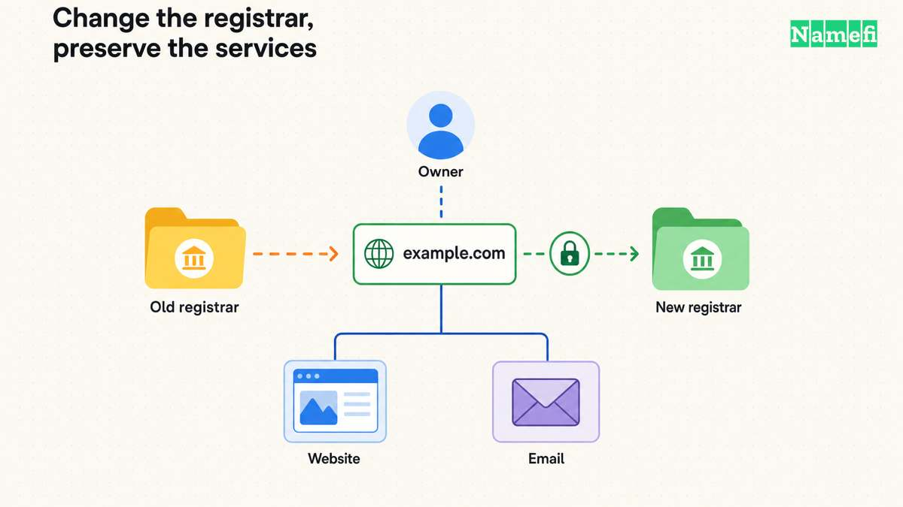

To transfer a domain into GoDaddy, unlock the domain at the current registrar, obtain its authorization code, and start at the official [GoDaddy domain transfer page](https://www.godaddy.com/domains/domain-transfer). GoDaddy's [inbound transfer instructions](#godaddy-explains-registrar-transfers) describe preparation and checkout. The transfer moves registration. It does not migrate the website or email.

Preserving service requires a separate DNS and hosting review. Before starting, identify which company provides each service and whether any service ends when registration leaves. This guide supplies that planning checklist. It cannot guarantee uninterrupted service for an unknown configuration.

Examples use [reserved example domains](#rfc-2606-reserves-example-domains).

## The intended move determines the correct workflow

Use the inbound transfer workflow when the domain currently belongs to another registrar and you want GoDaddy to manage registration. If both accounts already use GoDaddy, use an [internal GoDaddy account transfer](/en/blog/godaddy-account-domain-transfer/) instead.

Do not confuse a registrar change with changing nameservers. Registration determines the registrar account that manages the domain. Nameservers determine the authoritative DNS service. A hosting move changes the service that delivers the website.

For a hypothetical `example.com` migration, write the current and intended provider beside each job: registrar, DNS, website, and email. If only the registrar changes, mark the other jobs as continuing. If several jobs change, prepare a separate migration plan for each.

As practical advice, avoid combining unrelated changes in one session. A staged move makes it easier to identify which change caused a failure. Keep the current services available until the new registration and required service checks finish.

## Eligibility comes before payment and authorization

Review the domain's current status and extension. GoDaddy lists special instructions for several country-code extensions. GoDaddy also identifies restrictions after new registration, a recent transfer, or some contact changes. [Its transfer page describes those boundaries](#godaddy-explains-registrar-transfers).

ICANN's registrant FAQ lists permitted transfer denial reasons for covered domains, including lock status and recent registration or transfer. Country-code registry rules can differ. [Check the relevant policy rather than assuming one universal rule](#icann-explains-transfer-eligibility).

If contact information needs updating, ask the current registrar whether the change affects transfer eligibility before submitting the change. Do not deliberately keep inaccurate details. Coordinate the correction and transfer in the order that the registrar supports.

A missing authorization code is also a registrar issue. ICANN describes the code as a protection against unauthorized transfers and requires the code for registrar-to-registrar transfers. [Its FAQ explains the authorization-code role](#icann-explains-transfer-eligibility).

## The service inventory protects website and email continuity

Save the current nameservers and an export or complete inventory of DNS records. Include website records, MX records, email authentication TXT records, verification records, and any delegated subdomains. This is operational advice for the migration record.

Ask the current provider a precise question: will the existing DNS zone continue after the registration transfers? If DNS depends on the old registration product, arrange continuing DNS before relying on that zone.

Also check whether hosting and mailboxes have separate subscriptions. GoDaddy states that only the domain transfers through the inbound registrar workflow. [The website and email move require separate work](#godaddy-explains-registrar-transfers).

If a DNS move is necessary, reproduce the zone at the replacement service and test the records before changing delegation. Keep mail routing and website routing distinct. A correct A record cannot replace an MX record that a nameserver change omitted.

Record any DNSSEC configuration and follow both providers' documented migration process if delegation changes. Do not improvise a security change merely to clear a dashboard warning. Resolve the specific validation issue with the relevant provider.

## The current registrar prepares the domain for GoDaddy

Follow GoDaddy's documented preparation sequence. [The provider requires an unlocked domain, authorization code, and verified contact details](#godaddy-explains-registrar-transfers).

1. Sign in to the current registrar through its official website.
2. Locate the exact domain and check the visible status.
3. Unlock the domain when the transfer is ready to begin.
4. Obtain the current authorization code.
5. Confirm access to the relevant contact inbox.
6. Keep the authorization code private until GoDaddy requests it.

Do not post the code in support forums, shared screenshots, or a public project document. The destination registrar needs the code in its transfer workflow. Other observers do not need the code.

If the account shows a restriction, resolve the restriction with the current registrar. Buying the transfer again does not remove a domain-side lock or change a registry rule.

## GoDaddy starts the transfer after the checkout checks

On the transfer page, search for the exact domain. GoDaddy checks unlock status and accepts the authorization code. Continue through the displayed checks and review the optional products before completing checkout. [GoDaddy documents the purchase sequence](#godaddy-explains-registrar-transfers).

Inspect the final quote rather than assuming a promotion applies. Check the registration coverage, taxes, and optional protection choices. GoDaddy describes an additional registration year with eligibility exceptions, so confirm the result for the exact extension.

GoDaddy describes most transfers as taking five to seven days. Treat that statement as the provider's general expectation, rather than a deadline for your domain. Monitor the visible transfer status and official messages for required action. [The timing and exceptions appear in its instructions](#godaddy-explains-registrar-transfers).

## Completion requires a domain check and a service check

After GoDaddy reports completion, verify the exact domain in the intended account. Review the registrar, expiration information, nameservers, contact details, renewal settings, and billing responsibility. Save the final state with the original inventory.

Then test the actual website and email service. Check both the apex and `www` addresses if both matter. Send a test message from an outside account and verify that the intended mailbox receives the message.

If a service fails, compare current DNS with the saved records and check whether the old provider canceled a service. Avoid making several guessed changes at once. Use the [DNS propagation guide](/en/blog/ttl-and-dns-propagation/) when cached and authoritative answers disagree.

The next action is to complete the provider inventory before unlocking the domain. That inventory makes a registrar transfer a controlled account change instead of an accidental website or email migration.

For a public record check after the transfer, enter each known hostname and record type in [Namefi's DNS lookup](https://namefi.io/domain-tools/dns). Compare the selected resolver's answers with the saved service inventory. Keep the registrar completion notice and the website and mail tests as separate evidence.

## Sources and further reading

### GoDaddy explains registrar transfers

[GoDaddy explains registrar transfers](https://www.godaddy.com/help/transfer-my-domain-to-godaddy-1592). Checked 2026-10-30.

### ICANN explains transfer eligibility

[ICANN explains transfer eligibility](https://www.icann.org/resources/pages/name-holder-faqs-2017-10-10-en#:~:text=An%20Auth-Code). Checked 2026-10-30.

### RFC 2606 reserves example domains

[RFC 2606 reserves example domains](https://www.rfc-editor.org/rfc/rfc2606.html#section-3). Checked 2026-10-30.
