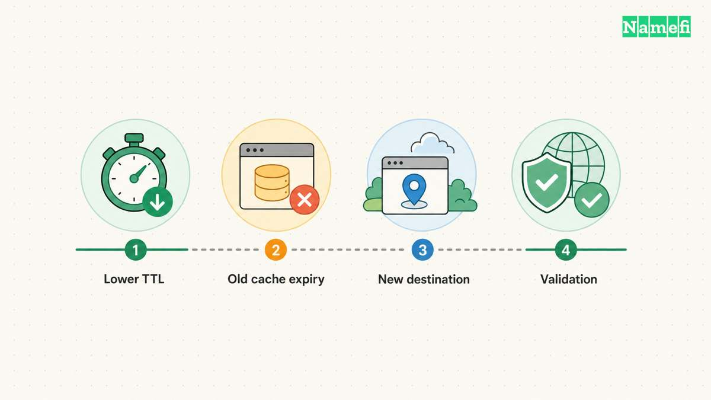

DNS propagation has no single worldwide completion time. After a record change, the wait often concerns cached answers with different remaining TTL values. First check that the authoritative DNS service publishes the new value. Then compare the resolver that still returns the old value. [The TTL specification explains ordinary cache timing](#rfc-1034-defines-cache-timing).

A change can also fail before caching enters the picture. You might have edited an inactive zone, published the wrong record type, or changed nameservers without copying required records. Waiting cannot correct those configuration mistakes.

Examples use [reserved example domains](#rfc-2606-reserves-example-domains).

## TTL limits cached reuse rather than starting a global timer

DNS TTL expresses a record's cache lifetime in seconds. An authoritative zone contains the source data. A recursive resolver can retain an answer and reuse that answer for later queries. [RFC 1034 distinguishes cached records from authoritative zone data](#rfc-1034-defines-cache-timing).

Consider a hypothetical record with a TTL of 3,600 seconds. One resolver fetches the old value at 12:00 UTC. Another fetches the old value at 12:20 UTC. You change the authoritative value at 12:30 UTC.

Under ordinary cache reuse, the resolvers have different remaining lifetimes. The record change does not make both caches start again at 12:30 UTC. The example explains the mechanism, rather than predicting a particular provider's response time.

TTL is therefore useful planning information. It is not proof that every device and application will show the same result at one deadline. Diagnose the actual answer and query path before promising a completion time.

## The authoritative answer decides whether waiting makes sense

Identify the active nameservers for the domain. Query the relevant authoritative server for the exact hostname and record type. If that server still publishes the old value, investigate the zone rather than labeling the result as resolver propagation.

With ISC's `dig`, the general specific-server form is `dig @server name type`. The `+norecurse` option clears the request for recursive resolution. [ISC documents the server argument and recursion option](#isc-documents-specific-server-queries).

For a hypothetical check, `dig @ns1.example.net www.example.com A +norecurse` illustrates the shape. Replace the names with the domain's actual authoritative server and intended hostname. This article does not execute that query or report a live result.

Check the response status and whether the server answers authoritatively for the zone. A referral or refusal does not establish the intended record. Compare more than one authoritative server when the zone has several servers and results disagree.

Record the timestamp, server, type, and value for each observation. That evidence lets the DNS provider distinguish publication delay from a record that never entered the active zone.

## A resolver comparison identifies the cache you are waiting for

After authoritative publication looks correct, ask the resolver used by the affected client. Compare the exact name and type with the authoritative answer. A website might use a different name or address family from the one you checked manually.

As practical advice, inspect the full DNS response before relying on a compact checker summary. Save the returned value, TTL, status, and server. A map showing several green locations cannot prove that every resolver has refreshed.

Changing your computer's resolver can help identify a difference in answers. It does not update other people's caches. Likewise, clearing one local cache does not invalidate a remote recursive resolver's cached answer.

If DNS answers match but the page still looks old, investigate the browser, CDN, application, and deployment. The observation may concern cached content rather than DNS. Avoid replacing correct DNS records to solve a different layer's problem.

## Negative caching can delay a newly created record

A resolver can cache a negative answer as well as a positive one. A previous “name does not exist” response can therefore matter after you create the name. [RFC 2308 defines negative caching](#rfc-2308-defines-negative-caching).

The negative cache lifetime comes from the smaller of the SOA record's TTL and SOA MINIMUM value. A newly created A record's TTL does not rewrite an earlier negative cache entry. [The negative-caching standard explains that calculation](#rfc-2308-defines-negative-caching).

Distinguish a name error from a successful response that lacks the requested record type. Also distinguish both from a timeout or server failure. Those observations lead to different checks.

For a newly added verification TXT record, first confirm authoritative publication at the exact requested name. Then compare the checker or resolver that previously saw no record. Adding duplicate values at guessed names makes the investigation harder.

## Lowering TTL helps only when you plan ahead

RFC 1034 describes lowering TTL before an anticipated change and raising TTL again afterward. [The planning advice follows the cache mechanism](#rfc-1034-defines-cache-timing).

Publish the lower TTL early enough for existing copies under the previous TTL to age out. Lowering TTL at the same moment as the address change cannot modify those older copies. Treat the previous TTL as a planning input.

Keep the old destination functioning during the transition when possible. Verify the new destination before changing the record. If rollback becomes necessary, remember that the replacement value can also remain in caches for its published lifetime.

A nameserver change adds delegation and zone-migration considerations. Prepare the full replacement zone and verify the required services. The [nameserver change guide](/en/blog/change-domain-nameservers/) covers that procedure separately.

## Stale answers require a different explanation from ordinary TTL reuse

Some recursive resolvers can serve expired data when they cannot refresh the answer from authoritative servers. RFC 8767 defines this serve-stale behavior for resilience. [The standard explicitly extends ordinary TTL behavior](#rfc-8767-explains-stale-answers).

Do not assume stale serving explains every unexpected answer. First confirm publication and compare the relevant resolver. If the evidence suggests stale data, check authoritative reachability and the resolver provider's documented behavior.

The useful next step is to collect two comparable responses: one authoritative answer and one answer from the affected resolver. If the authoritative answer is wrong, fix publication. If the resolver retains an old answer, inspect its remaining cache lifetime. If both answers agree, move the investigation to the service behind the domain.

## Sources and further reading

### RFC 1034 defines cache timing

[RFC 1034 defines cache timing](https://www.rfc-editor.org/rfc/rfc1034.html#section-3.6). Checked 2026-10-30.

### ISC documents specific-server queries

[ISC documents specific-server queries](https://bind9.readthedocs.io/en/latest/manpages.html#dig-dns-lookup-utility). Checked 2026-10-30.

### RFC 2308 defines negative caching

[RFC 2308 defines negative caching](https://www.rfc-editor.org/rfc/rfc2308.html#section-5). Checked 2026-10-30.

### RFC 8767 explains stale answers

[RFC 8767 explains stale answers](https://www.rfc-editor.org/rfc/rfc8767.html#section-1). Checked 2026-10-30.

### RFC 2606 reserves example domains

[RFC 2606 reserves example domains](https://www.rfc-editor.org/rfc/rfc2606.html#section-3). Checked 2026-10-30.
