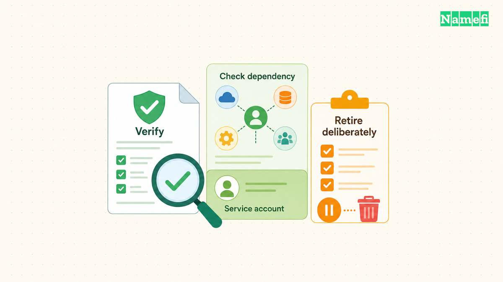

A TXT record can authorize an email sender, publish a signing key, or satisfy a service's verification challenge. The DNS type supplies a text container. The consuming service supplies the meaning.

That distinction matters during setup. Adding the right value under the wrong name can leave email authentication broken. Replacing an existing TXT record can remove an unrelated service's verification. A careful change preserves each consumer's separate instructions.

This guide explains how to manage SPF, DKIM, and verification TXT records together. The examples illustrate record relationships rather than production-ready policies. Use the exact values issued for the actual domain and account.

## Each TXT record serves a named consumer

[DNS record types](/en/glossary/dns-record-types/) define data formats. TXT holds one or more character strings, as [RFC 1035, section 3.3.14](https://www.rfc-editor.org/rfc/rfc1035.html#section-3.3.14) specifies. TXT alone does not identify an email policy, an ownership challenge, or an application configuration.

Start an inventory with the complete owner name, record type, value, purpose, and responsible account. Keep a separate row for each logical record. Add the service owner and a link to the service's current instructions so a future administrator can identify unfamiliar tokens.

For example, `example.com` can publish an SPF policy and a separate verification token as distinct TXT records. A DKIM key can appear at `selector1._domainkey.example.com`. Those names serve different consumers even though the DNS record type remains TXT.

| Purpose | Typical location | Consumer |
| --- | --- | --- |
| SPF authorization | Sending identity domain | Receiving mail system |
| DKIM public key | Selector below `_domainkey` | Signature verifier |
| Service verification | Provider-specified name | Named service account |
| Application data | Application-defined name | Compatible application |

Do not combine unrelated values into one TXT record merely to reduce dashboard rows. An SPF parser expects SPF syntax. A verification checker expects its issued token. A readable string in DNS does not become valid for every service that reads text.

Check how the DNS dashboard interprets the host field. Some interfaces append the zone name to a relative label. A full name entered into such a field can produce an unintended repeated suffix. Inspect the complete published name after saving rather than trusting the input display alone.

Also distinguish multiple strings inside one TXT record from multiple TXT records. SPF joins the strings of one record without adding spaces. [RFC 7208, section 3.3](https://www.rfc-editor.org/rfc/rfc7208.html#section-3.3) defines that behavior. A visual line break in a dashboard does not necessarily create a separate record.

Treat public DNS content as public information. A verification token intended for DNS differs from an account password or API secret. Never publish secret credentials because a service requested “a token” without first confirming the documented field and purpose.

## Each sending identity needs one valid SPF policy

SPF lets a domain authorize hosts to use specified email identities. The check concerns the SMTP identities defined by the protocol. A passing SPF result alone does not establish that every visible message detail is trustworthy. [RFC 7208, sections 2 and 11.2](https://www.rfc-editor.org/rfc/rfc7208.html#section-2) explains the scope.

Before changing SPF, list the systems that send mail for the domain. Include the main mailbox service, transactional application, support platform, and newsletter service when those systems use the relevant sending identity. Ask each service owner for the current documented authorization requirements.

Inspect the existing TXT answers before adding a new policy. SPF prohibits multiple records that cause a check to select more than one SPF policy. [RFC 7208, section 3.2](https://www.rfc-editor.org/rfc/rfc7208.html#section-3.2) establishes that rule. Multiple unrelated TXT records do not create that conflict by themselves.

A hypothetical no-sending domain might publish `v=spf1 -all` at the appropriate name. The example illustrates an explicit policy, not a recommendation for a domain that sends mail. Copying a restrictive policy into an active sending domain can exclude legitimate systems.

When a second service asks for SPF authorization, update the existing policy through a reviewed change. Do not create another `v=spf1` record beside the first policy. Preserve the existing legitimate senders and remove obsolete authorization only after the service owner confirms retirement.

Review the complete policy, including referenced mechanisms, with a suitable validator. A policy can look short while references create additional DNS processing. SPF defines lookup limits, so blindly appending every vendor instruction can produce an invalid or unsuitable result. Follow the actual provider's integration guidance.

Keep the previous value and the reason for every change. Test mail from each legitimate sending system after publication. Check authentication results at a receiving mailbox rather than assuming a syntactically valid policy proves delivery. Delivery involves additional receiver decisions outside the SPF record.

If SPF starts failing after a change, compare the actual sending identity and source with the policy. Investigate the specific failed sender before weakening the entire policy. A correction should authorize the intended system while preserving a clear record of the permission granted.

## DKIM retrieves the public key through a selector

DKIM associates a signing domain with a message through a cryptographic signature. The verifier retrieves a public key using the signing domain and selector. [RFC 6376](https://www.rfc-editor.org/rfc/rfc6376.html#section-3.6.2) defines the DNS lookup under `_domainkey`.

For example, a signature with signing domain `example.com` and selector `selector1` directs the key lookup to `selector1._domainkey.example.com`. A public key placed only at the apex does not satisfy that lookup. The exact owner name matters as much as the key value.

Obtain the key publication instructions from the actual sending provider. A provider may ask for TXT or for a provider-managed alias arrangement. Preserve the requested record type. Do not convert an alias instruction into a copied TXT key unless the provider documents that alternative.

Keep public and private keys separate. The DNS record contains public verification material. The signing system retains the private key. A request to paste a private signing key into public DNS indicates the wrong material or a misunderstood procedure.

Check for accidental truncation when copying a long public key. Preserve the provider's content and required formatting. When the dashboard splits the value into strings, confirm that the resulting logical value matches the expected key. Avoid adding spaces or punctuation to make the dashboard display look neater.

A provider's successful key check confirms one part of the setup. The sending system must also sign outgoing messages using the intended domain and selector. Send a new test message after enabling signing. Inspect the resulting signature and the receiver's authentication result.

During key rotation, coordinate DNS publication with the signing provider. Do not delete an old selector merely because a new selector appears. Messages signed earlier may still require the old key during the provider's transition procedure. Follow the documented retirement timing and keep the old record until the procedure permits removal.

For multiple sending providers, assign ownership to each selector. Separate selectors help administrators identify which service generated a signature. Record the service, selector, publication date, and retirement status. The inventory reduces confusion when a provider changes or a sending account closes.

An SPF change does not repair a missing DKIM key. A DKIM key does not authorize every sending host. Test both mechanisms according to their separate jobs. The [custom-domain email guide](/en/blog/set-up-email-with-your-own-domain/) places those checks within the broader mail setup.

## Service verification requires deliberate publication and retirement

A service verification TXT record usually proves that someone can publish a particular value at the requested name. The service then applies its own account and domain rules. The record does not create a universal ownership certificate that every application recognizes.

GitHub Pages provides a concrete example. GitHub asks the account owner to publish a TXT challenge and complete verification in account settings. [GitHub's verification instructions](https://docs.github.com/en/pages/configuring-a-custom-domain-for-your-github-pages-site/verifying-your-custom-domain-for-github-pages) also require keeping the record to retain verification. The requirement belongs to that service's procedure.

Create the challenge from the intended account before editing DNS. Match the target domain and account identifier with the request. A record issued for another account can complete a different relationship than the administrator intended. Check the service name and account owner in the change ticket.

After publishing, query the exact owner name and TXT type at the authoritative servers. Then compare a recursive answer. If the authoritative value is correct but a recursive answer remains old, [investigate caching](/en/blog/ttl-and-dns-propagation/). Avoid repeatedly replacing a correct token while a checker still sees an earlier answer.

Complete the verification action in the service interface when required. Saving DNS does not necessarily trigger the service's final confirmation. Record the service's verified state and any continued-publication requirement. A screenshot of the DNS row alone does not establish that the service accepted the challenge.

Before deleting a token, identify the service and account that depend on the token. Confirm whether the service requires continued publication. Remove retired records through an intentional decommissioning plan rather than deleting every unfamiliar string during a zone cleanup.

The same rule applies during a DNS provider migration. Preserve SPF, DKIM selectors, and verification challenges in the exported inventory. Check the migrated values by purpose, not only by row count. Two zones can contain the same number of TXT records while serving different accounts.

Keep a concise change log with the old value, new value, expected consumer, and test result. Ask another administrator to review high-impact mail or account changes. The final state should let an administrator answer two questions: which service reads each TXT record, and what evidence confirms that the service still works?

## These sources support the article

- IETF — [RFC 1035](https://www.rfc-editor.org/rfc/rfc1035.html#section-3.3.14), section 3.3.14: TXT data format. Fetched 2026-10-21.
- IETF — [RFC 7208](https://www.rfc-editor.org/rfc/rfc7208.html#section-3), sections 2–3, 4.6.4, and 11.2: SPF scope, publication, processing limits, and false identities. Fetched 2026-10-21.
- IETF — [RFC 6376](https://www.rfc-editor.org/rfc/rfc6376.html#section-3.6.2), section 3.6.2: selector-based DNS key retrieval. Fetched 2026-10-21.
- GitHub — [Verify a custom domain](https://docs.github.com/en/pages/configuring-a-custom-domain-for-your-github-pages-site/verifying-your-custom-domain-for-github-pages), TXT challenge and retention requirement. Fetched 2026-10-21.
