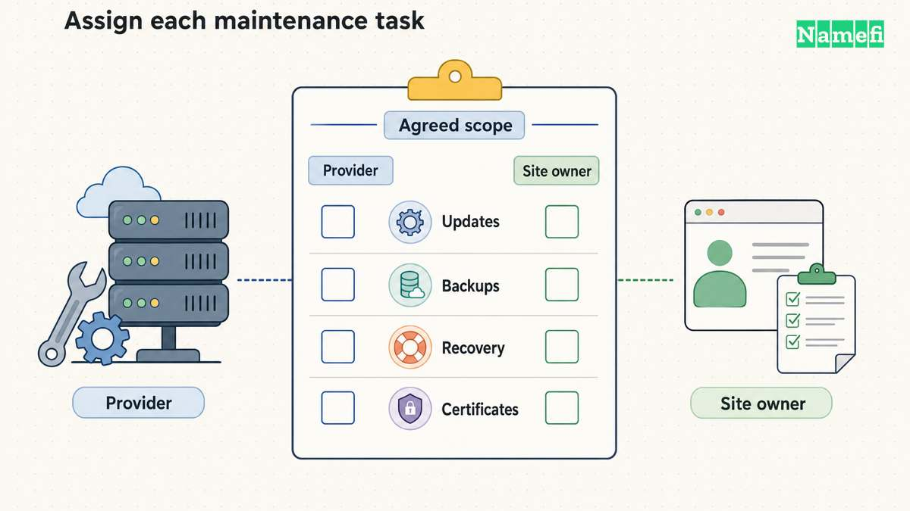

**Choose hosting that supports your website's actual software and the maintenance work you can manage.** A static site can use a static hosting service. A [WordPress site](/en/blog/wordpress-hosting-guide/) needs a host that supports WordPress's runtime and database requirements. A server you administer yourself adds operating responsibilities that a managed service may handle. [GitHub documents its static hosting model](#github-describes-static-site-hosting). [WordPress publishes its hosting requirements](#wordpress-publishes-the-runtime-requirements). [AWS distinguishes hosting models](#aws-explains-shared-vps-and-managed-hosting).

Start with the site you need, then compare the final and renewal terms of suitable plans. A low introductory price cannot answer whether a plan supports the software, recovery process, and support access your site requires.

## The site's workload narrows the useful choices

Hosting stores and serves a website or application. AWS describes hosting as a service that makes site files and application resources accessible to visitors. [The hosting explanation defines that role](#aws-explains-shared-vps-and-managed-hosting).

Use the following planning table before comparing providers:

| Website need | Hosting category to investigate | First question |
| --- | --- | --- |
| Prebuilt HTML, CSS, and JavaScript | Static hosting | How will the build publish and update files? |
| WordPress with a database | WordPress-compatible hosting | Which updates, backups, and recovery tasks does the provider handle? |
| An application with a specific server runtime | Application hosting or a suitable server | Does the plan support the exact runtime and background work? |
| A service requiring detailed server control | VPS or dedicated infrastructure | Who will operate, patch, monitor, and recover the server? |

Treat the categories as a shortlist, rather than a ranking. A small site can still need a particular runtime or access-control feature. A large collection of static pages can have different needs from a small database-backed application.

GitHub Pages provides a concrete static example. GitHub Pages takes HTML, CSS, and JavaScript from a repository and optionally runs a build process before publishing. [GitHub describes those inputs](#github-describes-static-site-hosting). Review that model against the proposed site before selecting the service.

For WordPress, check the current [official requirements](https://wordpress.org/about/requirements/) directly. WordPress specifies PHP, a supported database, and HTTPS support. [The requirements page provides the technical checklist](#wordpress-publishes-the-runtime-requirements). A generic promise to “host websites” does not establish compatibility with that checklist.

## The maintenance agreement matters as much as server capacity

Shared hosting divides a server's resources among customers. VPS hosting gives a customer a virtual-server environment. AWS also distinguishes managed services that take over ongoing server maintenance. [AWS explains the resource and responsibility differences](#aws-explains-shared-vps-and-managed-hosting).

The word “managed” still needs a detailed scope. As buying advice, ask which specific tasks the provider performs. Record the answer in a comparison sheet, rather than assuming every managed plan includes the same work.

Useful questions include:

- Who updates the operating system and application runtime?
- Who updates WordPress, themes, and plugins when the site uses WordPress?
- Which party investigates an outage?
- Which backups exist, and who can restore a backup?
- Who manages certificates and verifies renewal?
- Which support channel can the account owner use during an incident?

A VPS is a reasonable option only when the required control comes with a credible operating plan. List the person or team responsible for patching, monitoring, and recovery. Compare that workload with the managed alternatives before committing.

## A complete budget includes the next bill and the exit bill

Compare the actual checkout terms for the same period and currency. Do not compare one provider's monthly equivalent with another provider's total prepaid contract. Record the amount due now and the renewal basis separately.

Use these fields in a purchase note:

| Budget field | What to record |
| --- | --- |
| Initial payment | Currency, total charge, and covered period |
| Renewal | Current renewal rate, term, and automatic-renewal behavior |
| Usage charges | Any documented bandwidth, compute, storage, or request charges |
| Included services | Exact treatment of email, backups, certificates, and migrations |
| Cancellation | Deadline, refund conditions, and data-removal process |
| Exit | Export capability and any migration or retrieval charges |

These fields are editorial buying advice. They do not imply that every provider charges every fee. Mark a field “not applicable” only after checking the relevant plan terms.

Keep domain registration separate in the budget. ICANN explains that registration does not itself create a website or mailbox and that the registrar and hosting provider can differ. [ICANN separates those services](#icann-separates-domain-registration-from-hosting). The [domain and hosting comparison](/en/blog/domain-vs-hosting/) explains the account boundaries.

## Backups and access rules need a practical review

A promise that backups exist is less useful than a clear restoration procedure. Before purchase, ask how the account owner requests a restore, which data the backup includes, and whether the provider documents retention and recovery limits.

As operational advice, plan a test restoration before relying on a backup for an important site. Include the database and uploaded files when the application needs both. Keep an export that the team can use during a provider change.

Decide who may see the site before publishing. A public marketing site and an internal customer dashboard have different access requirements. Verify the plan's supported access controls for the intended audience. Keep administrative accounts restricted to the people who maintain the service.

HTTPS is another specific check. GitHub Pages, for example, provides documented HTTPS controls and discusses mixed-content problems. [GitHub explains its HTTPS setup](#github-documents-https-and-mixed-content-checks). Follow the selected host's workflow rather than buying a separate certificate before checking compatibility.

## A small deployment test can expose a poor fit

Use a representative test site before moving a production domain. Include the features that matter: a form, a login, database access, file uploads, or a build step, as applicable. Do not judge the hosting plan from an empty page alone.

Confirm the domain-connection instructions from the hosting provider. GitHub's custom-domain documentation illustrates that DNS and platform configuration form separate setup steps. [GitHub documents its custom-domain workflow](#github-documents-the-custom-domain-workflow). Other providers require their own exact values.

Record the outcome in plain terms: the application deployed, the expected page loaded, HTTPS verified, the intended users gained access, and the recovery procedure has an owner. A missing requirement should remove a plan from the shortlist before a longer contract begins.

Choose the plan that meets those verified requirements with a maintenance and cost commitment the team accepts. Keep the comparison sheet, renewal terms, and account ownership record with the site's operating documentation.

## Sources and further reading

### GitHub describes static site hosting

[GitHub Docs, About GitHub Pages](https://docs.github.com/en/pages/getting-started-with-github-pages/about-github-pages#about-github-pages). Fetched 2026-10-30.

### WordPress publishes the runtime requirements

[WordPress.org, Requirements](https://wordpress.org/about/requirements/#:~:text=To%20run%20WordPress). Fetched 2026-10-30.

### AWS explains shared VPS and managed hosting

[AWS, What is Web Hosting, hosting models](https://aws.amazon.com/what-is/web-hosting/#:~:text=Shared%20hosting). Fetched 2026-10-30.

### ICANN separates domain registration from hosting

[ICANN registration FAQ](https://www.icann.org/resources/pages/faqs-84-2012-02-25-en#:~:text=Your%20domain%20name%20registration%20is%20not). Fetched 2026-10-30.

### GitHub documents HTTPS and mixed content checks

[GitHub Docs, Securing your GitHub Pages site with HTTPS](https://docs.github.com/en/pages/getting-started-with-github-pages/securing-your-github-pages-site-with-https#enforcing-https-for-your-github-pages-site). Fetched 2026-10-30.

### GitHub documents the custom domain workflow

[GitHub Docs, Managing a custom domain](https://docs.github.com/en/pages/configuring-a-custom-domain-for-your-github-pages-site/managing-a-custom-domain-for-your-github-pages-site#configuring-an-apex-domain). Fetched 2026-10-30.
