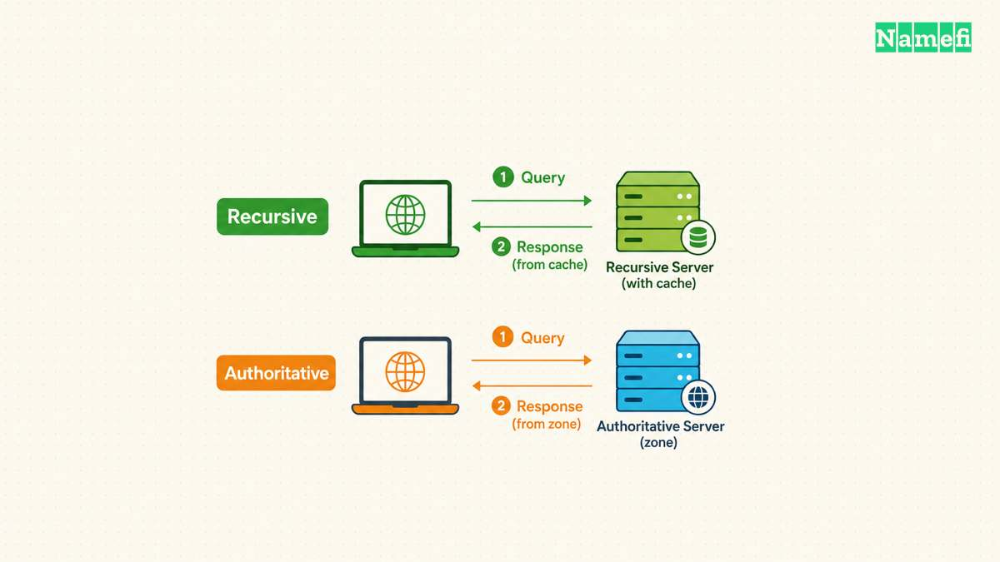
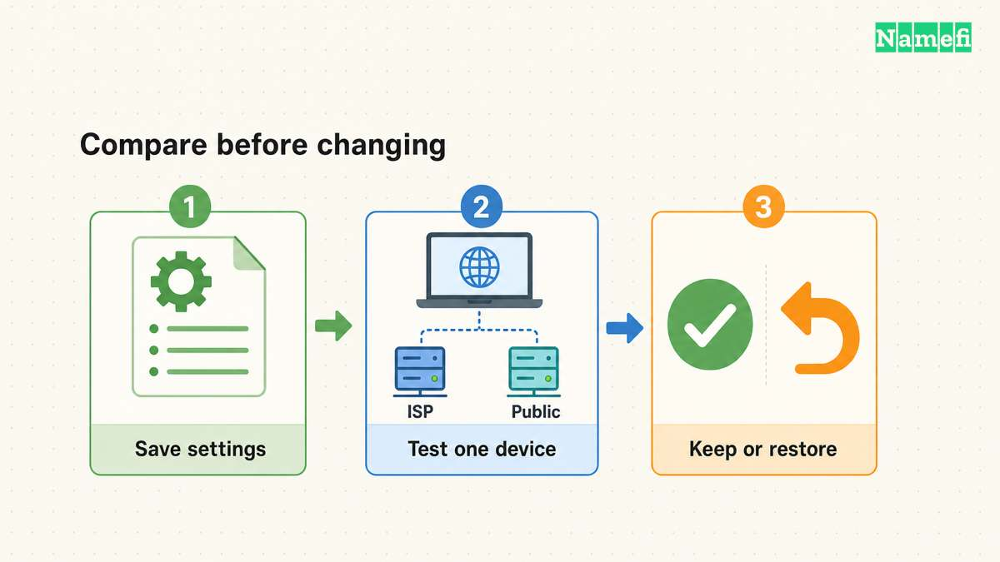

**A DNS server answers questions about domain names and their records.** The DNS server address in a device's network settings usually selects a resolver that obtains answers for applications. A domain's authoritative nameservers perform a different role: they serve the zone's authoritative data. [Current DNS terminology distinguishes these roles](#the-dns-terminology-distinguishes-server-roles).

The distinction matters during a failure. Changing a laptop's resolver does not edit a website's published address. Changing a domain's nameservers does not choose the resolver that every visitor uses. Identify the setting involved before changing either side.

## A recursive resolver obtains answers for the client

A stub resolver depends on another resolver to undertake full resolution. A recursive resolver can answer from local information or query other servers to obtain the answer. RFC 9499 defines both roles and explains their relationship. [The terminology describes the client-facing path](#the-dns-terminology-distinguishes-server-roles).

The server address shown on a device may therefore belong to an organization, internet provider, router, or selected resolver service. A router can also forward DNS queries to another resolver. RFC 9499 describes forwarders as a separate part of the path. [The forwarder definition explains that arrangement](#the-dns-terminology-explains-forwarding).

Do not assume the first displayed address identifies every server used behind the scenes. Record the setting as the device's configured destination. If a network administrator manages the path, ask which upstream service and internal zones the configuration requires.

The broader [DNS explanation](/en/blog/what-is-dns/) follows the lookup through the hierarchy. This guide concentrates on the server selection and the symptoms a visitor can observe.



## Authoritative servers publish a different side of DNS

An authoritative server knows a zone's contents from local knowledge and can answer questions about that zone. Authoritative servers also provide referrals for delegated child zones. [RFC 9499 defines that authority](#the-dns-terminology-defines-authoritative-service).

A domain owner edits records at the authoritative DNS provider. A visitor selects a resolver through device, router, browser, or managed-network configuration. Those actions can involve different accounts and different companies.

For example, an operator can publish a new website address while a visitor's resolver still has an older cached record. A resolver cache lifetime can explain that difference. The DNS standard defines TTL as the time a record can remain cached. [RFC 1034 describes the cache boundary](#the-dns-standard-defines-cache-lifetimes).

If the published record is wrong, changing a visitor's resolver is not the authoritative correction. If the selected resolver is unavailable, editing the website's address is not the client-side correction. Preserve the distinction in the incident report.

## The current settings provide evidence before a change

On Windows, `ipconfig /all` displays detailed adapter configuration. Microsoft's command reference defines the option. [The ipconfig documentation explains the configuration display](#microsoft-documents-network-configuration-display).

```text
ipconfig /all
```

On a Mac, Apple documents DNS settings under **System Settings > Network > network service > Details > DNS**. The page lists DNS servers and search domains. [Apple documents the settings screen](#apple-documents-dns-server-settings).

Check the active connection rather than an unrelated adapter. Save the current DNS configuration before making an approved change. Google explicitly recommends preserving existing settings before switching to [Google Public DNS](/en/blog/google-public-dns-setup/). [Google documents that preparation](#google-documents-public-dns-addresses-and-rollback-preparation).

For an organization device, keep the required VPN and resolver configuration. Split DNS can return different answers depending on the query source. RFC 9499 describes that arrangement. [The split-DNS definition explains the boundary](#the-dns-terminology-describes-split-dns).

A public resolver may therefore produce a different result from an internal resolver without either result alone proving a configuration mistake. An internal name needs investigation within the intended network context.



## A direct query helps separate lookup errors

With `nslookup` available, query the failing hostname first:

```text
nslookup www.example.com.
```

The hostname uses a [reserved documentation domain](#the-ietf-reserves-example-domains). Replace the hostname before testing. Microsoft documents the default server behavior and the optional server argument. [The nslookup reference defines the query](#microsoft-documents-server-selection-and-errors).

If the network permits an explicit public-resolver comparison, the following example selects Google Public DNS:

```text
nslookup www.example.com. 8.8.8.8
```

Google documents `8.8.8.8` as a Public DNS address. [The official configuration guide lists the address](#google-documents-public-dns-addresses-and-rollback-preparation). The example does not change the device's saved resolver configuration.

Do not send private organization hostnames to a public resolver during an unrelated test. Use a resolver that the network administrator permits. Keep the hostname, requested record type, UTC time, and exact output when comparing results.

| Observation | What to investigate next |
| --- | --- |
| The selected server does not respond | Resolver reachability and the intended network path |
| The result reports a nonexistent domain | Exact spelling, the published name, and the selected resolver context |
| The result reports no records of the requested type | The queried record type and authoritative data |
| The result reports a server failure | Resolver diagnostics and authoritative-server behavior |
| The lookup succeeds but the browser still fails | Browser resolution settings, HTTPS, and the application response |

Microsoft documents these distinct `nslookup` error categories. [The error descriptions support different next checks](#microsoft-documents-server-selection-and-errors). Do not reduce every error to “change the DNS server.”

Use [Namefi's DNS command generator](https://namefi.io/domain-tools/dns-commands) to prepare a lookup for your operating system. Choose the system resolver or one of the listed public resolvers, then run the command on the affected device. Generating the command does not test the connection or change its settings.


## A browser can select another DNS provider

Chrome supports a custom Secure DNS provider. The desktop setting lives under **Settings > Privacy and security > Security**. [Google documents the provider selection](#google-documents-desktop-browser-dns-selection).

A successful operating-system query therefore does not establish that Chrome used the same resolver. Inspect the actual browser setting when only Chrome fails. Keep the approved configuration for a managed device.

Changing the resolver is a service-selection decision. Review the provider's published policies, required internal-name support, and the network's rules. Do not promise that a resolver change will repair every connection or make every application faster.

If a stale local answer is the remaining hypothesis, use the platform-specific [Windows flush guide](/en/blog/flush-dns-cache/) or [Mac flush guide](/en/blog/flush-dns-mac/). If the authoritative record is wrong, contact the domain operator. A useful correction targets the server role that actually failed.

## Sources and further reading

### The DNS terminology distinguishes server roles

[IETF RFC 9499, section 6](https://www.rfc-editor.org/rfc/rfc9499.html#section-6). Fetched 2026-10-30.

### The DNS terminology explains forwarding

[IETF RFC 9499, Forwarder definition](https://www.rfc-editor.org/rfc/rfc9499.html#section-6). Fetched 2026-10-30.

### The DNS terminology defines authoritative service

[IETF RFC 9499, Authoritative server definition](https://www.rfc-editor.org/rfc/rfc9499.html#section-6). Fetched 2026-10-30.

### The DNS standard defines cache lifetimes

[IETF RFC 1034, TTL definition](https://www.rfc-editor.org/rfc/rfc1034.html#section-3.6). Fetched 2026-10-30.

### Microsoft documents network configuration display

[Microsoft, ipconfig /all](https://learn.microsoft.com/en-us/windows-server/administration/windows-commands/ipconfig#parameters). Fetched 2026-10-30.

### Apple documents DNS server settings

[Apple Mac User Guide, Change DNS settings](https://support.apple.com/guide/mac-help/change-dns-settings-on-mac-mh14127/mac#:~:text=To%20change%20these%20settings). Fetched 2026-10-30.

### Google documents Public DNS addresses and rollback preparation

[Google Public DNS, Get started](https://developers.google.com/speed/public-dns/docs/using#important_before_you_start). Fetched 2026-10-30.

### The DNS terminology describes split DNS

[IETF RFC 9499, Split DNS definition](https://www.rfc-editor.org/rfc/rfc9499.html#section-6). Fetched 2026-10-30.

### The IETF reserves example domains

[IETF RFC 2606, section 3](https://www.rfc-editor.org/rfc/rfc2606.html#section-3). Fetched 2026-10-30.

### Microsoft documents server selection and errors

[Microsoft, nslookup remarks and errors](https://learn.microsoft.com/en-us/windows-server/administration/windows-commands/nslookup#remarks). Fetched 2026-10-30.

### Google documents desktop browser DNS selection

[Google Chrome Help, desktop Secure DNS](https://support.google.com/chrome/answer/10468685?hl=en&co=GENIE.Platform%3DDesktop#:~:text=Select%20your%20current%20service%20provider). Fetched 2026-10-30.
