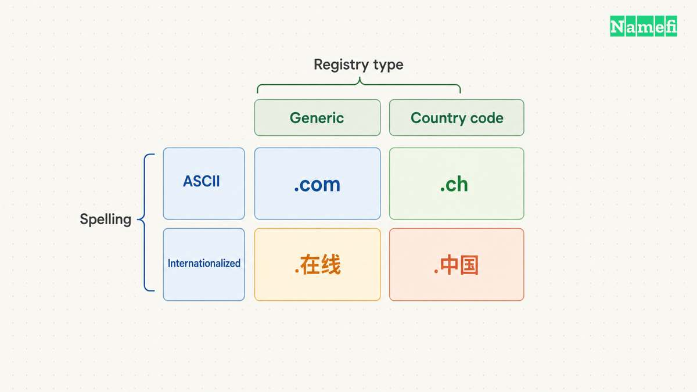

A TLD, or top-level domain, is the highest named level beneath the DNS root. In `example.com`, `.com` is the TLD. The `.ch` suffix is another TLD. [The DNS terminology standard defines the hierarchy](#the-dns-standard-defines-top-level-domains).

For a domain buyer, the practical question is which ending fits the audience, registration rules, and recurring budget. A familiar ending can help people recognize an address. The ending does not replace a good name, a working website, or appropriate security controls.

## A domain name contains several levels

Read the hypothetical address `https://shop.example.com/products` in separate parts. The scheme is `https`, the hostname is `shop.example.com`, and the path is `/products`. [MDN explains these URL components](#mdn-explains-url-anatomy).

| Component | Example | Meaning |
| --- | --- | --- |
| TLD | `.com` | The highest named DNS level beneath the root |
| Second-level label | `example` | The label immediately beneath `.com` |
| Subdomain label | `shop` | A label beneath `example.com` |
| Application path | `/products` | A resource selected by the website |

DNS labels form a hierarchy. A path does not become a DNS label because the path appears in a web address. Our [subdomain examples](/en/blog/subdomain-examples/) show how prefixes such as `shop` and `support` relate to the parent domain.

Do not assume every registrable domain contains exactly two labels. Some registration structures include additional public labels. Confirm the complete domain that the registrar offers, rather than counting dots and guessing.

The rightmost-label explanation describes the familiar written form without a trailing root dot. Technical documentation may write an absolute name as `example.com.`. The final dot represents the DNS root, not another commercial extension.

## Generic and country-code classifications answer different questions

[IANA’s Root Zone Database](#iana-lists-the-delegated-extensions) identifies TLD delegations and their types. The database provides a better starting point than a registrar’s marketing category.

| Classification | Examples | Buyer’s next check |
| --- | --- | --- |
| Generic | `.com`, `.org`, `.app` | Registry policy and registrar support |
| Country code | `.ch`, `.uk`, `.io` | Local association and registry eligibility |
| Internationalized spelling | A TLD written in a non-Latin script | Exact spelling, registration policy, and application compatibility |
| Brand-associated ending | `.google` | Whether the registry permits the intended registration |

The descriptions can overlap. A TLD’s script describes how people write the label. The script does not replace the registry’s generic or country-code classification.

A generic TLD does not automatically mean every person can register every name. A delegated extension can have eligibility restrictions or a limited registration purpose. Read the operator’s policy before treating a name as a purchase option.

A country-code TLD also does not automatically require local citizenship. Eligibility depends on that registry’s rules. For example, our [.ch registration guide](/en/tld/ch/) explains the Swiss registry’s conditions. Do not apply one country-code registry’s conditions to another registry.

## The official root list identifies extensions rather than available names

Open [IANA’s Root Zone Database](https://www.iana.org/domains/root/db). Search for an extension and open the extension’s delegation record. The record identifies the TLD manager and related delegation information.

IANA’s database does not promise that `yourbrand` is available beneath that extension. A registrar’s search answers that separate question. Even an available search result does not resolve trademark or contractual questions.

For a wider browsing list, use our [domain extensions list](/en/blog/domain-extensions-list/). The list groups examples for comparison and links back to the official source. The present article explains what those categories mean.

Keep three questions separate: Does the extension exist in the public DNS? Can the intended applicant register beneath the extension? Is the exact desired name currently available? Each question needs its own evidence.

## Search engines can interpret country-code endings differently

Google describes country-code domains as a signal of a country audience. Google also lists exceptions that Google treats as generic, including `.io` and `.ai`. [Google’s regional-site documentation explains the distinction](#google-describes-country-targeting-signals).

The registry classification and Google’s search treatment answer different questions. Google’s generic treatment of `.io` does not turn `.io` into a generic TLD in IANA’s records.

Use the audience as a practical decision factor. A Swiss organization serving Swiss customers may find `.ch` appropriate. A product addressing several countries should evaluate whether a country association helps the product’s intended presentation.

No extension in this guide guarantees rankings. Choose an address that visitors can read and remember, then build useful content and a functioning website. Treat a promised automatic ranking boost as a claim that needs separate evidence.

## You should compare the full registration terms before checkout

A domain registration grants use under a registration agreement and term. ICANN distinguishes domain registration from the other services needed to create a website. [ICANN’s domain-name guidance explains the separation](#icann-explains-domain-registration).

Before choosing the ending, record the following details for each candidate:

- The exact spelling and extension.
- The first registration term and price currency.
- The ordinary renewal price and renewal term.
- Any premium-name pricing conditions.
- Applicant eligibility and verification duties.
- Transfer requirements and support access.
- Included DNS services and separately billed products.

This checklist is practical buying advice. It does not imply that every registry uses the same pricing or transfer rules. Review the actual registrar agreement and registry policy for the chosen extension.

Try the complete address aloud. Ask someone to type the address after hearing the address once. Check whether a short ending creates confusion with another ending or an expected `.com` address. Those simple exercises can reveal a naming problem before you pay.

## A clear next step turns the definition into a choice

Create a shortlist with a broad ending, a relevant country-code ending, and an appropriate descriptive ending when available. Remove options whose eligibility or renewal terms do not fit the project.

Then search the exact names with a registrar that supports the chosen extensions. Save the quoted term and renewal conditions before checkout. Arrange hosting, email, and HTTPS according to the services the project actually needs.

A TLD is one part of the address decision. Understanding the hierarchy helps you compare extensions without confusing a registration, a subdomain, and a website package.

Use [Namefi's supported-extension directory](https://namefi.io/tlds) to see which endings Namefi currently lists for its service. Keep IANA's root list for the broader delegation question. A listed extension does not establish the availability, eligibility, or current price of a particular name.

## Sources and further reading

### The DNS standard defines top level domains

[The DNS standard defines top level domains](https://www.rfc-editor.org/rfc/rfc9499.html#:~:text=A%20Top-Level%20Domain%20is%20a%20zone%20that%20is%20one%20layer%20below%20the%20root%2C%20such%20as%20%22com%22%20or%20%22jp%22.), checked 2026-10-30.

### IANA lists the delegated extensions

[IANA lists the delegated extensions](https://www.iana.org/domains/root/db#:~:text=The%20Top-Level%20Domain%20Registry%20represents%20the%20delegation%20details%20of%20top-level%20domains%20in%20the%20Domain%20Name%20System%20%28DNS%29.), checked 2026-10-30.

### Google describes country targeting signals

[Google describes country targeting signals](https://developers.google.com/search/docs/specialty/international/managing-multi-regional-sites#:~:text=Country-code%20top-level%20domain%20names%20%28ccTLDs%29.%20These%20are%20tied%20to%20a%20specific%20country), checked 2026-10-30.

### ICANN explains domain registration

[ICANN explains domain registration](https://www.icann.org/resources/pages/about-domain-names-2018-08-30-en#:~:text=Your%20domain%20name%20is%20not%20the%20same%20thing%20as%20a%20website%20or%20a%20Uniform%20Resource%20Locator%20%28URL%29.), checked 2026-10-30.

### MDN explains URL anatomy

[MDN explains URL anatomy](https://developer.mozilla.org/en-US/docs/Learn_web_development/Howto/Web_mechanics/What_is_a_URL#:~:text=%2Fpath%2Fto%2Fmyfile.html%20is%20the%20path%20to%20the%20resource%20on%20the%20Web%20server.), checked 2026-10-30.
