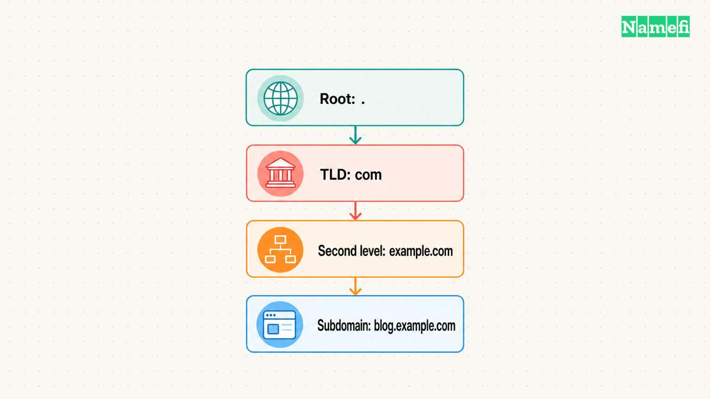
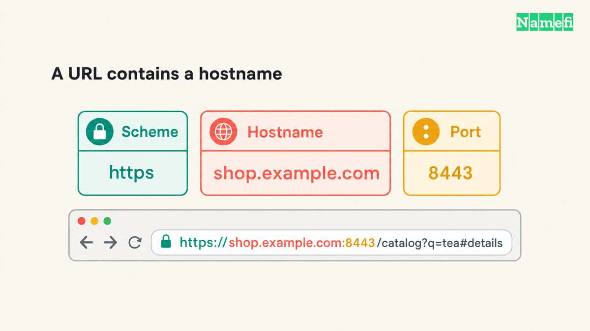
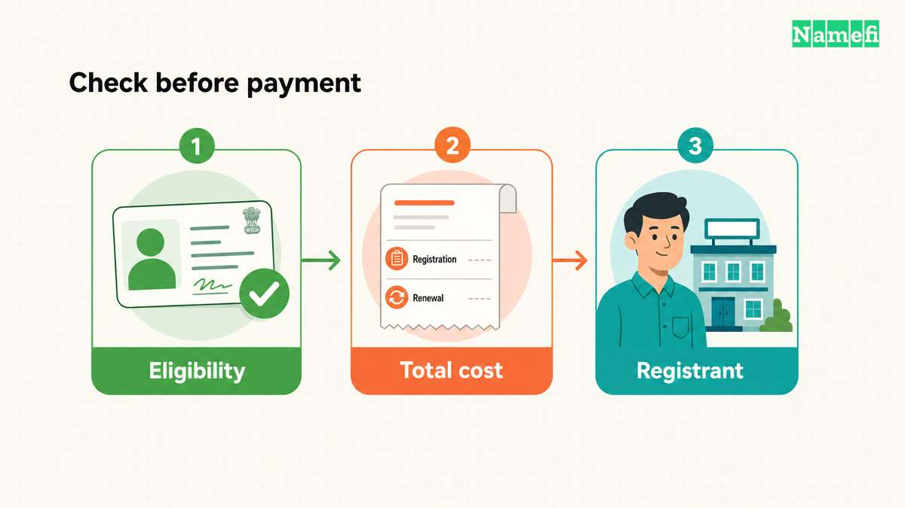
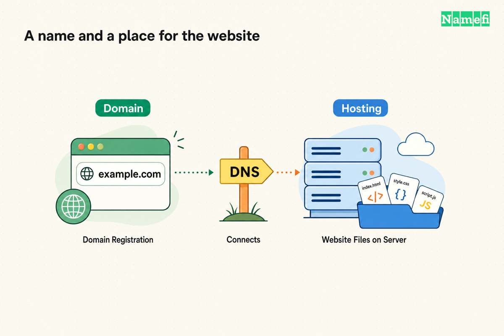

**A domain name is a name in DNS, such as `example.com`, that applications can use to find service records.** To get a name for a project, choose a registrar through an official route such as the [ICANN registrar directory](https://www.icann.org/en/contracted-parties/accredited-registrars/list-of-accredited-registrars), then check the exact name and registration terms. Registration alone does not create a website or mailbox. [The DNS standard defines the name space](#the-dns-standard-defines-domain-names). [ICANN explains the registration relationship](#icann-explains-registrars-and-registrants).

A useful name must pass more than a spelling check. The project needs an available registration offer, acceptable terms, an account the intended registrant controls, and a plan for connecting the required services.

## A domain name identifies a place in the DNS hierarchy

Read `shop.example.com.` from the specific label toward the root. `shop` sits below `example`, `example` sits below `com`, and the final dot represents the root. The DNS standard defines names as paths through this hierarchy. [RFC 1034 explains the labels and root](#the-dns-standard-defines-domain-names).

The example uses `example.com`, which the IETF reserves for documentation. [RFC 2606 records that reservation](#the-ietf-reserves-example-domains). The example does not report an available name for sale.

| Name | Role in the example |
| --- | --- |
| `com.` | Top-level domain |
| `example.com.` | Domain below `com` |
| `shop.example.com.` | More specific name below `example.com` |

A subdomain describes a relationship to a parent domain. A subdomain can serve a website, identify another service, or hold DNS records without serving a website. DNS associates names with different record types, rather than requiring every name to display a page. [RFC 1034 defines names and their associated information](#the-dns-standard-defines-names-and-records).

Do not assume that the last two labels always define a registration boundary. Public suffixes and registration policies can use different boundaries. [Current DNS terminology explains public suffixes](#the-current-dns-terminology-explains-public-suffixes). Check the actual ending before applying a generic domain-splitting rule.

To inspect another name, enter the hostname without a URL path in [Namefi's domain-name inspector](https://namefi.io/domain-tools/domain-name). The local result shows normalized forms and the public-suffix boundary when known. The result does not establish availability, registration rights, or who controls the name.



## A URL includes the domain and the resource location

Consider this illustrative URL:

```text
https://shop.example.com/products?view=full
```

The hostname is `shop.example.com`. The scheme is `https`. The path is `/products`, and the query is `view=full`. HTTP specifications distinguish the authority from the path and query. [RFC 9110 describes those URL components](#the-http-standard-separates-the-host-from-the-resource).

Buying a registration does not purchase a particular page path. The website application manages paths and page behavior. The domain's DNS configuration manages the relevant service records.

This distinction helps during setup. A wrong hostname points toward a name or DNS question. A missing page path can remain an application question after the browser reaches the correct website. Use the [domain terminology guide](/en/blog/domain-terminology-guide/) when labels in a provider's interface become confusing.



## A registrar checks the exact registration offer

ICANN distinguishes registrars, resellers, registrants, and registry operators. A registrar provides registration services. A registry operator maintains the registry for a top-level domain. The registrant holds the registration rights. [ICANN explains these roles](#icann-explains-registrars-and-registrants).

Use this practical selection process:

1. Write the full proposed name and ending.
2. Open the chosen registrar's official search page.
3. Check every character in the returned offer.
4. Identify whether the offer is a new registration, transfer, or resale.
5. Check eligibility and terms for the actual ending.
6. Review the registration total and renewal terms before payment.

A public registration lookup can help identify an already registered name and its registrar. ICANN directs users to its [registration lookup](https://lookup.icann.org/en). [The RDAP announcement identifies that official route](#icann-identifies-the-official-registration-lookup). A lookup result is not a substitute for the registrar's purchase and availability process.

Do not infer that a domain is available merely because no website appears. ICANN explains that registration and website hosting are separate services. [The registration FAQ makes that distinction](#icann-separates-registration-from-web-services).

For the purchase steps, follow the [registration guide](/en/blog/register-domain-name/). Keep the domain explanation and the checkout procedure separate so each task has a clear result.



## The intended registrant needs control of the account

ICANN warns that a developer or other third party may register a domain using that third party's details, even when the customer pays. The resulting registrant record can therefore differ from the payer. [The registration FAQ describes that risk](#icann-explains-the-registrant-record-and-registration-term).

As practical advice, identify the intended registrant before checkout. Use a working contact address and keep access under the person or organization that will maintain the registration. Give contractors only the access their work requires.

Registration is not an indefinite purchase. ICANN explains that registration periods vary and that a registrant must renew to continue the registration. [The FAQ describes that ongoing relationship](#icann-explains-the-registrant-record-and-registration-term).

Record the registrar, account owner, expiry date, renewal setting, and payment responsibility. Read the agreement before accepting the offer. A name that fits the launch budget still needs an acceptable maintenance commitment.

## DNS and hosting make the registered name useful

The registrar can also sell hosting or email, but ICANN does not require registrants to use hosting from the registrar. Registration alone does not supply those services. [ICANN explains the service choices](#icann-separates-registration-from-web-services).

Choose the website or email provider, then copy the provider's exact DNS setup instructions. DNS record types serve different functions: address records support network destinations, MX supports mail routing, and nameserver records support authority. [RFC 1034 describes the record roles](#the-dns-standard-defines-names-and-records).

Test the results separately. Confirm that the intended website opens, that HTTPS verifies for the intended hostname, and that any configured mailbox sends and receives mail. Do not treat a registration receipt as evidence that those services work.

The [hosting selection guide](/en/blog/website-hosting-guide/) helps identify the next service. A usable domain project ends with a maintained registration and verified services, rather than an unchecked name in a shopping cart.



## Sources and further reading

### The DNS standard defines domain names

[IETF RFC 1034, section 3.1](https://www.rfc-editor.org/rfc/rfc1034.html#section-3.1). Fetched 2026-10-30.

### ICANN explains registrars and registrants

[ICANN, Domain Name Registration Process](https://www.icann.org/resources/pages/domain-name-registration-process-2023-11-02-en#:~:text=The%20person%20or%20entity%20that%20holds). Fetched 2026-10-30.

### The IETF reserves example domains

[IETF RFC 2606, section 3](https://www.rfc-editor.org/rfc/rfc2606.html#section-3). Fetched 2026-10-30.

### The DNS standard defines names and records

[IETF RFC 1034, sections 2.4 and 3.6](https://www.rfc-editor.org/rfc/rfc1034.html#section-2.4). Fetched 2026-10-30.

### The current DNS terminology explains public suffixes

[IETF RFC 9499, section 9](https://www.rfc-editor.org/rfc/rfc9499.html#section-9). Fetched 2026-10-30.

### The HTTP standard separates the host from the resource

[IETF RFC 9110, section 4.2.2](https://www.rfc-editor.org/rfc/rfc9110.html#section-4.2.2). Fetched 2026-10-30.

### ICANN identifies the official registration lookup

[ICANN, RDAP lookup announcement](https://www.icann.org/en/announcements/details/icann-update-launching-rdap-sunsetting-whois-27-01-2025-en#:~:text=Users%20are%20encouraged). Fetched 2026-10-30.

### ICANN separates registration from web services

[ICANN registration FAQ, domain versus website and hosting options](https://www.icann.org/resources/pages/faqs-84-2012-02-25-en#:~:text=Your%20domain%20name%20registration%20is%20not). Fetched 2026-10-30.

### ICANN explains the registrant record and registration term

[ICANN registration FAQ, registration rights and third-party registration](https://www.icann.org/resources/pages/faqs-84-2012-02-25-en#:~:text=If%20you%20have%20outsourced). Fetched 2026-10-30.
