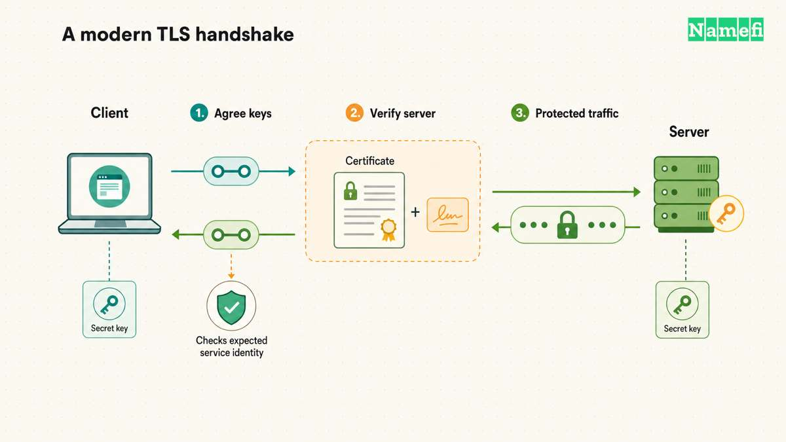
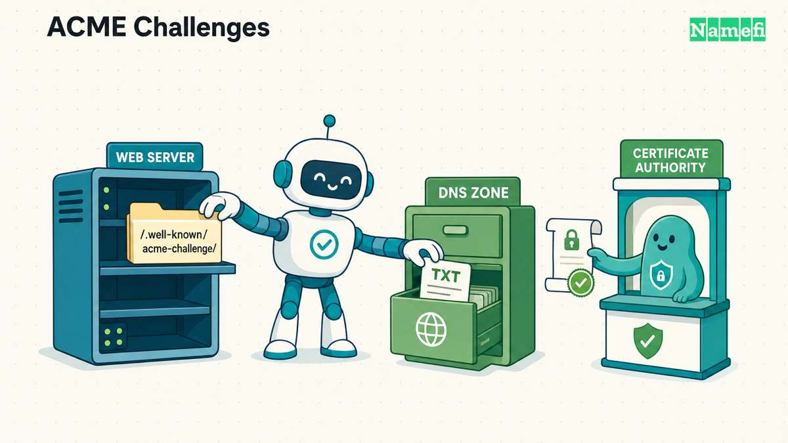

**HTTPS protects HTTP communication with authentication, confidentiality, and integrity.** A browser checks the service identity and exchanges protected requests and responses. HTTPS does not establish that the website's operator is honest or that an offer is legitimate. [The HTTPS standard defines connection protection](#the-https-standard-requires-a-protected-connection). [Chromium explains the separate website-safety question](#chromium-distinguishes-connection-security-from-site-safety).

For a visitor, the immediate task is to check the intended address and respect certificate warnings. For a website operator, the task includes configuring HTTPS for every intended hostname and keeping certificate management working.

## HTTPS adds protection to web requests and responses

HTTP defines how a client requests a resource and how a server responds. An HTTPS URL requires protected communication with the authority identified by that URL. The standard requires confidentiality and integrity acceptable to both endpoints. [RFC 9110 defines the HTTPS scheme](#the-https-standard-requires-a-protected-connection).

TLS supplies the secure-channel properties behind ordinary HTTPS connections. Confidentiality protects established-channel data from outside readers. Integrity makes unauthorized changes detectable. Authentication connects the secure channel to the service identity the client expects. [RFC 8446 describes those properties](#the-tls-standard-defines-the-secure-channel).

Consider a hypothetical sign-in request to `https://accounts.example.com/`. HTTPS protects the request as the browser communicates with the authenticated service. The protected request can contain a password or session cookie. HTTPS does not decide whether the user should have entered that password at that address.

The sign-in example uses a [reserved documentation domain](#the-ietf-reserves-example-domains-for-documentation).

The distinction also applies to downloads and payments. A protected connection helps preserve the bytes exchanged with the named service. The visitor must still judge the source, intended recipient, and requested action. Encryption cannot replace that judgment.

## A certificate connects a server identity to the requested name

A browser needs more than encrypted bytes. The client must verify that the service identity matches the origin server it intended to reach. The HTTPS standard requires that verification and a configured set of trust anchors. [RFC 9110 explains certificate verification](#the-https-standard-requires-service-identity-verification).

A certificate authority participates in that trust system. The server presents a certificate, and the client verifies the certificate under the client's trust configuration. curl provides a concrete example: curl verifies the certificate signature and checks the server name supplied in the URL. [curl documents the default verification](#curl-explains-certificate-and-hostname-verification).

The requested hostname therefore matters. `example.com` and `accounts.example.com` are different names to consider during certificate setup. Do not assume that installing a certificate for one name covers every other name. The [certificate selection guide](/en/blog/ssl-certificate-types/) explains coverage choices.

A certificate warning means the client could not complete the expected verification. As practical advice, stop before submitting credentials or approving a payment. Record the displayed hostname and error. A visitor should contact the site operator or device administrator when the reason remains unclear.

Do not follow advice that disables certificate verification to make a production request succeed. curl's documentation explicitly recommends keeping verification enabled in production. [The verification guidance states that boundary](#curl-explains-certificate-and-hostname-verification).

## TLS establishes keys before protecting application traffic

TLS uses a handshake to negotiate parameters and establish shared keying material. After the handshake, the peers use established keys to protect application traffic. Authentication forms part of that process. [RFC 8446 explains the protocol sequence](#the-tls-handshake-establishes-shared-keys).

The certificate does not need to encrypt each page byte itself. The handshake combines identity verification with key establishment, and the connection uses the resulting traffic keys. This distinction helps explain why replacing a certificate and changing website content are separate administrative actions.

The secure channel also has limits. TLS does not hide the length of transmitted data by default. Endpoints can still see the application data they exchange. [The TLS specification describes confidentiality and its limits](#the-tls-standard-defines-the-secure-channel).

Treat claims that HTTPS makes browsing invisible as too broad. This article describes the protected connection, rather than every possible observation available to a network operator, application, or website. A privacy assessment must examine the actual services and configuration involved.

## Port 443 is a default endpoint rather than a trust signal

An HTTPS URL without an explicit port uses port 443 by default. A URL can explicitly select another port. [RFC 9110 defines the default](#the-https-standard-requires-a-protected-connection). The [port 443 guide](/en/blog/what-is-port-443/) explains visitor and server network checks.

Keep three diagnostic results separate:

| Result | What the result establishes |
| --- | --- |
| A TCP connection succeeds | The tested TCP endpoint accepts that connection |
| Certificate verification succeeds | The client accepts the certificate and requested service identity |
| The application returns the expected page | The tested request reaches the intended application behavior |

HTTP/3 adds another transport distinction because HTTP/3 uses QUIC. A TCP-only test therefore does not test the HTTP/3 connection path. [RFC 9114 defines HTTP over QUIC](#http3-maps-http-onto-quic).

An HTTP error can occur after HTTPS works. For example, a server can return 403 because the server refuses the request. A certificate change will not necessarily change that permission decision. [RFC 9110 defines 403](#the-http-standard-defines-a-forbidden-response).

## Website operators need a working certificate lifecycle

Certificate issuance requires a way to validate the requested names. Let's Encrypt documents automated challenges that test domain control. HTTP-01 retrieves a challenge file through port 80. DNS-01 checks a TXT record and supports wildcard issuance. [Let's Encrypt explains the challenge paths](#lets-encrypt-documents-domain-control-challenges).

As operational advice, start by listing every public hostname that should work. Include redirect entry points as well as the final destination. Confirm the hosting platform's certificate workflow before changing DNS or network settings.

Then check the actual visitor experience. Open the intended HTTPS URL, inspect any redirects, and test the actions the site supports. Confirm that the correct site appears, rather than treating certificate issuance as the end of setup.

Keep renewal automation and its validation permissions under review. A workflow that issued a certificate once still needs the required access when renewal runs. Restrict automation permissions to the operations the certificate workflow needs.

## Visitors should judge the address and the request together

Chromium explains that a connection-security indicator does not mean a website is trustworthy. HTTPS can protect a connection to a phishing site. [The Chromium explanation addresses that misunderstanding](#chromium-distinguishes-connection-security-from-site-safety).

Before a sensitive action, inspect the full hostname and use a known route to the service. Treat unexpected requests for passwords, recovery codes, or payments as a separate question from encryption. For a website operator, keep the [domain account](/en/blog/harden-domain-registrar-account/) and DNS administration protected alongside HTTPS.

The next useful step depends on the problem. A certificate warning needs connection diagnosis. A misleading website needs an identity and content assessment. A production site needs both a verified HTTPS connection and the intended application behavior.

## Sources and further reading

### The IETF reserves example domains for documentation

[IETF RFC 2606, section 3, Reserved example second-level domain names](https://www.rfc-editor.org/rfc/rfc2606.html#section-3). Fetched 2026-10-30.

### The HTTPS standard requires a protected connection

[IETF RFC 9110, section 4.2.2, HTTPS URI scheme](https://www.rfc-editor.org/rfc/rfc9110.html#section-4.2.2). Fetched 2026-10-30.

### Chromium distinguishes connection security from site safety

[Chromium Blog, An Update on the Lock Icon, website-safety discussion](https://blog.chromium.org/2023/05/an-update-on-lock-icon.html#:~:text=not%20an%20indicator%20of%20website%20safety). Fetched 2026-10-30.

### The TLS standard defines the secure channel

[IETF RFC 8446, section 1, Introduction](https://www.rfc-editor.org/rfc/rfc8446.html#section-1). Fetched 2026-10-30.

### The HTTPS standard requires service identity verification

[IETF RFC 9110, section 4.3.4, HTTPS certificate verification](https://www.rfc-editor.org/rfc/rfc9110.html#section-4.3.4). Fetched 2026-10-30.

### curl explains certificate and hostname verification

[curl, SSL certificate verification, Verification and Skip verification sections](https://curl.se/docs/sslcerts.html#:~:text=curl%20does%20certificate%20verification%20by%20default). Fetched 2026-10-30.

### The TLS handshake establishes shared keys

[IETF RFC 8446, section 2, Protocol overview](https://www.rfc-editor.org/rfc/rfc8446.html#section-2). Fetched 2026-10-30.

### HTTP3 maps HTTP onto QUIC

[IETF RFC 9114, section 2, HTTP/3 protocol overview](https://www.rfc-editor.org/rfc/rfc9114.html#section-2). Fetched 2026-10-30.

### The HTTP standard defines a forbidden response

[IETF RFC 9110, section 15.5.4, 403 Forbidden](https://www.rfc-editor.org/rfc/rfc9110.html#section-15.5.4). Fetched 2026-10-30.

### Lets Encrypt documents domain control challenges

[Let's Encrypt, Challenge Types, HTTP-01 and DNS-01 sections](https://letsencrypt.org/docs/challenge-types/#http-01-challenge). Fetched 2026-10-30.
