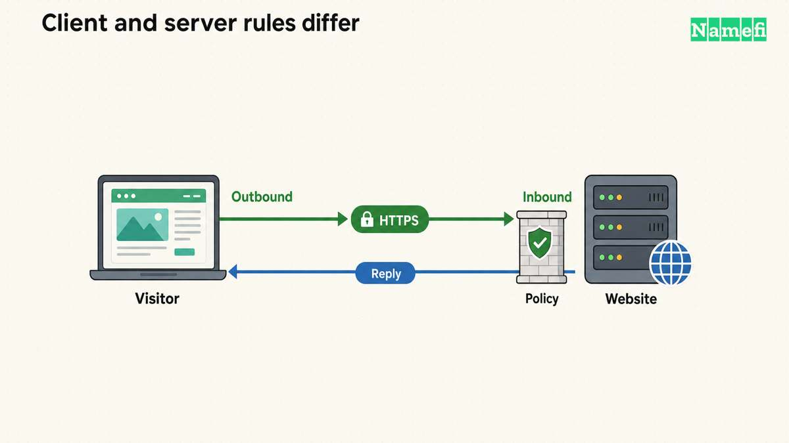
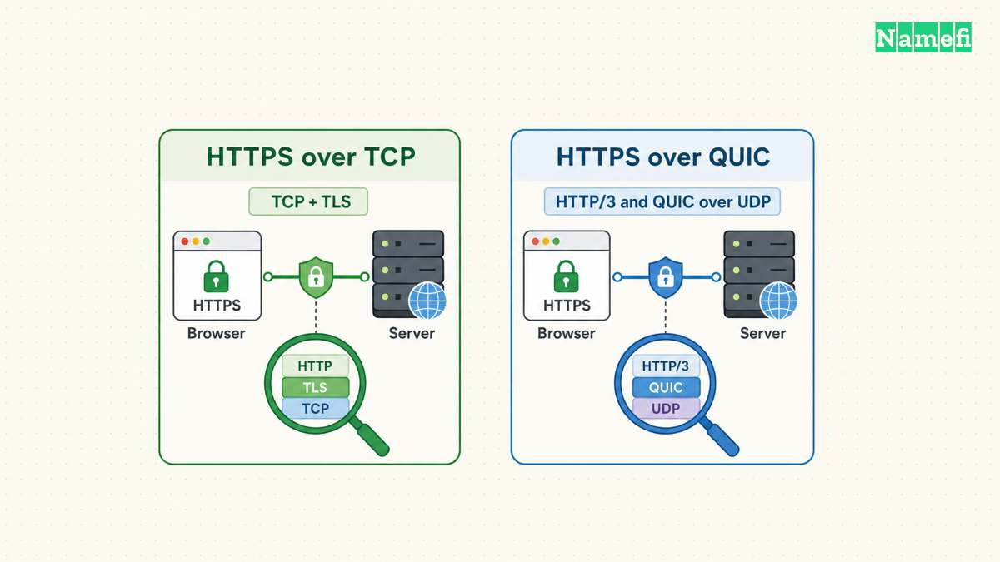

**Port 443 is the default port for HTTPS when a URL does not specify another port.** A website usually accepts HTTPS connections there. A visitor usually needs permission to make an outbound connection, rather than an inbound rule on the visitor's router. [The HTTPS specification defines the default endpoint](#the-https-standard-defines-the-default-port).

Before opening anything, identify the failing side: the visitor's connection, the server's listener, or the application behind the server. An open port alone does not establish a valid certificate or permission to view a page. The checks below separate those questions.

## A URL selects a hostname and a service endpoint

Consider the illustrative URL `https://www.example.com/account`. The hostname identifies the intended service. HTTPS supplies the connection requirements. Because the URL omits an explicit port, the default port is 443. A URL such as `https://www.example.com:8443/account` explicitly selects a different port. [RFC 9110 describes this URL structure](#the-https-standard-defines-the-default-port).

The examples use a [reserved documentation domain](#the-ietf-reserves-example-domains-for-documentation).

The hostname still matters when several websites share an address. Replacing the hostname with an IP address changes the identity the client asks to verify. curl checks the certificate against the server name in the URL, so an IP-only test can answer a different question. [curl documents name verification](#curl-verifies-the-server-name-by-default).

Do not treat `443` as a security label attached to every program using the number. HTTPS requires an authenticated, protected connection. A service needs the right protocol and configuration, regardless of its chosen port. [The HTTPS definition requires confidentiality and integrity](#the-https-standard-defines-the-default-port).

## Visitors and operators need different network permissions

Use this practical decision table before changing a rule:

| Situation | Appropriate next check |
| --- | --- |
| One visitor cannot load a public site | Compare the error with another permitted network or device |
| All visitors fail after a server change | Inspect the server listener, deployment, and network policy |
| A private application rejects an outside request | Confirm whether outside access should exist |
| A site works but a TCP port test fails elsewhere | Compare test location, protocol, destination, and time |
| A page returns 403 through HTTPS | Investigate application authorization or a security rule |

A public site needs an intentionally public entry point. A private dashboard needs an entry point restricted to its intended users or approved network. As operational advice, write that access decision down before opening a server port.

For a reverse proxy or load balancer, check the public entry point and the connection to the application separately. Do not assume the application itself must accept public traffic on port 443. The administrator should follow the hosting platform's documented network design.

Avoid instructions that disable an entire firewall or allow every source to every port. A useful rule names the required direction, destination service, transport, and allowed source. Keep a record of the previous rule so a reviewed change can be reversed.



## Three checks distinguish transport, TLS, and HTTP failures

On Windows PowerShell, test the intended hostname:

```powershell
Test-NetConnection -ComputerName www.example.com -Port 443
```

Replace the example hostname with the actual hostname. Microsoft documents `Test-NetConnection` as a diagnostic tool with a TCP test. Inspect the selected remote address and the `TcpTestSucceeded` result. [Microsoft explains the TCP test](#microsoft-documents-the-tcp-connection-test).

A successful TCP test means that test established a TCP connection. The command does not complete the browser's certificate checks or establish that an account may view a protected page. Record the result as transport evidence.

With curl installed, inspect the HTTPS connection:

```bash
curl --head --verbose https://www.example.com/
```

The `--head` option requests HTTP headers using HEAD. The `--verbose` option exposes diagnostic details. [The curl manual defines both options](#curl-documents-the-request-options). curl verifies certificates by default, including the requested server name. Keep verification enabled during diagnosis. [curl explains the verification boundary](#curl-verifies-the-server-name-by-default).

Interpret the outcome in order. A connection timeout leaves the transport path unresolved. A certificate error requires certificate and hostname investigation. An HTTP response means the client reached an HTTP-speaking endpoint through the established connection.

A HEAD request is not identical to a browser's GET request. If the server treats HEAD differently, compare the actual browser request before diagnosing a page failure. Use the [HTTPS explanation](/en/blog/what-is-https/) for the connection model and the [certificate guide](/en/blog/ssl-certificate-types/) for hostname coverage.

Verbose output can include request details. As a practical precaution, remove credentials, tokens, and sensitive hostnames before sending diagnostic output to support.


## HTTP/3 requires a separate transport check

A TCP test does not test every possible HTTPS path. HTTP/3 maps HTTP onto QUIC and uses UDP rather than TCP. The HTTP/3 specification also permits servers to advertise another UDP port. [RFC 9114 explains the transport and endpoint discovery](#http3-uses-quic-and-udp).

An administrator should enable the transport required by the deployed service. Do not add a UDP rule merely because a generic article mentions HTTP/3. Confirm that the server supports HTTP/3 and that the network policy permits the intended exposure.

Likewise, a successful TCP connection on port 443 does not prove that HTTP/3 works. If an incident concerns one protocol, record that protocol explicitly. Compare like with like when reviewing results from monitoring, a browser, and a command-line tool.



## Certificate issuance can require another verification path

Serving HTTPS and obtaining a certificate involve different checks. For Let's Encrypt, HTTP-01 validation uses port 80. DNS-01 validation checks a TXT record and can support wildcard certificates. [Let's Encrypt documents both challenge types](#lets-encrypt-separates-http-and-dns-validation).

Opening port 443 therefore does not, by itself, repair a failed HTTP-01 challenge. Review the actual challenge type and the certificate client's error. Follow the provider's instructions for the chosen validation path.

Finish with a result that names the layer: TCP connection established, certificate verification succeeded, or the expected page loaded. If a failure remains, send the operator the hostname, UTC test time, protocol, exact error, and test location. That report supports a focused correction without an unnecessary network reset.


## Sources and further reading

### The IETF reserves example domains for documentation

[IETF RFC 2606, section 3, Reserved example second-level domain names](https://www.rfc-editor.org/rfc/rfc2606.html#section-3). Fetched 2026-10-30.

### The HTTPS standard defines the default port

[IETF RFC 9110, section 4.2.2, HTTPS URI scheme](https://www.rfc-editor.org/rfc/rfc9110.html#section-4.2.2). Fetched 2026-10-30.

### curl verifies the server name by default

[curl, SSL certificate verification, Verification section](https://curl.se/docs/sslcerts.html#:~:text=curl%20does%20certificate%20verification%20by%20default). Fetched 2026-10-30.

### Microsoft documents the TCP connection test

[Microsoft, Test-NetConnection, Description and Example 3](https://learn.microsoft.com/en-us/powershell/module/nettcpip/test-netconnection?view=windowsserver2025-ps#description). Fetched 2026-10-30.

### curl documents the request options

[curl manual, --head and --verbose options](https://curl.se/docs/manpage.html#:~:text=Fetch%20the%20headers%20only). Fetched 2026-10-30.

### HTTP3 uses QUIC and UDP

[IETF RFC 9114, section 3.1, Discovering an HTTP/3 Endpoint](https://www.rfc-editor.org/rfc/rfc9114.html#section-3.1). Fetched 2026-10-30.

### Lets Encrypt separates HTTP and DNS validation

[Let's Encrypt, HTTP-01 and DNS-01 challenge sections](https://letsencrypt.org/docs/challenge-types/#http-01-challenge). Fetched 2026-10-30.
