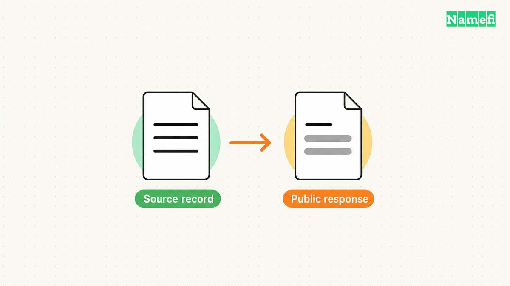

**Use [ICANN Lookup](https://lookup.icann.org/en) to inspect a domain's public registration information.** Start with the registrar, status, nameservers, and clearly labeled registration dates. For generic top-level domains, RDAP now supplies the standardized registration-data service behind the familiar lookup task. [ICANN identifies the official lookup route](#icann-identifies-the-rdap-lookup-route).

A public lookup can answer useful registration questions without revealing the registrant's personal name or email. A hidden contact field is an information limit, rather than proof that the domain lacks a registrant.

## The exact domain determines what the lookup can answer

Enter the domain name, rather than an entire website URL. For the hypothetical URL `https://www.example.com/store`, the registration question concerns `example.com`. The example uses a [reserved documentation domain](#the-ietf-reserves-example-domains-for-documentation).

Keep the website path out of the query. A registration record concerns the registered name and associated registration data. RDAP defines a domain object with fields such as nameservers, entities, events, and status. [RFC 9083 describes that object](#the-rdap-standard-describes-domain-registration-objects).

Use this practical workflow:

1. Open the official lookup tool directly.
2. Enter the exact domain, including the ending.
3. Check that the returned domain matches the query.
4. Record the registrar and the source of the result.
5. Copy relevant dates with their full field labels.
6. Read notices before interpreting missing personal information.

This guide explains how to interpret a result. The examples do not report a live lookup for a particular domain. For a step-by-step tour of the interface, use the separate [ICANN Lookup guide](/en/blog/icann-domain-lookup/).

## WHOIS and RDAP describe different access protocols

ICANN describes RDAP as the replacement for the WHOIS protocol. RDAP provides structured registration data and supports differentiated access. A website can still label a search box “WHOIS” while using RDAP to obtain the result. [ICANN explains the current protocol transition](#icann-explains-the-current-whois-requirements).

ICANN's current user guidance requires gTLD registries and registrars to provide RDAP. The same guidance states that WHOIS requirements ended on January 28, 2025, with exceptions for `.com`, `.name`, and `.post`. [The guidance identifies those exceptions](#icann-explains-the-current-whois-requirements).

Do not translate that policy change into “every WHOIS server disappeared.” A requirement and a provider's continued service are different questions. Country-code domains also require attention to their own operator's arrangements.

When two tools disagree, compare the source and retrieval time before choosing the more detailed result. An interface can change field labels or combine data from several places. A longer result does not automatically establish a newer registration record.

For an investigation, preserve the query, tool, source service, and UTC retrieval time. That record lets another reader understand which observation supported the conclusion.

## Public fields support specific registration conclusions

ICANN's Registration Data Policy distinguishes required operational fields, conditional publication, and redaction. The following table summarizes the publication boundary for covered registrars and gTLD registry operators. [Section 9 sets those requirements](#icann-specifies-publication-and-redaction-boundaries).

| Field | Useful interpretation | Limit |
| --- | --- | --- |
| Registrar and registrar IANA ID | Identify the sponsoring registration provider | Do not establish who runs the website |
| Creation date | Identifies the reported creation event | Does not establish the business's founding date |
| Registry expiry date | Reports the registry-side expiry field | Keep distinct from the registrar's registration expiration field |
| Domain status | Reports operational status values | Does not explain every underlying account or billing event |
| Nameservers | Reports configured nameserver data when supplied | Does not establish the website's origin host |
| Registrar abuse contact | Provides a route for an abuse report | Does not decide whether a complaint is valid |

The policy separately names registry expiry and registrar registration expiration. Preserve that distinction when a deadline matters. Do not shorten both fields to an unlabeled “expiration date” in a support report. [The policy lists the two fields separately](#icann-specifies-publication-and-redaction-boundaries).

An updated date also needs context. Treat the date as the reported update field, rather than proof that a sale occurred. If a purchase depends on history, combine current registration evidence with an appropriate historical source. The [domain age guide](/en/blog/check-domain-age/) explains that narrower question.

## Redaction does not erase the underlying registration

The Registration Data Policy requires redaction in specified circumstances and permits redaction in others. The policy distinguishes collecting information from publishing information. [Section 9.2 defines the redaction requirements](#icann-specifies-publication-and-redaction-boundaries).

Read the notices and contact route that the result supplies. Do not replace an unavailable personal field with a guess. Do not infer that a privacy service's listed details identify the person who operates a website.

If legitimate work requires nonpublic gTLD registration data, ICANN directs users to its Registration Data Request Service for participating registrars or to the sponsoring registrar's disclosure process. ICANN first asks users to check whether the public lookup supplies the data. [The official announcement explains that route](#icann-identifies-the-rdap-lookup-route).

A disclosure request is a request, rather than a guaranteed release of information. Use the provider's stated process and explain the relevant purpose. The public lookup remains the appropriate first step for ordinary registration checks.

## Registration research and website attribution need separate evidence

A registrar maintains the registration relationship. Hosting supplies a separate website service. ICANN explicitly explains that domain registration does not itself provide a website or email. [The registration FAQ separates those services](#icann-separates-registration-from-website-services).

For a site you administer, use account records, invoices, and deployment configuration to identify the host. For another person's site, report the narrow observation the public record supports. Do not promote a registrar name into a confirmed hosting attribution.

The same discipline applies to buying a domain. A public registration record can identify the current registrar. The buyer still needs a transaction process that verifies the seller's authority and control. A copied lookup result does not authorize a transfer.

Finish with an answer that matches the original question: which registrar sponsors the domain, which date field the source reports, or which contact route the provider publishes. If the question remains “Who is the person behind this site?”, state the remaining evidence gap instead of inventing an owner.

## Sources and further reading

### ICANN identifies the RDAP lookup route

[ICANN, Launching RDAP; Sunsetting WHOIS](https://www.icann.org/en/announcements/details/icann-update-launching-rdap-sunsetting-whois-27-01-2025-en#:~:text=Users%20are%20encouraged). Fetched 2026-10-30.

### The IETF reserves example domains for documentation

[IETF RFC 2606, section 3](https://www.rfc-editor.org/rfc/rfc2606.html#section-3). Fetched 2026-10-30.

### The RDAP standard describes domain registration objects

[IETF RFC 9083, section 5.3, Domain object class](https://www.rfc-editor.org/rfc/rfc9083.html#section-5.3). Fetched 2026-10-30.

### ICANN explains the current WHOIS requirements

[ICANN, Information for RDAP users](https://www.icann.org/en/contracted-parties/registry-operators/registration-data-access-protocol/information-for-rdap-users-31-08-2018-en#:~:text=All%20gTLD%20registries). Fetched 2026-10-30.

### ICANN specifies publication and redaction boundaries

[ICANN Registration Data Policy, sections 9.1 and 9.2](https://www.icann.org/en/contracted-parties/consensus-policies/registration-data-policy#:~:text=9.1.%20RDDS%20Publication%20Requirements). Fetched 2026-10-30.

### ICANN separates registration from website services

[ICANN registration FAQ, domain registration versus a website](https://www.icann.org/resources/pages/faqs-84-2012-02-25-en#:~:text=Your%20domain%20name%20registration%20is%20not). Fetched 2026-10-30.
