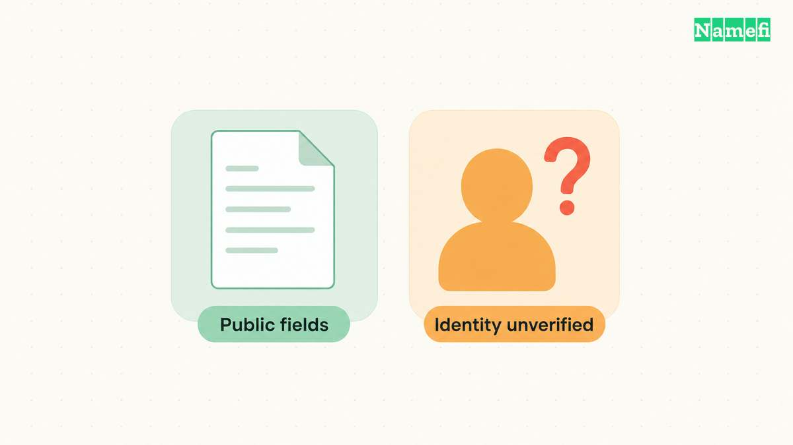
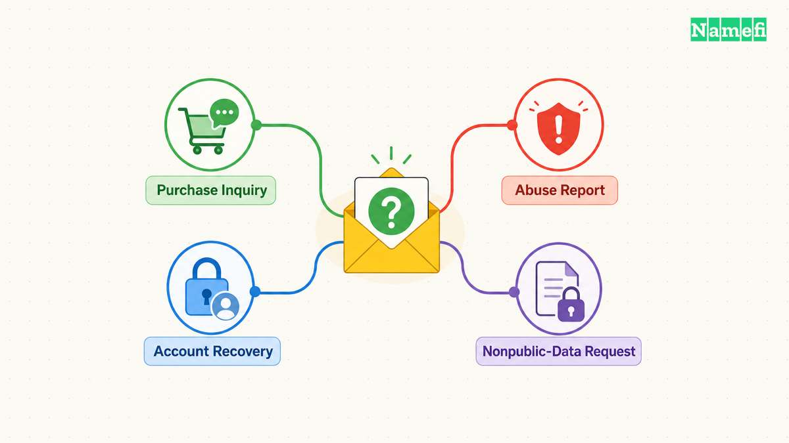

WHOIS and RDAP provide access to registration information. RDAP supplies a standardized protocol and structured responses, but RDAP does not make every registrant's personal information public.

A useful domain investigation separates the access protocol, the information the provider holds, and the information the provider publishes. A change in protocol does not erase that distinction.

The practical question is rarely “Which tool shows the most fields?” Ask which current source supports the specific conclusion you need. A blank contact field, a redaction notice, and a failed request require different interpretations.

## A WHOIS result does not establish the website's hosting provider

**To identify a website's host, separate the registrar, DNS service, and web service first.** A registrar name in a domain lookup answers a registration question. The same company might supply several services, but the registration result alone does not establish that arrangement.

For a site you administer, start with hosting invoices, deployment accounts, and the site's configuration. Compare those records with the [separate domain and hosting services](/en/blog/domain-vs-hosting/). Record which account controls each service before requesting a change.

For a site you do not administer, preserve the exact hostname and observed public address. Treat the address as evidence about the visible endpoint. Avoid labeling the address provider as the confirmed origin host without independent evidence.

Cloudflare provides a concrete limit: a proxied hostname returns Cloudflare addresses instead of the origin address. Cloudflare shares address ranges across proxied hostnames. [Cloudflare documents the proxy behavior](#cloudflare-documents-why-a-public-address-can-hide-the-origin).

An IP registration lookup and a domain registration lookup also ask different questions. [IANA's WHOIS gateway accepts names, IP addresses, and AS numbers](#iana-documents-its-registration-lookup-inputs). Keep each result's query and source beside the finding.

If the public evidence identifies only a proxy, report that limit. The useful conclusion can be: “The public endpoint uses Cloudflare; the origin host remains unverified.”

## RDAP changes the access method without promising a public identity directory

RDAP means Registration Data Access Protocol. ICANN describes RDAP as the [replacement for the WHOIS protocol](https://www.icann.org/en/contracted-parties/registry-operators/registration-data-access-protocol/information-for-rdap-users-31-08-2018-en). A service can still use the familiar WHOIS label while presenting registration information through a different technical interface.

ICANN requires gTLD registries and registrars to provide RDAP. Since January 28, 2025, ICANN no longer requires WHOIS services, except for `.com`, `.name`, and `.post`. The [current user guidance](https://www.icann.org/en/contracted-parties/registry-operators/registration-data-access-protocol/information-for-rdap-users-31-08-2018-en) states those exceptions. The obligation change does not mean that every WHOIS server stopped operating.

Country-code extensions and individual service implementations need their own documentation. A gTLD policy statement cannot establish identical behavior for every country-code registry. Check the responsible operator before generalizing from one extension.

RDAP uses structured requests and responses. [RFC 9082 defines a domain query path](https://datatracker.ietf.org/doc/html/rfc9082#section-3.1.3) with a `domain/` segment followed by the domain name. The endpoint belongs to the responsible service, rather than a universal server that holds every domain.

A graphical client can hide those details and present readable labels. The presentation does not change the source's limits. Two interfaces can arrange the same underlying record differently, and an aggregator can add information from other sources.

Keep three layers separate when comparing results:

| Layer | Question to ask | Common mistake |
| --- | --- | --- |
| Protocol | How does the client request data? | A new protocol must reveal more personal data |
| Source | Which registry or registrar supplied the response? | Every website uses the same source and update time |
| Presentation | How does the client label the result? | A tool's “owner” label proves current identity |

For a browser workflow, our [ICANN Lookup guide](/en/blog/icann-domain-lookup/) explains how to interpret the operational fields. For a data workflow, preserve the endpoint, timestamp, and response structure before extracting individual values.

A hypothetical comparison might show a contact label in one interface and a redaction notice in another. Investigate source and timing before announcing a contradiction. Do not assume that a more detailed page necessarily provides newer or more authoritative information.

The protocol tells you how data travels. Publication policy tells you which data the provider exposes. Keep both questions in the investigation record.

## Public fields support registration checks rather than complete ownership conclusions

ICANN's [Registration Data Policy, section 9](https://www.icann.org/en/contracted-parties/consensus-policies/registration-data-policy#:~:text=Publication%20of%20Domain%20Name%20Registration%20Data), sets publication requirements for its covered contracted parties. The policy distinguishes operational data, conditional fields, and redaction requirements. Read the current text before treating a missing field as a compliance finding.

The policy separates required public fields from conditional publication and redaction. Use the following reading aid for covered gTLD services. The table summarizes [sections 9.1 and 9.2](https://www.icann.org/en/contracted-parties/consensus-policies/registration-data-policy).

| Field group | Publication boundary | Reading limit |
| --- | --- | --- |
| Domain, registrar, registrar IANA ID, registrar URL, status and abuse contact | Required public data | Registrar details identify the provider, rather than the website operator |
| Creation and expiry dates | Required, with different expiry requirements for registry and registrar responses | Keep the exact event label and source |
| Updated date, nameservers and DNSSEC elements | Required when collected, transferred or generated | A missing conditional field needs context |
| Registrant name, street, phone and email | Publication depends on the redaction rules | A public response need not expose direct personal contact details |
| Registrant organization | Publication depends on the applicable rules and agreement to publish | A blank organization field does not prove an individual registration |

For ordinary research, start with the domain, registrar, status, relevant dates, and published contact route. Those fields help identify the registration's operational context. The fields do not establish every contractual or beneficial ownership relationship.

The [registrant](/en/glossary/registrant/) and the person who operates a website can differ. A contractor may administer hosting. A business may use a privacy service. A corporate registration can involve employees and service providers with different responsibilities.

Avoid combining those roles into one unsupported “owner” label. Write the narrow observation instead: “The public result names this registrar” or “The public result provides this contact route.” Keep an identity conclusion separate until independent evidence supports the conclusion.

Dates require the same discipline. A registration date can support a statement about the reported registration event. An update date cannot automatically reveal a sale. Use our [domain age guide](/en/blog/check-domain-age/) when registration history affects your decision.

Nameservers identify part of the technical configuration. Nameservers do not establish the identity of the business that wrote a website's content. Shared infrastructure also does not prove that two domains share a registrant.

A useful research note can separate four columns:

- Observed field: the exact field label and value.
- Source context: the provider and retrieval time.
- Supported use: the narrow question the field answers.
- Remaining gap: the conclusion that needs another source.

For a hypothetical seller investigation, a public record might confirm the sponsoring registrar. The buyer still needs a process that verifies the seller's control and the agreed transfer. A copied registration record gives no account authorization.

For an abuse report, the registrar's published abuse contact can help route the report. The contact does not replace evidence of the reported conduct. Preserve the suspicious URL, message, and relevant time separately from the registration record.

Treat registration data as evidence with a defined scope. A lookup can answer practical questions even when personal details remain unavailable. The value comes from a correct interpretation, rather than a large number of exposed fields.

## Redaction notices explain an information limit rather than an empty registration

A public response can omit personal information while the underlying registration remains active. ICANN's [redaction requirements](https://www.icann.org/en/contracted-parties/consensus-policies/registration-data-policy#:~:text=Redaction%20Requirements) distinguish collection and publication. A public lookup cannot tell you everything the provider holds internally.

The technical representation can also vary. [RFC 9537 defines redaction methods](https://datatracker.ietf.org/doc/html/rfc9537#section-3), including removal and empty-value approaches. An application that checks only whether a value exists can miss that context.

Read notices and remarks before interpreting missing contact information. Preserve the exact wording that the service supplies. If the response contains a structured redaction description, keep that description with the extracted data.

Do not replace missing values with invented defaults. “Not publicly available in this response” differs from “none.” A spreadsheet that converts every empty field to “no registrant” creates a claim that the source does not support.

The following distinctions prevent common mistakes:

| Observation | Safe description | Unsupported conclusion |
| --- | --- | --- |
| A redaction notice appears | The service limits the public response | The registrant does not exist |
| A privacy-service contact appears | The result names a contact service | The service is the website operator |
| The request times out | The lookup failed at the recorded time | The domain is unregistered |
| A third-party page lists an old name | The page reports that name and date | The name identifies the current controller |
| An email contact form appears | The result offers a contact mechanism | The form guarantees an answer |

[Privacy and proxy services](/en/blog/domain-privacy-vs-proxy/) also require precise language. Describe the service terms and visible role rather than assuming that every hidden field uses the same arrangement. Redaction and a separately purchased privacy service are not interchangeable observations.

A missing field also does not prove misconduct. Many ordinary registrations limit public personal information. Evaluate harmful conduct through evidence of harmful conduct, rather than treating privacy as a substitute for investigation.

When sharing a report, avoid copying unnecessary personal data. Include the operational fields needed for the stated task. A broad dump can distract the reviewer and expose information that adds no value to the conclusion.

If two tools disagree, return to the current source response. Record the discrepancy instead of selecting whichever value supports your preferred explanation. Preserve uncertainty until the source, timestamp, or policy difference explains the result.

## Contact and disclosure requests need a separate purpose and process

Choose the next action according to your purpose. A purchase inquiry, an abuse report, an [account-recovery request](/en/blog/harden-domain-registrar-account/), and a request for nonpublic data need different channels. A public lookup cannot replace those workflows.

For a purchase inquiry, use the published contact mechanism or a documented marketplace process. Keep the first message narrow. A failure to answer does not prove that the address is invalid or that the domain is abandoned.

For your own account recovery, start from the registrar's trusted website and documented support route. The public record can help identify the provider, but recovery usually requires account-specific evidence. Do not send credentials to an address copied from an unverified third-party page.

For nonpublic gTLD registration data, consult ICANN's current [Registration Data Request Service](https://www.icann.org/rdrs-en). RDRS routes standardized requests to participating registrars. ICANN continued RDRS after its November 2025 pilot, so an old pilot end date does not establish current unavailability.

If a registrar does not participate, find the registrar's direct disclosure process. [Policy section 10.1](https://www.icann.org/en/contracted-parties/consensus-policies/registration-data-policy) requires covered providers to publish a link to that process on their homepage. A response obligation does not guarantee disclosure. Section 10.6 permits a reasoned refusal.

Prepare a request around a defined need, rather than a general wish to uncover a person. State the domain, purpose, requested information, and relevant supporting material. Follow the provider's instructions and applicable requirements. A request does not itself establish entitlement or promise disclosure.

For a technical investigation, consider whether personal data is necessary at all. A DNS error, certificate issue, or hosting outage may call for a service operator rather than a registrant's personal details. Match the channel to the problem.

Keep a short decision record:

1. State the operational or investigative question.
2. Record the current public response and checking time.
3. Identify the specific evidence gap.
4. Select the appropriate contact or request route.
5. Preserve the response without overstating the result.

A hypothetical analyst might conclude: “The public record identifies the registrar and a redacted registrant contact. The analyst has not verified the current controller.” That conclusion remains useful because the conclusion states both the evidence and the limit.

Historical WHOIS products answer a different question from current registration services. [DomainTools documents timestamped historical records](https://docs.domaintools.com/iris/investigate/data-panels/whois-history/) and privacy filtering in its WHOIS History panel. A subscription does not turn an archived record into a current identity check.

Record the historical observation date separately from the date of your search. Compare the archived source with the current registry or registrar response. Treat any proposed ownership change as an inference until independent evidence supports the change.

Review old reports before reusing them. A past public name, an archived screenshot, or an old aggregator export can describe a historical observation. A historical observation cannot silently become a current identity claim.

Use WHOIS and RDAP results as bounded registration evidence. Preserve source and time, distinguish public data from held data, and route requests through the appropriate process. A careful report can remain actionable without pretending that every identity is public.

## These sources support the article

Sources checked on October 21, 2026. The policy page includes a May 12, 2026 revision notice. The article does not infer a disclosure outcome.

- [ICANN: Information for RDAP Users](https://www.icann.org/en/contracted-parties/registry-operators/registration-data-access-protocol/information-for-rdap-users-31-08-2018-en). The page describes RDAP and the scope of the WHOIS obligation transition.
- [ICANN: Registration Data Policy, sections 9 and 10](https://www.icann.org/en/contracted-parties/consensus-policies/registration-data-policy). The policy distinguishes publication, redaction, and disclosure requests.
- [RFC 9082, section 3.1.3](https://datatracker.ietf.org/doc/html/rfc9082#section-3.1.3). The standard defines domain-query syntax.
- [RFC 9537, section 3](https://datatracker.ietf.org/doc/html/rfc9537#section-3). The standard defines redaction methods in RDAP responses.
- [ICANN: Registration Data Request Service](https://www.icann.org/rdrs-en). The page describes the request service and participating registrars.

- [DomainTools: WHOIS History panel](https://docs.domaintools.com/iris/investigate/data-panels/whois-history/). The operator documents timestamped historical records and privacy filtering. Fetched October 21, 2026.

### Cloudflare documents why a public address can hide the origin

[Cloudflare's IP address documentation](https://developers.cloudflare.com/fundamentals/concepts/cloudflare-ip-addresses/) explains proxied DNS answers, shared address ranges, and the origin connection. Source checked 2026-10-29.

### IANA documents its registration lookup inputs

[IANA's WHOIS gateway](https://www.iana.org/whois) accepts domain names, IP addresses, and AS numbers. The gateway returns registration information rather than certifying a website's hosting arrangement. Source checked 2026-10-29.
