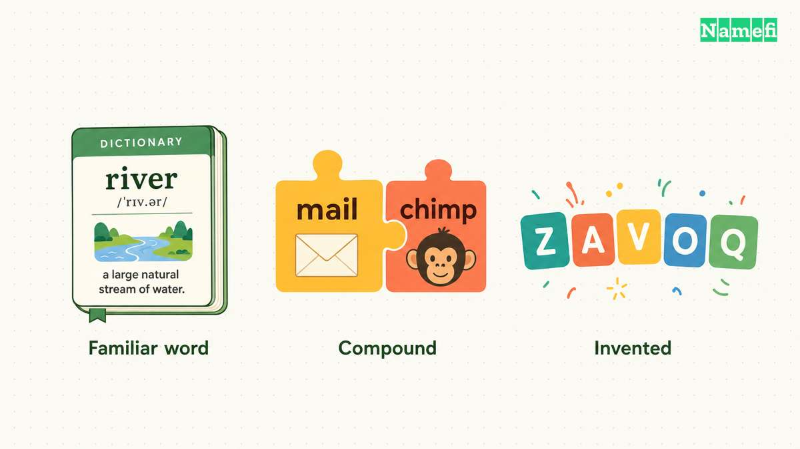
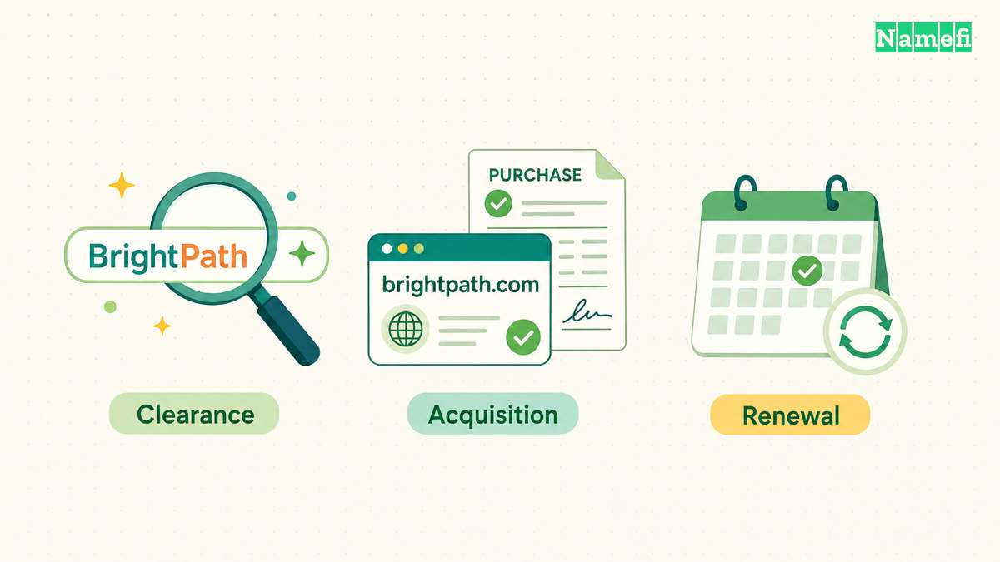

Los nombres que aparecen en las ilustraciones son solo ejemplos. Las imágenes no indican que los dominios estén disponibles, que alguien los haya comprado ni que los nombres estén libres de conflictos con marcas registradas.

**Un nombre de dominio de marca da a un producto o empresa una identidad que las personas pueden reconocer y usar.** El nombre puede usar una palabra conocida en un contexto nuevo, combinar palabras o crear una palabra. La pregunta útil es qué tan bien funciona el nombre para tu público.

Un nombre puede verse convincente en un logotipo y resultar incómodo en una conversación con un cliente. Antes de comprar un dominio de marca, di el nombre en voz alta, pide a alguien que lo escriba y úsalo en una oración habitual sobre tu producto.

El objetivo es encontrar un nombre que puedas usar con comodidad, con un significado y una identidad que quieras desarrollar. Los ejemplos siguientes son nombres consolidados para estudiar. Los ejemplos no son dominios en venta ni sugerencias para imitarlos. El análisis de los nombres expresa un criterio editorial. El análisis no demuestra que un nombre específico vaya a generar más conversiones, posicionarse mejor o venderse mejor.

## Los nombres reales muestran distintas formas de crear una marca

Considera dos formas distintas de crear un nombre.

**Stripe usa una palabra común fuera de la categoría del producto.** La página del producto de Stripe describe una plataforma de pagos. [Consulta Stripe Payments.](https://stripe.com/payments) El nombre, por sí solo, no explica el procesamiento de pagos. Esa separación resulta útil como ejercicio para elegir un nombre: la palabra puede evocar una imagen mientras una descripción independiente explica el servicio.

Prueba la misma separación con tu lista de candidatos. Coloca cada nombre junto a una descripción sencilla de lo que vendes. ¿La combinación tiene sentido sin un párrafo que explique el nombre? Un nombre sugerente admite distintas interpretaciones, pero tu cliente no debería tener que resolver un acertijo para entender la oferta.

**Mailchimp combina una referencia a la categoría con una palabra inesperada.** Su plataforma actual de mercadotecnia incluye herramientas de marketing por correo electrónico, entre otras. [Consulta la descripción de la plataforma de Mailchimp.](https://mailchimp.com/marketing-platform/) En el nombre, “mail” ofrece una asociación reconocible y “chimp” evoca una imagen distintiva. La observación describe la estructura del nombre. La observación no explica por qué la empresa tuvo éxito.

Un nombre compuesto puede dar a una empresa nueva un punto de partida para explicar su actividad. Comprueba si ambas partes siguen siendo apropiadas para el producto que quieres desarrollar. Una segunda palabra divertida puede encajar con tu tono o dificultar una conversación de ventas seria.

| Estructura que puedes estudiar | Pregunta útil | Posible debilidad que puedes comprobar |
| --- | --- | --- |
| Palabra conocida que funciona como marca | ¿Podemos acompañar la palabra con una descripción clara del producto? | La palabra puede sugerir una categoría equivocada |
| Referencia a la categoría más una palabra distintiva | ¿La combinación suena natural en voz alta? | La referencia puede resultar limitada si el producto cambia |
| Palabra inventada | ¿Una persona que no conoce la palabra puede pronunciarla y escribirla? | La escritura puede requerir explicaciones repetidas |

No des una calificación alta a un nombre consolidado solo porque reconoces a la empresa. El ejercicio evalúa la estructura del nombre, sin atribuir al nombre la reputación de la empresa.

## Las conversaciones cotidianas ponen a prueba tu lista de nombres

Haz la prueba con personas parecidas al público al que realmente esperas llegar. Si tus clientes usarán más de un idioma, incluye esos idiomas en el ejercicio. No supongas que un nombre fácil de leer en inglés también será fácil de leer en otros idiomas.

Primero, di el nombre propuesto y la extensión en voz alta sin mostrar un logotipo. Pide a la persona que escriba la dirección. Registra exactamente cómo escribe la dirección. Anota también cualquier corrección, como “todo junto, con una letra adicional al final”. La explicación forma parte del costo de usar el nombre.

Después, muestra el nombre en minúsculas y sin diseño. Pregunta qué cree leer la persona y qué tipo de empresa espera encontrar. Presta atención a separaciones entre palabras, abreviaturas o asociaciones que no habías previsto. Los resultados son observaciones de la prueba, no una medida estadística del mercado.

Por último, usa el nombre en oraciones que realmente necesitarás:

> “Trabajo en [nombre]. Creamos [descripción sencilla del producto].”
>
> “Puedes encontrar las instrucciones en [dominio].”
>
> “Por favor, envía la factura a [dirección].”

Deja pasar un tiempo entre la presentación del nombre y una pregunta posterior sobre lo que la persona recuerda. Anota lo que recuerda la persona en vez de preguntar si el nombre era “fácil de recordar”. El ejercicio resulta más útil cuando registra conductas en lugar de opiniones de cortesía.

Compara los candidatos con una ficha breve de resultados:

| Aspecto | Información que debes registrar |
| --- | --- |
| Pronunciación | Las pronunciaciones que las personas intentaron sin ayuda |
| Escritura | La dirección que escribieron después de escuchar el nombre |
| Significado | El producto o la sensación que asociaron con el nombre |
| Recuerdo | Las palabras que recordaron después |
| Afinidad con el producto | Si la descripción tenía sentido junto al nombre |
| Expansión | Si el nombre sigue siendo apropiado para el siguiente producto que razonablemente podrías ofrecer |

Evita resumir todos los resultados en una calificación universal inventada. Un problema de escritura puede ser aceptable para un producto que la mayoría descubre mediante enlaces. El mismo problema puede resultar inaceptable para un producto cuyos clientes llegan por teléfono. Explica de forma explícita qué desventaja aceptas y por qué.

## La disponibilidad del dominio no resuelve todas las comprobaciones del nombre

Una búsqueda de dominios responde una pregunta sobre la adquisición. La búsqueda no determina si puedes usar el nombre como marca.

En Estados Unidos, la USPTO explica que las marcas en conflicto pueden parecerse por su sonido, apariencia, significado o impresión comercial. La relación entre los productos y servicios también importa. [Consulta la guía sobre la probabilidad de confusión.](https://www.uspto.gov/trademarks/search/likelihood-confusion) Por eso, buscar solo la escritura exacta del nombre resulta insuficiente.

Busca variantes relevantes y productos relacionados. La guía de búsqueda de la USPTO también incluye fuentes externas a su base de datos federal, como búsquedas en internet de usos que puedan generar derechos conforme al derecho común estadounidense. [Consulta la guía de búsqueda de posibles conflictos.](https://www.uspto.gov/trademarks/search/comprehensive-clearance-search-similar-trademarks) Si la compra tiene un peso importante en tu lanzamiento, pide a un profesional jurídico calificado que interprete los resultados para los mercados, productos o servicios que tienes previstos.

Después, confirma por separado los datos de la adquisición: si puedes obtener el dominio exacto, el precio de compra cotizado, el costo recurrente de renovación, las condiciones de transferencia y quién tendrá el control del registro. Registra la moneda y la fecha de cada cotización. El artículo no verifica la disponibilidad ni ofrece estimaciones de precios para los nombres de ejemplo.

Elige un nombre cuando puedas explicar tanto sus ventajas como sus limitaciones. Una nota útil para documentar la decisión podría decir: “El público escribió el nombre de forma consistente, el nombre encaja con la descripción del producto y aceptamos que el nombre necesita una frase de presentación”. Esa explicación ofrece una base más firme para comprar que “el nombre se siente de alta gama”.

Si evalúas nombres para revenderlos, en lugar de usarlos para tu propia empresa, las preguntas relevantes cambian. Continúa con la comparación entre [dominios de marca y dominios de palabras clave](/es/blog/brandable-vs-keyword-domains/) para conocer esa otra perspectiva.

## Las fuentes ofrecen información adicional

- Stripe — [Stripe Payments](https://stripe.com/payments), descripción inicial del producto. Fecha de consulta: 2026-09-15. El enlace redirigió a la página regional de Malasia. No se verificó ninguna captura de archivo.
- Mailchimp — [Plataforma de mercadotecnia](https://mailchimp.com/marketing-platform/), secciones de funciones de la plataforma y marketing por correo electrónico. Fecha de consulta: 2026-09-15. No se verificó ninguna captura de archivo.
- USPTO — [Probabilidad de confusión](https://www.uspto.gov/trademarks/search/likelihood-confusion), ejemplos de similitud y sección “Productos y servicios relacionados”. Fecha de consulta: 2026-09-15. No se verificó ninguna captura de archivo.
- USPTO — [Búsqueda exhaustiva de posibles conflictos con marcas similares](https://www.uspto.gov/trademarks/search/comprehensive-clearance-search-similar-trademarks), fuentes de búsqueda y uso conforme al derecho común estadounidense. Fecha de consulta: 2026-09-15. No se verificó ninguna captura de archivo.
