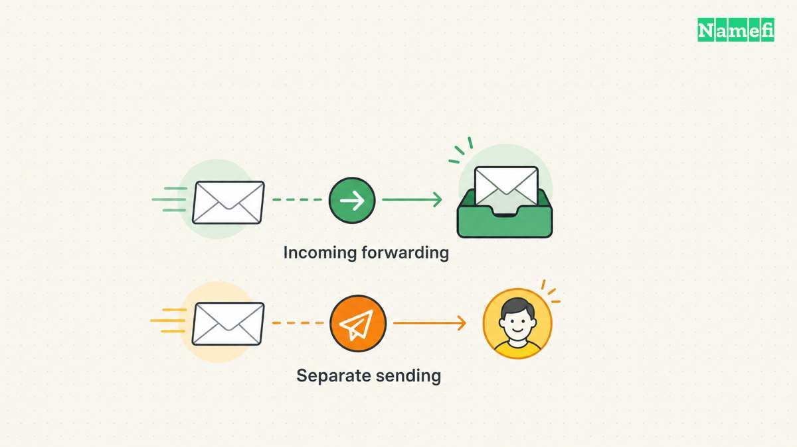

**Une adresse fournie par un service de messagerie ne nécessite pas l’achat d’un domaine. Une adresse comme `hello@example.com` exige un domaine que vous contrôlez.** Un hébergement gratuit, une redirection gratuite et un essai gratuit rendent des services différents.

Choisissez d’abord l’adresse. Déterminez ensuite vos besoins : réception, réponses depuis votre domaine ou comptes distincts pour plusieurs personnes. Vérifiez l’offre proposée à l’inscription avant de transférer votre messagerie active.

Un service gratuit ne paie ni le renouvellement du domaine ni la gestion des comptes. Une promotion sur la première année du domaine impose aussi des conditions distinctes. Notre [guide des offres de domaines gratuits](/fr/blog/free-domain-offers/) explique ces coûts.

## Une adresse fournie par un service permet de démarrer sans domaine

Google décrit une [inscription à Gmail](https://support.google.com/mail/answer/56256?hl=en#zippy=%2Csign-up-for-a-google-account) avec une option pour le travail ou l’entreprise. Choisir cette option ne crée pas une adresse sur votre domaine. Google présente les adresses professionnelles de Google Workspace comme une offre distincte.

Proton illustre une autre distinction. Son [comparatif des offres gratuites](https://proton.me/mail/pricing#compare-plans) indique un utilisateur, une adresse, jusqu’à 1 Go de stockage et 150 messages par jour. L’offre gratuite exclut les domaines personnalisés. Le [guide de configuration des domaines](https://proton.me/support/custom-domain#:~:text=A%20paid%20Proton%20plan) exige un domaine et un abonnement payant.

Une adresse fournie peut convenir à un indépendant qui doit correspondre immédiatement. Choisissez une adresse disponible que les clients peuvent lire et épeler. Conservez la récupération du compte sous le contrôle de l’entreprise.

Une adresse fournie entraîne aussi un coût de migration : les clients enregistrent cette adresse. Acheter votre domaine plus tard ne transfère pas automatiquement les échanges et ne modifie pas leurs carnets d’adresses. Évaluez ce changement avant d’imprimer des supports durables.

## Une boîte et une redirection répondent à des besoins différents

Une boîte hébergée conserve les messages et permet de les consulter et de les gérer. Une redirection achemine les messages entrants vers une autre destination. Une adresse de redirection ne fournit pas automatiquement une solution complète pour envoyer du courrier.

Notez les tâches nécessaires avant de comparer les prestataires. Un indépendant peut avoir besoin d’une adresse publique et de réponses occasionnelles. Une équipe peut exiger des comptes distincts, des adresses communes, un accès mobile et un administrateur capable de rétablir l’accès.

Un alias ne constitue pas un compte salarié supplémentaire. Un alias peut diriger une autre adresse vers une destination existante. Un compte distinct possède ses propres modalités d’accès et d’administration. Vérifiez le fonctionnement du prestataire avant de compter les adresses comme des utilisateurs.

Les catégories suivantes permettent une première sélection :

| Option | Service possible | Points à vérifier |
| --- | --- | --- |
| Boîte gratuite sur domaine personnalisé | Stockage et consultation sous certaines limites | Région, utilisateurs, stockage, logiciels, envoi et export |
| Redirection gratuite | Livraison entrante vers une adresse existante | Vérification de destination et moyen distinct de répondre |
| Offre groupée | Messagerie incluse dans un autre achat | Renouvellement et conséquences de la résiliation |
| Essai | Accès temporaire aux fonctions payantes | Fin de l’essai, changement de formule et export |
| Adresse grand public | Adresse sur le domaine du prestataire | Inclusion réelle d’une identité sur domaine personnalisé |

Un compte grand public peut recevoir les messages redirigés. Le compte ne devient pas automatiquement une boîte sur votre domaine. Vérifiez l’adresse d’expéditeur que les destinataires voient dans vos réponses.

Un essai diffère aussi d’une formule gratuite durable. Avant de migrer des messages essentiels, vérifiez la situation à la fin de l’essai. Notez si le compte devient payant, perd des fonctions ou exige une intervention.

Pour une offre groupée avec un domaine, examinez l’achat déjà prévu. Une boîte incluse peut présenter un intérêt. La boîte dépend toutefois du produit payant. Notez les conséquences d’un transfert du domaine ou d’une résiliation de l’hébergement.

Consultez notre [guide de configuration d’une messagerie sur votre domaine](/fr/blog/set-up-email-with-your-own-domain/) après avoir choisi le modèle de service. Le présent comparatif aide à choisir ce modèle avant de modifier les enregistrements DNS.

Une exigence utile serait : « Une personne doit recevoir des messages et envoyer des réponses authentifiées depuis un domaine. » Une autre entreprise peut exiger cinq boîtes indépendantes. Ces besoins conduisent à des choix différents malgré une même recherche de messagerie gratuite.

## Les offres gratuites exigent une vérification datée des limites

Les exemples suivants décrivent les offres consultées le 21 octobre 2026. Les exemples comparent des types de services sans classer les prestataires.

| Offre | Domaine personnalisé | Réception et envoi | Condition de gratuité |
| --- | --- | --- | --- |
| Proton Free | Non | Boîte sur le domaine du prestataire | Un utilisateur, jusqu’à 1 Go, 150 messages par jour |
| Zoho Mail Free | Un domaine | Boîte professionnelle hébergée | Jusqu’à cinq utilisateurs, 5 Go chacun, certains centres de données |
| Cloudflare Email Routing | Oui | Redirection vers une destination vérifiée | Cloudflare DNS obligatoire, service d’envoi distinct pour les réponses ordinaires |
| Essai Namecheap Private Email | Oui | Boîte temporaire | Premier mois gratuit, renouvellement ensuite payant |

Le [comparatif Proton](https://proton.me/mail/pricing#compare-plans) et la [tarification Zoho](https://www.zoho.com/mail/zohomail-pricing.html) fournissent les limites des boîtes. Zoho exclut IMAP, POP et ActiveSync de son offre gratuite. Ne supposez pas qu’un logiciel de messagerie externe pourra accéder à la boîte.

La [documentation des abonnements Zoho](https://www.zoho.com/mail/help/adminconsole/subscription.html#:~:text=selected%20data%20centers) décrit un accès gratuit par navigateur et des restrictions régionales. Zoho ne garantit pas l’accès dans tous les pays. Confirmez la disponibilité lors de l’inscription réelle.

La même documentation distingue l’essai premium de 15 jours. Les comptes des régions admissibles passent ensuite à l’offre gratuite. Dans les régions sans offre gratuite, Zoho désactive les opérations de messagerie sans passage au payant. Zoho accorde alors 30 jours pour souscrire avant de programmer la suppression des données. Contactez l’assistance pendant cette période pour obtenir une sauvegarde.

Le [service de messagerie Cloudflare](https://developers.cloudflare.com/email-service/) sépare la redirection et l’envoi transactionnel. Sa [tarification](https://developers.cloudflare.com/email-service/platform/pricing/#plan-pricing) permet la redirection avec Workers Free et Workers Paid. L’envoi à des destinataires quelconques exige Workers Paid. L’envoi gratuit aux destinations vérifiées ne permet pas de répondre librement à tous les clients.

Cloudflare annonce un nombre illimité de messages entrants. Cette annonce ne supprime pas les [limites de redirection](https://developers.cloudflare.com/email-service/platform/limits/#email-routing-limits). Cloudflare autorise 200 règles par domaine et 200 adresses de destination vérifiées par compte. Cloudflare rejette les messages entrants de plus de 25 Mio. Une règle ne représente ni une boîte salarié ni une allocation de stockage.

Cloudflare exige aussi [Cloudflare DNS et la vérification des destinations](https://developers.cloudflare.com/email-service/get-started/route-emails/#set-up-your-domain). Incluez cette exigence dans votre décision, surtout si un autre opérateur gère la zone DNS actuelle.

Namecheap illustre la différence entre essai gratuit et service durablement gratuit. Son [offre Private Email](https://www.namecheap.com/hosting/email/#pricing) annonce actuellement le premier mois gratuit. La formule Launch comprend une boîte de 5 Go et affiche un renouvellement annuel de 14,88 dollars américains. Vérifiez la formule, la devise, les taxes et le renouvellement lors du paiement. Le premier mois ne constitue pas une offre gratuite permanente.

La comparaison pratique porte sur le type de service :

- Envisagez une boîte gratuite admissible si les limites correspondent aux utilisateurs et aux accès nécessaires.
- Envisagez la redirection pour acheminer surtout du courrier entrant vers une boîte existante.
- Envisagez une boîte payante si les logiciels, l’administration ou le stockage dépassent l’offre gratuite.
- Évaluez une interface d’envoi applicatif séparément de la boîte quotidienne d’une personne.

Vérifiez les règles d’utilisation et l’assistance du prestataire. Un service adapté aux échanges ordinaires peut imposer d’autres règles aux messages transactionnels ou aux campagnes. Une offre gratuite ne doit pas remplacer artificiellement un autre produit d’envoi.

Conservez une note datée avec la formule, la région, les limites et les fonctions nécessaires. Relisez cette note avant l’inscription et avant une migration importante. Un comparatif décrit l’offre observée à une date donnée. Le prestataire peut ensuite modifier l’offre.

## La réception et l’envoi exigent des vérifications distinctes

La réception commence par la configuration du domaine auprès du prestataire. Les enregistrements MX dirigent le courrier entrant vers le service de réception. Le prestataire peut aussi exiger des enregistrements de vérification et d’authentification.

Le [guide de redirection Cloudflare](https://developers.cloudflare.com/email-service/get-started/route-emails/#set-up-your-domain) décrit les enregistrements et la vérification des destinations. Utilisez les instructions applicables au compte choisi. Ne copiez pas les valeurs d’un autre domaine ou d’une ancienne capture d’écran.

Avant de changer les enregistrements MX, recensez le service existant. Identifiez chaque utilisateur, alias, application expéditrice et destination. Un remplacement mal préparé peut interrompre les messages de personnes absentes de votre boîte personnelle.

Conservez les anciens enregistrements et un plan de retour arrière. Consultez notre [guide des enregistrements DNS](/fr/blog/dns-record-types-guide/) si les types d’enregistrements vous sont inconnus. Ne supprimez pas les enregistrements du site web pour changer la messagerie.

L’envoi exige une vérification distincte. Confirmez le service autorisé à envoyer depuis votre domaine et les enregistrements nécessaires. La destination d’une redirection et le service d’envoi peuvent relever de deux opérateurs.

Les [consignes Google aux expéditeurs](https://support.google.com/mail/answer/81126?hl=en#zippy=%2Crequirements-for-all-senders) distinguent les exigences pour les envois ordinaires et en nombre vers Gmail personnel. Google recommande SPF, DKIM et DMARC. L’authentification aide les systèmes destinataires à évaluer les messages. L’authentification ne garantit pas leur arrivée dans la boîte de réception.

Notre [guide TXT, SPF et DKIM](/fr/blog/txt-records-spf-dkim-verification/) explique les rôles des enregistrements. Construisez la configuration à partir des services réellement autorisés. Une configuration copiée peut omettre une application qui envoie encore des messages légitimes.

Si le service choisi envoie des messages depuis votre domaine, inspectez ses enregistrements SPF et DMARC ainsi que le sélecteur DKIM connu avec le [vérificateur de configuration d’authentification des e-mails de Namefi](https://namefi.io/domain-tools/email-auth). Cette étape vérifie uniquement la configuration. Poursuivez les tests de réponse et de messages externes pour vérifier le fonctionnement réel de l’envoi.

Testez le parcours complet avant de publier l’adresse :

1. Envoyez un message externe à l’adresse personnalisée.
2. Confirmez l’arrivée dans la boîte prévue.
3. Répondez depuis l’identité du domaine personnalisé.
4. Vérifiez l’expéditeur visible et l’adresse de réponse.
5. Examinez les résultats d’authentification du message reçu.
6. Testez une seconde destination externe.
7. Testez une pièce jointe et une conversation représentatives.
8. Notez les rejets et les passages en courrier indésirable.

Utilisez un compte externe distinct pour tester la redirection entrante. Les essais avec le compte destinataire peuvent tromper par le comportement du prestataire ou le regroupement des conversations. Conservez le message réel et l’observation de livraison au lieu de supposer le bon fonctionnement.

Un essai entrant réussi ne prouve pas le fonctionnement des réponses. Une réponse réussie ne prouve pas le fonctionnement de chaque application. Vérifiez les formulaires, factures, outils d’assistance et autres systèmes qui utilisent le domaine.

Lorsqu’un essai échoue, conservez le texte du rejet et les en-têtes disponibles. Déterminez si le problème concerne l’acheminement, l’autorisation, l’authentification ou les limites. Évitez de modifier tous les enregistrements DNS après un seul échec.

## Une solution gratuite utilisable prévoit récupération et migration

Un faible abonnement ne supprime pas l’administration. Une personne doit contrôler le domaine, maintenir la récupération des comptes, surveiller la capacité et gérer un futur changement de prestataire.

[Sécurisez le compte du bureau d’enregistrement](/fr/blog/harden-domain-registrar-account/) et le compte d’administration de la messagerie. Utilisez les méthodes d’authentification multifacteur et de récupération disponibles. Gardez au moins un moyen de récupération indépendant du service que vous pourriez perdre.

Notez le responsable de chaque compte. L’entreprise doit pouvoir récupérer une adresse après le départ d’un salarié ou d’un prestataire. Des identifiants privés détenus par une seule personne créent une dépendance évitable.

Vérifiez les limites de stockage et d’utilisateurs avant le lancement. Une limite atteinte peut imposer un abonnement ou un nettoyage. Désignez la personne qui pourra approuver une dépense avant que le service devienne essentiel.

Conservez un petit registre d’exploitation :

| Information | Objectif |
| --- | --- |
| Compte du domaine et responsable du renouvellement | Préserver le contrôle des adresses |
| Formule et admissibilité | Expliquer les limites actuelles |
| Utilisateurs, alias et redirections | Comprendre le fonctionnement de la livraison |
| Services d’envoi autorisés | Maintenir les enregistrements d’authentification |
| Méthode de récupération | Rétablir l’accès après incident ou changement d’équipe |
| Export et migration | Conserver les messages lors d’un changement de prestataire |

Testez l’export réellement disponible dans la formule. Ne supposez pas qu’une migration IMAP fonctionnera si l’offre gratuite exclut IMAP. Lisez les instructions actuelles de sauvegarde et de migration avant de dépendre d’une méthode.

Pour une redirection, entretenez la boîte de destination autant que la règle. Une boîte pleine, un compte suspendu ou un accès perdu peut empêcher une configuration correcte de fonctionner. Surveillez les échanges réels au-delà de l’indicateur de configuration.

Si l’entreprise dépasse les limites gratuites, comparez le coût d’une formule adaptée avec le travail de migration. Évaluez la gestion des utilisateurs, les logiciels compatibles, la récupération et la conservation. Une offre payante prévisible peut mieux convenir qu’un assemblage fragile de services gratuits.

Préparez la migration avant de modifier les enregistrements. Préservez les messages, configurez la destination, testez l’identité du domaine et organisez la bascule. Conservez l’ancien service pendant la période de chevauchement nécessaire.

Une configuration gratuite sur domaine personnalisé peut répondre à un besoin limité et précis. Choisissez délibérément boîte ou redirection, vérifiez les limites et testez réception et envoi. Préservez un moyen de récupération et une méthode de départ utilisable.

## Les sources suivantes étayent les informations de l’article

Sources consultées le 21 octobre 2026. Les offres dépendent de la formule et de l’admissibilité du compte. L’article ne garantit ni la livraison ni un droit permanent à la gratuité.

- [Tarification Zoho Mail](https://www.zoho.com/mail/zohomail-pricing.html). Domaine, utilisateurs, stockage, protocoles et centres de données.
- [Abonnements Zoho Mail](https://www.zoho.com/mail/help/adminconsole/subscription.html). Disponibilité, essais et fonctions payantes.
- [Cloudflare Email Service](https://developers.cloudflare.com/email-service/). Distinction entre redirection entrante et envoi transactionnel.
- [Tarification Cloudflare Email Service](https://developers.cloudflare.com/email-service/platform/pricing/#plan-pricing). Redirection gratuite et envoi payant à des destinataires quelconques.
- [Redirection Cloudflare](https://developers.cloudflare.com/email-service/get-started/route-emails/#set-up-your-domain). Enregistrements et vérification des destinations.
- [Formules Proton Mail](https://proton.me/mail/pricing#compare-plans). Stockage, utilisateurs, messages et exclusion des domaines personnalisés de l’offre gratuite.
- [Domaines personnalisés Proton](https://proton.me/support/custom-domain). Domaine contrôlé séparément et abonnement payant obligatoires.
- [Création d’un compte Gmail](https://support.google.com/mail/answer/56256?hl=en). Inscription et distinction avec les adresses professionnelles Workspace.
- [Limites Cloudflare Email Service](https://developers.cloudflare.com/email-service/platform/limits/#email-routing-limits). Règles, destinations et taille des messages.
- [Namecheap Private Email](https://www.namecheap.com/hosting/email/#pricing). Essai du premier mois et renouvellement ultérieur.
- [Consignes Google aux expéditeurs](https://support.google.com/mail/answer/81126?hl=en). Authentification et livraison vers les comptes Gmail personnels.
