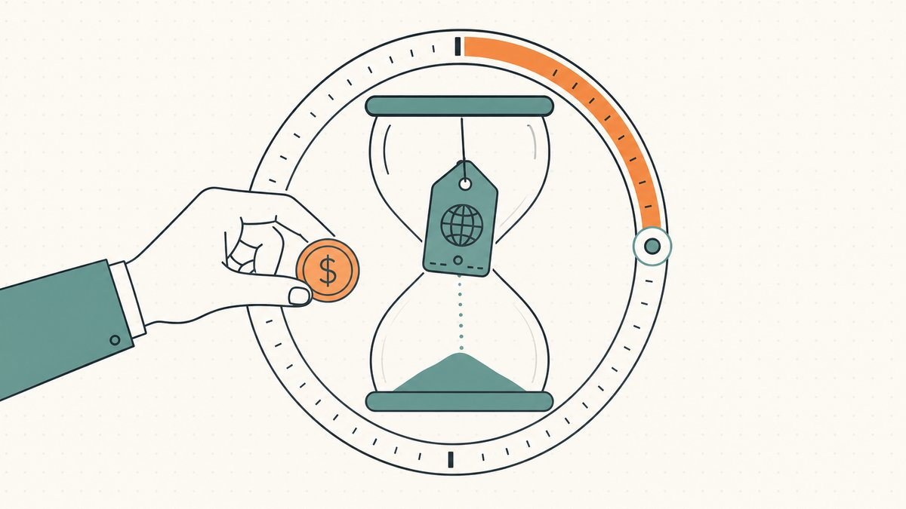
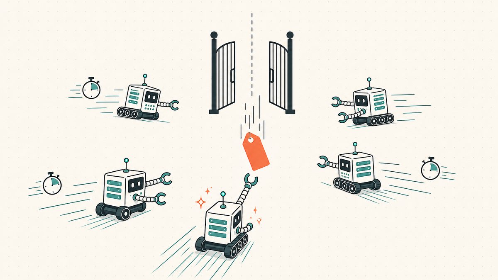
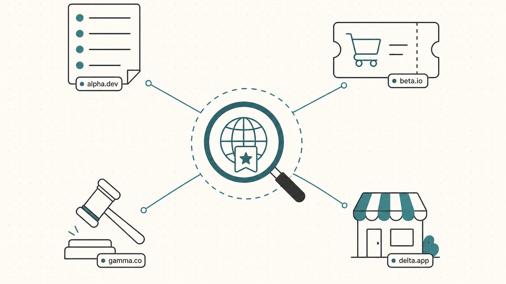

期限切れのドメインがすぐに登録可能になるわけではない。レジストラは利用者の更新期限とオークションを管理する。レジストリは削除と解放を管理する。本記事は通常の `.com` 登録を例に説明する。国別ドメインやスポンサー付きドメインには別の規則が適用される場合がある。

フリッパーがこの市場に注目するのは、ドロップされたドメインが白紙状態ではないからだ。ドロップまで到達したということは、誰かがかつて登録し、使用し、手放したということを意味する。そのため、ドメイン年齢、被リンク、残存トラフィック、あるいは自分が手動登録しようとしていた文字列がすでに取得済みだったという経緯を持つことがある。このサイクルは、かつて誰かが必要としたと証明されたドメイン名のリサイクルストリームだ。新規文字列とはリスクプロファイルが異なり、[転売向けドメインの発掘方法](/ja/blog/how-to-find-domains-to-flip/)で解説するサプライチャネルのひとつでもある。本記事ではライフサイクルをステージごとに解説し、ドロップされたドメインがどこに現れるか、そしてフリッパーがどのようにキャッチを狙うかを説明する。

## ステージ1：アクティブ登録と更新ウィンドウ

レジストリは、利用者が支払っていなくても `.com` を自動更新する場合がある。45日間の自動更新猶予期間は、レジストリとレジストラの料金精算に関する制度である。レジストラは期間内に削除すると、該当料金の返金処理を受けられる。利用者に45日間の更新権を保証する制度ではない。有効期限の延長表示も利用者の支払いを証明しない。[現行契約の付録7第3.1.3節](https://itp.cdn.icann.org/en/files/registry-agreements/com/com-agreement-html-01-12-2024-en.htm)を参照してほしい。[ICANNの現行方針第2.2節](https://www.icann.org/resources/pages/errp-2024-02-21-en)は、関連規則に従う期限切れ登録の削除を認めている。

## ステージ2：回復猶予期間（リデンプション・グレース・ピリオド）

通常の `.com` 登録を新規登録猶予期間外に削除すると、30暦日の `redemptionPeriod` が始まる。期限切れの日付だけでは回復猶予期間は始まらない。元の登録者は削除したレジストラに復旧を依頼する。レジストリはDNS名前解決を停止する。ICANNは非スポンサー型gTLDに30日間を義務付けているが、新規登録猶予期間内の削除は例外である。一律100米ドルの復旧料金はない。復旧と更新の合計額を確認してほしい。[現行方針の第3節と第4節](https://www.icann.org/resources/pages/errp-2024-02-21-en)が根拠となる。

## ステージ3：ペンディングデリート

通常の `.com` が回復猶予期間中に復旧しなかった場合、最後の削除待ち期間に入る。期間は5暦日である。レジストリは変更を拒否し、その後登録を消去する。[付録7第3.3.2節](https://itp.cdn.icann.org/en/files/registry-agreements/com/com-agreement-html-01-12-2024-en.htm)が期間を定めている。

状態コードは組み合わせ全体を確認する必要がある。`pendingDelete` は `redemptionPeriod` や `pendingRestore` と同時に表示される場合がある。併記の場合は回復や復旧の説明に従う。[ICANNの状態説明](https://www.icann.org/resources/pages/epp-status-codes-2014-06-16-en)が違いを説明している。公開状態だけでは正確な解放時刻は決まらない。45 + 30 + 5の合計も、期限切れから80日目の解放を保証しない。

## ステージ4：リリース、そしてキャッチの争奪戦

登録消去後の再登録にはレジストリの規則が適用される。期限切れオークションは削除前に登録を売却する場合がある。公開解放を経ずに登録者が変わる可能性もある。オークション日程とレジストリの削除日程は別物である。

バックオーダーは取得の試みを依頼するものであり、成功を保証しない。複数のサービスが同じ新規登録をそれぞれ完了することはできない。取得に成功したサービスは、複数の依頼者がいる場合にオークションを行うことがある。[Dynadot](https://www.dynadot.com/help/question/backorder-auction)は、取得成功後に複数のバックオーダーがあると公開オークションを行う。非公開オークションが共通規則ではない。

## ドロップされたドメインが現れる場所

サイクルを知っているだけでは不十分だ。どこを見ればいいかを知らなければ意味がない。ドロップ済みおよびドロップ間近の名前はいくつかの予測可能な場所に現れ、実用的なソーシング（調達）ルーティンは通常これらを複数組み合わせる。

- **ドロップリストと期限切れドメインデータベース。** 公開または有料のリストが毎日ペンディングデリートに入る名前を公開しており、文字数、[TLD](/ja/glossary/tld/)、キーワード、年齢、リンクメトリクスなどでフィルタリングできることが多い。まもなくリリースされる名前のウォッチリストのための生データフィードだ。
- **バックオーダーおよびドロップキャッチプラットフォーム。** 自分でカレンダーを監視する代わりに、バックオーダーを入れてサービスにリリース時の競争を代行させる。需要があるものを狙うには現実的なルートだ。詳しくは[ドメインバックオーダーとドロップキャッチング](/ja/blog/domain-backorders-and-drop-catching/)を参照。
- **期限切れドメインオークション。** 多くのレジストラは価値のある期限切れインベントリをパブリックドロップに出さず、猶予ウィンドウ中または終了後に自社の期限切れオークションに回す。名前はリリースではなく販売される形になる。これは[ドメインオークションで勝つ方法](/ja/blog/how-to-win-domain-auctions/)で説明するより広いチャネルとも重なる。
- **アフターマーケット。** 他の誰かにキャッチされた名前や、回復されて再出品された名前は、[アフターマーケット](/ja/glossary/aftermarket/)で再販される。ドロップそのものではないが、ドロップ後のインベントリの多くはここに行き着く。

フリッパーの優位性は、チャネルを名前に合わせることにある。競争の少ない文字列がパブリックドロップリストにあれば、手動登録に近い良い勝負になる。一方、プレミアムな一語ドメインはバックオーダーとおそらくオークション予算が必要だ。代わりに新規文字列を登録する方法を選ぶなら、それも正当な別のルートだ。[転売目的のドメイン手動登録](/ja/blog/hand-registering-domains-to-flip/)で説明している。

## フリッパーとしてのサイクルの読み方

登録者は直ちにレジストラへ連絡し、更新と復旧の条件、合計料金を確認してほしい。購入者は拡張子、レジストラ、全状態、確認時刻、オークション窓口、注文期限を記録する必要がある。有効期限だけから解放日を断定してはいけない。再販売やトークン移転でも、元のドメイン登録の更新義務はなくならない。

**デューデリジェンスは名前と一緒についてくる。** ドロップされた名前はその歴史を引き継ぐ。そして歴史がすべて良いとは限らない。古い名前に入札する前に、過去の使われ方、[WHOIS](/ja/glossary/whois/)と所有権の履歴、[レジストラ](/ja/glossary/registrar/)のロック、かつて問題のあるコンテンツを掲載していないかを確認すること。かつてブランドを侵害していた名前は、あなたが保有していても[UDRP](/ja/glossary/udrp/)の申し立てを受ける可能性がある。既存のバックリンクはゴールドと同様にスパムである可能性がある。ドロップは資産を渡すと同時に、その荷物も渡す。

## Namefiの視点

優れたドロップドメインをキャッチすることは仕事の半分に過ぎない。次の取引の際には、高額な[ドメイン取引](/ja/glossary/domain-trading/)すべてが直面する同じ摩擦にぶつかる。バイヤーは名前が移転する前に支払わず、セラーは代金を受け取る前に移転しない。そしてレジストラ間での[認証コード](/ja/glossary/auth-code/)の引き渡しが中間に不安なギャップを生む。この膠着状態こそが[エスクロー](/ja/glossary/escrow/)が存在する理由であり、年数の積み重なったリンク豊富な名前になるほど問題は鋭くなる。

## 免責事項（必ずお読みください）

> 私たちは弁護士でも会計士でも財務アドバイザーでも医師でもなく、**本記事のいかなる内容も、法的・財務的・税務的・会計的・医療的、またはその他の専門的なアドバイスを構成するものではありません。** これらの記事は自己教育と顧客の利便性を目的として執筆しています。ここに記載された情報は古くなっていたり、特定の地域にのみ該当したり、単純に誤りである可能性もあります。私たちも間違いを犯すことがあります。
>
> 重要な意思決定の際は、**必ず専門家にご相談ください（本当に！）**。それが合わない場合は、友人、Twitter、Reddit、AI、あるいは占い師に聞いてみてください。要するに：**DOYR（Do Your Own Research＝自分で調べる）**。一緒に学び、楽しみましょう。

## 出典および参考資料

出典確認日：2026年10月22日（UTC）。元の公開日を維持している。

- [ICANN / Verisign — 現行 .com 契約の付録7](https://itp.cdn.icann.org/en/files/registry-agreements/com/com-agreement-html-01-12-2024-en.htm)
- [ICANN — ERRP 2024](https://www.icann.org/resources/pages/errp-2024-02-21-en)
- [ICANN — EPP](https://www.icann.org/resources/pages/epp-status-codes-2014-06-16-en)
- [Dynadot](https://www.dynadot.com/help/question/backorder-auction)
