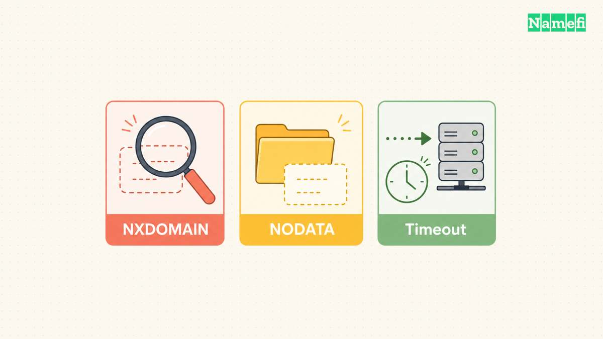
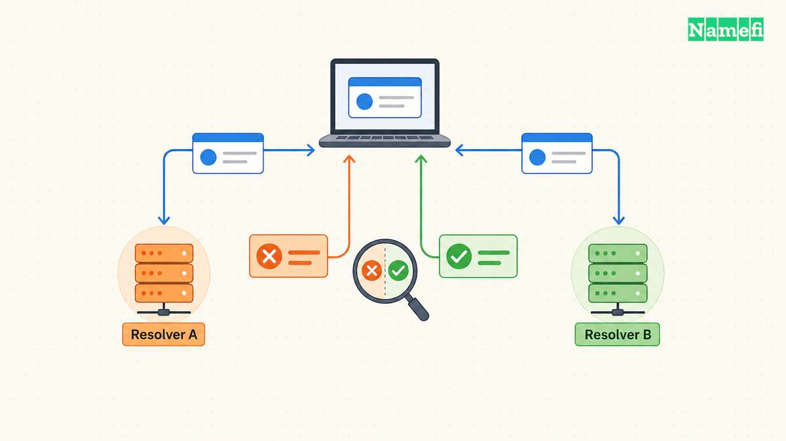
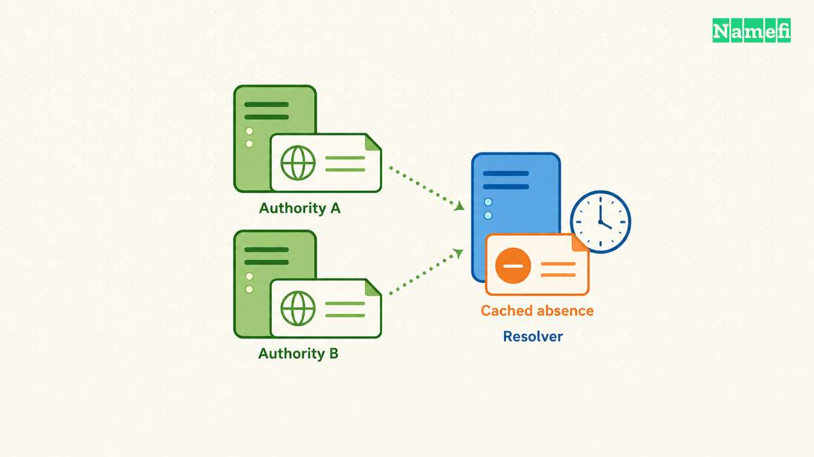

`DNS_PROBE_FINISHED_NXDOMAIN` は、Chromeが表示するDNS診断の状態です。
最初に正確なホスト名を確認し、ブラウザーの問い合わせ経路と条件をそろえたDNS問い合わせを比較します。
すぐにDNS設定を変えると、原因が分からなくなったり、社内の名前にアクセスできなくなったりする可能性があります。

Chromiumは、DNSサーバーが動作している一方で、ドメインが存在しないと考えられる場合の診断結果として状態を定義しています。
状態はブラウザーのエラーページに表示されます。
[ChromiumのDNS診断の定義](https://github.com/chromium/chromium/blob/main/components/error_page/common/net_error_info.h#L73-L119)で確認できます。
ブラウザーの診断だけでは、ドメイン登録の期限切れや、全リゾルバーが同じ応答を返すことは証明できません。

次の手順では、閲覧者ができる確認と、ドメイン運用者が行う修正を区別します。
例には、資料用の名前と仮のサーバーアドレスを使います。
例は構文の説明であり、実測した障害の記録ではありません。

## 応答コードが示す問題はウェブサイト全体の不在よりも限定的です



[DNS](/ja/glossary/dns/)プロトコルでは、NXDOMAINはName Errorという応答コードです。
応答は、名前が存在しないことを示します。
SERVFAILはサーバー側の失敗を示します。
タイムアウトは、ツールの待機期限までに応答を受け取れなかったという観測です。
[RFC 1035の4.1.1節](https://www.rfc-editor.org/rfc/rfc1035.html#section-4.1.1)は、DNSの応答コードを定義しています。
タイムアウトはNXDOMAIN応答とは異なります。

名前が存在しても、特定の種類のレコードがない場合があります。
一般にNODATAと呼ぶ結果は、`NOERROR` を使い、要求したデータを返しません。
[RFC 2308の2.2節](https://www.rfc-editor.org/rfc/rfc2308.html#section-2.2)は、NODATA、名前エラー、委任先への参照を区別しています。
たとえば、AAAAレコードがなくても、Aレコードで正常にアクセスできる名前はあります。
1種類のレコードがないという理由だけで、ドメインを作り直さないでください。

別名についても確認が必要です。
NXDOMAIN応答には、最後の参照先が存在しないCNAMEの連鎖が含まれる場合があります。
存在しない名前は、ブラウザーに入力した名前と異なる可能性があります。
[RFC 8020の2節](https://www.rfc-editor.org/rfc/rfc8020.html#section-2)は、別名の連鎖の最後の名前を不在と判断する対象としています。
動作している別名を削除する前に、応答全体を確認してください。

フィルタリングを行うリゾルバーは、意図的にNXDOMAINを返す場合があります。
Quad9は、ブロック対象にNXDOMAINを返し、DNSSECの認証失敗にはSERVFAILを返すと説明しています。
選択したリゾルバーがフィルタリングを行う場合は、提供元の[ブロック確認手順](https://docs.quad9.net/FAQs/#identifying-a-quad9-block)を使ってください。
NXDOMAINという結果だけでは、実際の不在とポリシーによる応答を区別できません。

## 閲覧者は正確な名前と問い合わせ経路を比較できます



最初にアドレスバーを確認してください。
綴り、余分な文字、目的のホスト名を確認します。
`example.com` と `www.example.com` は異なるDNS名です。
`/account` のようなパスはDNSホスト名の一部ではありません。
Googleの[接続エラーの解決手順](https://support.google.com/chrome/answer/6098869?hl=en)は、ウェブサイトのアドレス確認と再読み込みから始まります。

次に、失敗する範囲を確認します。

1. 綴りを修正した場合は、正確なホスト名でもう一度試してください。
2. 関係のない別のウェブサイトが開くか確認してください。
3. 同じ端末の別のブラウザーで同じホスト名を開いてください。
4. 仕事用のホスト名では、承認済みのVPNと社内DNSの要件を確認してください。
5. 失敗したアプリケーションが使うリゾルバーを記録してください。

ブラウザーの比較で分かるのは、アプリケーション間の違いです。
ネットワークの比較で分かるのは、ネットワーク経路間の違いです。
どちらの比較だけでも、ドメインの正しい権威データは確定できません。
設定を変える前に、元のエラーとUTC時刻を保存してください。

ChromeはセキュアDNSで問い合わせを行えます。
Googleの[セキュアDNSの資料](https://support.google.com/chrome/answer/10468685?hl=en)でブラウザーの設定を確認できます。
コマンドラインのツールとChromeが、異なるリゾルバーに問い合わせる場合があります。
結果の食い違いを判断する前に、セキュアDNSとVPNの設定を記録してください。
社内の名前では、組織が承認したリゾルバーの運用方針に従います。

問い合わせ先のDNSサーバーを指定すると、比較条件を再現できます。

```text
nslookup -type=A www.example.com. 192.0.2.53
nslookup -type=A www.example.com. 192.0.2.54
```

資料用の両アドレスを、確認済みで使用が許可されたリゾルバーのアドレスに置き換えてください。
Microsoftは、[nslookupの第2引数でサーバーを指定する構文](https://learn.microsoft.com/en-us/windows-server/administration/windows-commands/nslookup#remarks)を説明しています。
両方のテストで、ホスト名とレコードの種類をそろえてください。
末尾のピリオドは名前を絶対名とし、検索サフィックスによる曖昧さを防ぎます。

BINDのdigをインストール済みのシステムでは、次の形式でも比較できます。

```text
dig @192.0.2.53 www.example.com. A
dig @192.0.2.54 www.example.com. A
```

状態、回答、権威セクション、選択したサーバーを確認してください。
digプロセスの正常終了を、アドレスが存在する証拠としないでください。
[BINDのdigマニュアル](https://bind9.readthedocs.io/en/latest/manpages.html#dig-dns-lookup-utility)は、応答の扱いとコマンドのオプションを説明しています。
[特定のサーバーに問い合わせる手順](/ja/blog/nslookup-specific-dns-server/)で詳しい読み方を確認できます。

選択したリゾルバーが期待どおりの応答を返しても、ローカルのアプリケーションだけが失敗する場合は、アプリケーションの経路とキャッシュを調べます。
端末のキャッシュ削除は、条件を記録したうえで行う次の確認になります。
削除の成功だけでは、上流の否定応答が消えたとは判断できません。
比較結果がレコード公開の問題を示している場合は、初期化を繰り返さないでください。

## ドメイン運用者はキャッシュを消す前に公開データを修正できます



閲覧者は通常、ドメイン側の問題を運用者に報告します。
ドメイン運用者は、目的のレコードと委任先の権威サーバーを確認できます。
観測した結果に応じて、修正対象を選びます。

| 観測した結果 | 運用者が次に確認する対象 |
| --- | --- |
| 問い合わせに誤ったホスト名が含まれる | アプリケーションのURLを修正するか、目的のホスト名を公開する |
| CNAMEの連鎖が存在しない名前で終わる | サービス提供元と最後の参照先を確認して修正する |
| 委任先の権威サーバー間で応答が異なる | 全委任先でゾーンの公開と同期を確認する |
| 権威サーバーにはレコードがあるがリゾルバーは不在を返す | 否定応答のキャッシュとリゾルバーのポリシーを確認する |
| 社内の名前が社内DNS経由でだけ動作する | 承認済みの社内問い合わせ経路を維持する |
| 応答がSERVFAILである | 名前の不在と判断する前に、サーバーの失敗と検証を調べる |

ドメインの確認済みの設定から、目的のネームサーバーを特定してください。
委任先の全権威エンドポイントに、正確なホスト名とレコードの種類を問い合わせます。
運用者が権威サーバーのアドレスを確認している場合は、次の形式を使えます。

```text
dig @198.51.100.53 www.example.com. A +norecurse
```

資料用のアドレスを、確認済みの権威エンドポイントに置き換えてください。
`+norecurse` は、無関係なゾーンに対する権威をサーバーに与える設定ではありません。
エンドポイントが目的のゾーンを提供することを確認し、権威応答フラグを調べてください。
任意のサーバーから得た否定応答は、公開の失敗を証明しません。

DNS提供元の管理画面だけでなく、親ゾーンの委任も確認してください。
委任先ではない提供元に正しいレコードがあっても、閲覧者が該当する提供元へ到達するとは限りません。
Googleの[Public DNSのトラブルシューティング資料](https://developers.google.com/speed/public-dns/docs/troubleshooting#returning_the_wrong_answers_for_a_domain)は、キャッシュと権威データの不一致を区別しています。
提供元のキャッシュを削除しても古い応答が続く場合、資料は権威サーバーのSOAシリアル番号を確認するよう案内しています。

公開データの修正後は、キャッシュされた不在も考慮します。
[RFC 2308の3節](https://www.rfc-editor.org/rfc/rfc2308.html#section-3)は、SOAレコードのTTLとSOA MINIMUMの小さい方から否定応答のキャッシュ期間を求めます。
新しいレコードのTTLは、以前の否定応答の有効期間を遡って変更しません。
[TTLとDNS伝播の解説](/ja/blog/ttl-and-dns-propagation/)で時刻の扱いを説明しています。

世界中で同時に復旧するという固定の期限を約束しないでください。
修正した権威サーバー、影響を受けたリゾルバー、元のアプリケーションを再確認します。
正確な名前、レコードの種類、サーバー、応答コード、別名の連鎖、観測したUTC時刻を記録してください。
社内の名前は、承認済みの問い合わせ窓口だけで共有します。
記録があれば、公開データの修正と、別の経路を使った結果としてブラウザーが動く場合を区別できます。

## 次の資料で診断手順を確認できます

- [Chromium：DNS診断状態の定義](https://github.com/chromium/chromium/blob/main/components/error_page/common/net_error_info.h#L73-L119)。ブラウザーの診断状態とエラーページへの表示。2026-10-22取得。
- [IETF：RFC 1035の4.1.1節](https://www.rfc-editor.org/rfc/rfc1035.html#section-4.1.1)。DNS応答コード。2026-10-22取得。
- [IETF：RFC 2308](https://www.rfc-editor.org/rfc/rfc2308.html)。2.2節と3節はNODATAと否定応答の有効期間を説明。2026-10-22取得。
- [IETF：RFC 8020の2節](https://www.rfc-editor.org/rfc/rfc8020.html#section-2)。NXDOMAINと別名の最後の参照先。2026-10-22取得。
- [Quad9：ブロックの確認](https://docs.quad9.net/FAQs/#identifying-a-quad9-block)。フィルタリングとDNSSEC失敗の違い。2026-10-22取得。
- [Google：接続エラーと読み込みエラーの解決](https://support.google.com/chrome/answer/6098869?hl=en)。アドレスとブラウザーの確認。2026-10-22取得。
- [Google：Chromeの安全性とセキュリティの管理](https://support.google.com/chrome/answer/10468685?hl=en)。セキュアDNS。2026-10-22取得。
- [Microsoft：nslookup](https://learn.microsoft.com/en-us/windows-server/administration/windows-commands/nslookup#remarks)。サーバー指定とサフィックスの動作。2026-10-22取得。
- [ISC：BINDのdigマニュアル](https://bind9.readthedocs.io/en/latest/manpages.html#dig-dns-lookup-utility)。サーバー指定、再帰要求、応答の扱い。2026-10-22取得。
- [Google Public DNS：トラブルシューティング](https://developers.google.com/speed/public-dns/docs/troubleshooting#returning_the_wrong_answers_for_a_domain)。古いキャッシュと権威サーバーの比較。2026-10-22取得。
