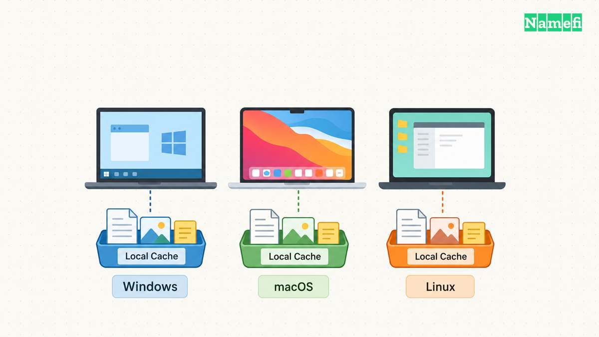

Windowsでは、`ipconfig /flushdns` で端末のDNSクライアントリゾルバーのキャッシュを削除します。
systemd-resolvedを使うLinuxでは、`resolvectl flush-caches` で当該サービスのローカルキャッシュを削除します。
macOSでは、インストール済みのバージョンに合った手順を確認します。
端末のキャッシュを削除しても、ドメインが公開するレコードや上流の全リゾルバーのキャッシュは変わりません。

影響を受けた端末のキャッシュが原因と考えられる場合に、削除を試します。
削除する前に、失敗したホスト名とエラーを記録してください。
削除後もエラーが続く場合は、設定の初期化を繰り返すよりも応答を比較します。
[特定のDNSサーバーに問い合わせる手順](/ja/blog/nslookup-specific-dns-server/)で比較方法を説明しています。

## Windowsではipconfigでクライアントキャッシュを削除します


管理対象の端末で、管理者権限のコマンドプロンプトを開いてください。
次のコマンドを実行します。

```text
ipconfig /flushdns
```

Microsoftは、Windows 10とWindows 11向けにコマンドを説明しています。
コマンドは、キャッシュされた否定応答を含め、動的に追加された項目を削除します。
[Microsoftのipconfigリファレンス](https://learn.microsoft.com/en-us/windows-server/administration/windows-commands/ipconfig#parameters)で削除対象を確認できます。
コマンドは、ウェブサイトの新しいアドレスを公開する操作ではありません。

削除前の状態を確認する場合は、次のコマンドを使えます。

```text
ipconfig /displaydns
```

キャッシュの出力には、閲覧先や社内サービスのホスト名が含まれる場合があります。
問い合わせの記録を共有する前に、保存した出力を確認してください。
Microsoftによると、表示対象にはローカルのHostsファイルから取り込んだ項目も含まれます。
Hostsファイルの誤った項目は、キャッシュ削除とは別に確認する必要があります。

削除後に、元のアプリケーションを再試行してください。
元のエラーが変わったかどうかを記録します。
コマンドの正常終了はキャッシュ操作の実行を示しますが、ウェブサイトの正常表示を保証しません。

シェルに合うコマンドを用意する場合は、[NamefiのDNSコマンド生成ツール](https://namefi.io/domain-tools/dns-commands)でWindowsとキャッシュ削除のタスクを選び、コマンドをコピーしてください。ページはテキストだけを生成します。必要な管理者権限でコマンドをローカル実行し、元のテストを繰り返してください。

目的と関係のないipconfigコマンドを追加しないでください。
`/release` はDHCPで取得したアドレス設定を破棄し、`/renew` はDHCPリースを更新します。
`/registerdns` は、端末の名前とアドレスの動的登録を要求します。
Microsoftは、[各操作の違い](https://learn.microsoft.com/en-us/windows-server/administration/windows-commands/ipconfig#parameters)を説明しています。
クライアントキャッシュの削除と同じ操作はありません。

## macOSとLinuxでは使用中のリゾルバーに合った手順を選びます



Macでは、ターミナルのコマンドをコピーする前にmacOSのバージョンを確認してください。
Appleの[OS XのDNSキャッシュをリセットする記事](https://support.apple.com/en-us/101481)は、OS Xのバージョンごとに異なるコマンドを示しています。
Appleは記事をアーカイブ済みとし、更新を終了しています。
記事は、Macを再起動してキャッシュ情報を更新する方法も説明しています。
個人用のMacを再起動する前に、作業を保存してください。

過去の手順として、Appleはアーカイブ済みの記事でOS X 10.10.4以降に次のコマンドを示しています。

```text
sudo killall -HUP mDNSResponder
```

記事の対象バージョンは過去の説明であり、現在の全macOSバージョンに対する互換性保証ではありません。
権限を必要とするコマンドを使う前に、使用中のバージョンの資料や管理者の手順を確認してください。
不慣れなコマンドは、共有端末で調査対象のブラウザー以外にも影響する可能性があります。

Linuxでは、最初に使用中のリゾルバーを確認します。
systemd-resolvedを使うシステムでは、次のコマンドを実行してください。

```text
resolvectl status
resolvectl statistics
sudo resolvectl flush-caches
```

`status` は、全体および接続ごとのDNS設定を表示します。
`statistics` は、リゾルバーの統計を表示します。
`flush-caches` は、systemd-resolvedがローカルに保持するDNSリソースレコードのキャッシュを削除します。
[systemdのresolvectlマニュアル](https://www.freedesktop.org/software/systemd/man/latest/resolvectl.html#flush-caches)で各操作を確認できます。

`resolvectl` が見つからなくても、端末にDNSキャッシュがないとは限りません。
別のサービスやアプリケーションがキャッシュを保持する場合があります。
該当するサービスを特定し、インストール済みのサービスの資料に従ってください。
別のディストリビューション向けのコマンドが失敗したという理由だけで、ネットワークサービスを再起動しないでください。

## 応答を比較すると調査すべきキャッシュが分かります


[DNSリゾルバー（再帰的リゾルバー）](/ja/glossary/dns-resolver/)は、端末とは独立して応答を保持できます。
リゾルバーは否定応答もキャッシュできます。
[RFC 2308の5節](https://www.rfc-editor.org/rfc/rfc2308.html#section-5)は、否定応答のキャッシュを定めています。
端末のキャッシュを削除しても、次の上流応答が変わるとは限りません。

たとえば、管理者が不足していた確認用レコードを作成したとします。
権威サーバーは新しいレコードを返しますが、選択したリゾルバーは以前の否定応答を保持しています。
端末のキャッシュを削除して再問い合わせしても、リゾルバーから以前の否定応答を受け取る場合があります。
[TTLとDNS伝播の解説](/ja/blog/ttl-and-dns-propagation/)でキャッシュの有効期間を説明しています。

リゾルバーの応答を比較するときは、ホスト名とレコードの種類をそろえてください。
設定済みのリゾルバーと、ネットワーク管理者が許可する別のリゾルバーを使います。
次のアドレスは資料用の仮の値であり、実際のDNSサービスではありません。

```text
nslookup -type=A www.example.com. 192.0.2.53
nslookup -type=A www.example.com. 192.0.2.54
```

比較前に、両方のアドレスを確認済みのリゾルバーのアドレスへ置き換えてください。
Microsoftは、[nslookupの第2引数にサーバーを指定する構文](https://learn.microsoft.com/en-us/windows-server/administration/windows-commands/nslookup#remarks)を説明しています。
異なる応答が得られた場合、比較した2回の観測に違いがあると分かります。
応答の違いだけでは、どちらが正しいかは判断できません。

観測した結果に応じて、次の操作を選びます。

| 観測した結果 | 次の操作 |
| --- | --- |
| 端末のキャッシュを1回削除するとアプリケーションが動く | 変化を記録し、設定の初期化を止める |
| 選択したリゾルバーが古い応答を返し続ける | 確認済みの権威応答とキャッシュの有効期間を比較する |
| ブラウザーだけが失敗する | ブラウザーのリゾルバー設定を確認してブラウザーを再起動する |
| 公開リゾルバーで社内の名前を解決できない | 承認済みの社内DNSまたはVPNの経路に戻す |
| 確認した全権威サーバーに目的の名前がない | ドメイン運用者にレコード公開と委任の確認を依頼する |

ChromeはセキュアDNSを使用できるため、OSのテストと異なる問い合わせ経路を使う場合があります。
Googleの[Chromeのセキュリティ設定の説明](https://support.google.com/chrome/answer/10468685?hl=en)で設定を確認できます。
Googleの[接続エラーの解決手順](https://support.google.com/chrome/answer/6098869?hl=en#zippy=%2Cstep-update-and-restart-chrome)は、Chromeを終了して開き直す方法も説明しています。
Cookieの削除やブラウザー全体の初期化で、失敗しているDNS経路の確認を置き換えないでください。

公開リゾルバーには、独自のキャッシュ操作があります。
たとえば、Googleの[Public DNSキャッシュ削除ツール](https://developers.google.com/speed/public-dns/cache)はGoogleのサービスを対象とします。
全ISPや企業のリゾルバーを削除するツールではありません。
公開済みのレコードが正しいと確認した後で、提供元のツールを使ってください。

問い合わせの記録には、正確なホスト名、レコードの種類、UTC時刻、選択したリゾルバー、元のエラー、削除後の結果を含めます。
社内のホスト名は承認済みの問い合わせ窓口だけで共有してください。
記録があれば、管理者は残っている問題の層を調べられます。

## 次の資料でキャッシュ操作を確認できます

- [Microsoft：ipconfig](https://learn.microsoft.com/en-us/windows-server/administration/windows-commands/ipconfig#parameters)。クライアントキャッシュ、DHCP、登録の各操作。2026-10-22取得。
- [Apple：Reset the DNS cache in OS X](https://support.apple.com/en-us/101481)。アーカイブ済みのバージョン別コマンドと再起動の説明。2026-10-22取得。
- [systemd：resolvectl](https://www.freedesktop.org/software/systemd/man/latest/resolvectl.html#flush-caches)。systemd-resolvedのローカル操作。2026-10-22取得。
- [IETF：RFC 2308の5節](https://www.rfc-editor.org/rfc/rfc2308.html#section-5)。否定応答のキャッシュ。2026-10-22取得。
- [Microsoft：nslookup](https://learn.microsoft.com/en-us/windows-server/administration/windows-commands/nslookup#remarks)。サーバーを指定した問い合わせ。2026-10-22取得。
- [Google：Chromeの安全性とセキュリティの管理](https://support.google.com/chrome/answer/10468685?hl=en)。セキュアDNS。2026-10-22取得。
- [Google：接続エラーと読み込みエラーの解決](https://support.google.com/chrome/answer/6098869?hl=en)。ブラウザーの再起動手順。2026-10-22取得。
- [Google Public DNS：Flush Cache](https://developers.google.com/speed/public-dns/cache)。提供元固有のキャッシュ削除ツール。2026-10-22取得。
