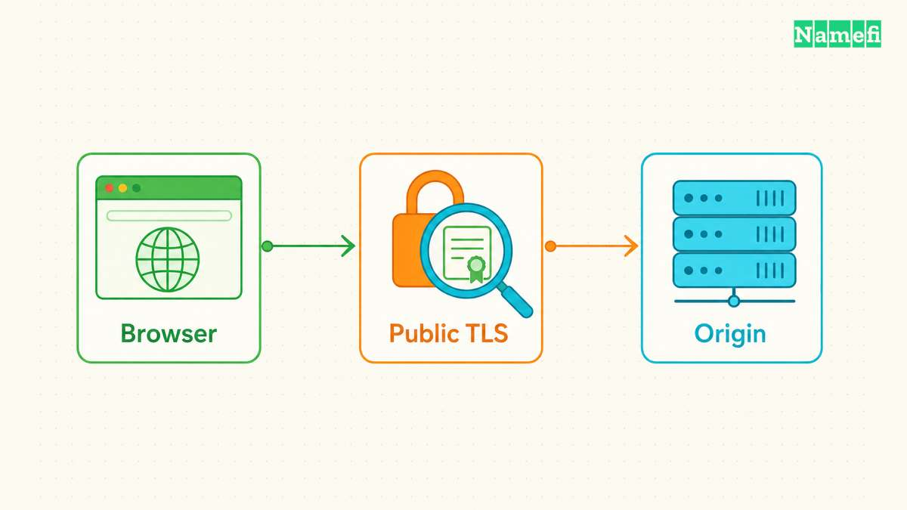
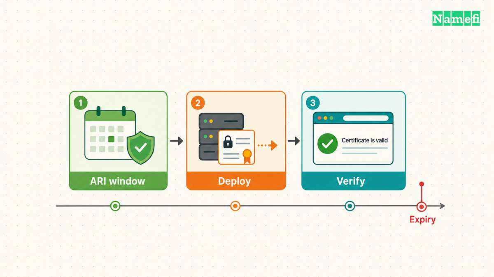
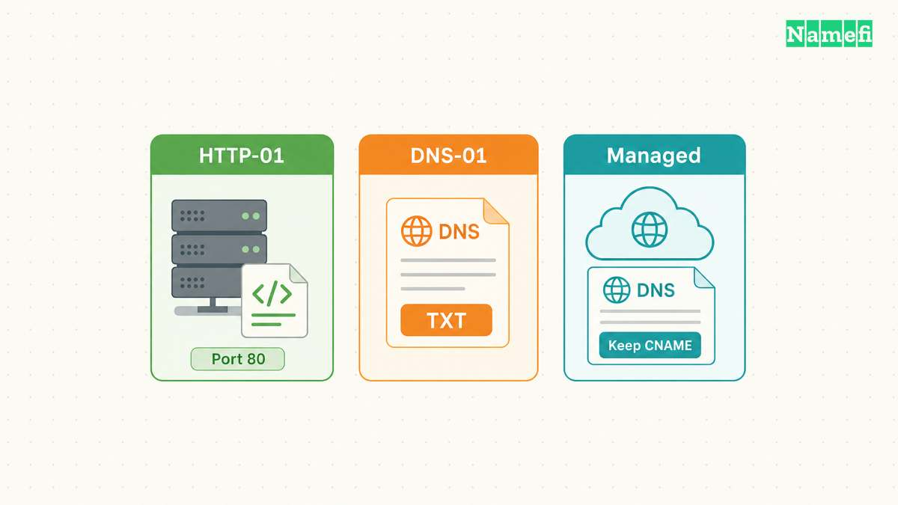
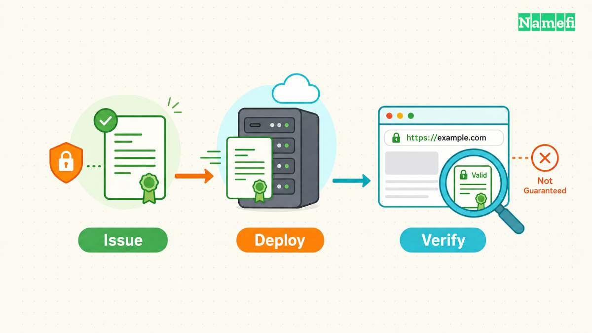
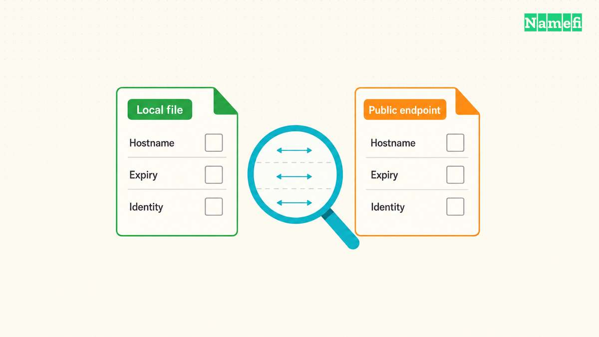

**SSL証明書を更新するには、証明書の管理元を特定し、ドメイン検証を確認し、代替証明書を取得して配備を検証します。** 証明書の取得が成功しても、訪問者が新しい証明書を受信しているとは限りません。

「SSL証明書 更新」という呼び方は今も使いますが、現在の[HTTPS](/ja/blog/what-is-https/)はTLSを使います。更新では代替証明書を取得します。更新によって既存証明書の署名済みの有効期間が延びるわけではありません。本記事は、運用中のウェブサイトの更新作業を扱います。ホスティング事業者、クラウドサービス、ローカルのACMEクライアントのどれが証明書を管理するかによって、手順は変わります。

仮のサイト`shop.example.com`を考えます。管理画面には新しい証明書が表示されていますが、利用者のブラウザーは期限切れの警告を出しています。管理者は再発行を注文する前に、公開接続が返す証明書を確認する必要があります。

## 更新計画は訪問者に返す証明書の確認から始めます



まず、公開ホスト名の証明書を読み取り専用で調べます。ブラウザーの証明書表示を開き、発行者、有効期間、対象の名前を記録してください。重要なホスト名ごとに確認します。ルートドメインと`www`の両方を公開している場合は、両方を確認します。

次のコマンドは、仮のホスト名へ接続して証明書を表示します。`shop.example.com`を管理対象のホスト名に置き換えてください。

```bash
openssl s_client -connect shop.example.com:443 -servername shop.example.com -showcerts </dev/null
```

OpenSSLの`-connect`は接続先、`-servername`はTLSのServer Name Indicationの値を指定します。名前を明示すると、意図した仮想ホストを選択できます。`-showcerts`はサーバーが送る証明書を表示します。[OpenSSL、s_clientのオプション](https://docs.openssl.org/3.5/man1/openssl-s_client/#options)

証明書の表示と信頼性の検証は別の作業です。証明書を表示できても、ブラウザーが証明書を信頼するとは限りません。エラー出力を隠さず、接続エラーや検証エラーを調べてから、不完全な出力を解釈してください。

次に、公開TLS接続の終端を特定します。終端はコンテンツ配信ネットワーク、ロードバランサー、ウェブサーバーの場合があります。オリジンサーバーの証明書と、公開接続先の証明書は異なることがあります。

変更の前に、次の管理表を作成してください。

| 場所 | 記録する内容 | 次に確認する内容 |
| --- | --- | --- |
| 公開接続先 | 対象名と有効期限 | 訪問者向けの証明書 |
| 証明書の管理元 | 発行者と更新状態 | 更新の担当 |
| 配備先 | リスナーまたは証明書のパス | 現在使う設定 |
| 検証サービス | 検証方法とアカウント | アクセスの継続性 |

各場所の担当者も記録します。証明書の作業をサービスが自動化していても、別のチームがドメイン検証を管理する場合があります。[ドメインとホスティングの違い](/ja/blog/domain-vs-hosting/)では、ドメインのアカウントとホスティングのアカウントが分かれる理由を説明しています。

### 更新時期は実際の証明書の有効期間に合わせます



古い予定を流用せず、実際の有効期間を確認してください。2026年10月21日時点では、2026年3月15日以降に発行する公開TLS証明書の有効期間の上限は200日です。認証局は、上限より短い有効期間の証明書を発行できます。

| 公開証明書の発行日 | 有効期間の上限 |
| --- | --- |
| 2026年3月15日～2027年3月14日 | 200日 |
| 2027年3月15日～2029年3月14日 | 100日 |
| 2029年3月15日以降 | 47日 |

上限の対象は、公的に信頼されるTLSサーバー証明書です。企業内のプライベート認証局の更新予定を定める上限ではありません。[CA/Browser Forum、Baseline Requirements 2.3.1、第1.1節および第6.3.2節](https://cabforum.org/working-groups/server/baseline-requirements/requirements/#632-certificate-operational-periods-and-key-pair-usage-periods)

Let's Encryptの現在の既定の有効期間は90日です。10月7日の発表では、2027年2月10日に既定の有効期間を64日に変更する予定です。45日と6日の選択肢もあります。有効期間の数字はLet's Encryptのプロファイルについての数字であり、すべての認証局に共通する数字ではありません。[Let's Encrypt、64日への変更の発表](https://letsencrypt.org/2026/10/07/64-day-certs)

任意で選ぶ`tlsserver`プロファイルは、すでに45日の証明書を発行しています。Let's Encryptは、2028年2月16日に既定の有効期間を45日に変更する予定です。警告を設定する前に、使用中のプロファイルを確認してください。[Let's Encrypt、変更日程](https://letsencrypt.org/2025/12/02/from-90-to-45#timeline-of-changes)

クライアントがACME Renewal Information（ARI）に対応する場合は、認証局が示す更新期間を優先します。ARIを使わない場合、Let's Encryptは有効期間のおよそ3分の2が過ぎた時点での更新を推奨しています。60日ごとの固定間隔では、45日の証明書を更新できません。[Let's Encrypt、自動化の案内](https://letsencrypt.org/2025/12/02/from-90-to-45#action-required)

障害調査、ドメイン検証、配備の時間を確保できる警告を設定してください。有効期限はUTCで記録します。証明書に残り時間があっても、更新が失敗した時点で調べます。年払いの決済やドメインの更新は、公開中の証明書を更新する操作ではありません。

## 更新には使用中のドメイン検証経路を維持する必要があります



ACMEは、証明書の申請者と認証局のやり取りを自動化します。証明書の発行や、ドメインの管理権限を確かめるチャレンジを扱うプロトコルです。認証局が検証を要求する場合、クライアントは正常に動く検証経路を必要とします。[RFC 8555、第7節および第8節](https://www.rfc-editor.org/rfc/rfc8555.html#section-8)

HTTP-01では、認証局が所定のHTTPパスからチャレンジの内容を取得します。DNS-01では、認証局が`_acme-challenge`のTXTレコードを確認します。検証対象の設備が異なるため、設定を変える前に、使用中の方法を特定してください。

| 方法 | 必要なアクセス | よくある障害 |
| --- | --- | --- |
| HTTP-01 | HTTPのチャレンジ用パス | ルーティングやアクセス制限 |
| DNS-01 | チャレンジ用TXTレコード | ゾーンや認証情報の誤り |
| 事業者管理の検証 | 事業者が指定するレコード | 検証レコードの削除 |

Let's EncryptのHTTP-01はポート80を必要とし、ワイルドカード証明書の発行には対応しません。DNS-01はワイルドカード証明書に対応します。HTTPの公開先が複数ある場合、すべての公開先でチャレンジへの応答を提供する必要があります。[Let's Encrypt、チャレンジの種類](https://letsencrypt.org/docs/challenge-types/#http-01-challenge)

HTTP検証が失敗した場合は、チャレンジのホスト名と現在のルーティングを照合します。最近のリダイレクト、アクセス制御、プロキシのルール、アプリケーションの配備を調べてください。チャレンジ用パスを横取りするルールを特定してから、ルールを修正します。

サイト全体の認証を無効にしないでください。例外が必要な場合は、文書に定められた検証パスに限定し、アクセス範囲を確認します。ホスティングのネットワーク外から、意図した経路を試験してください。

DNS検証が失敗した場合は、権威[ネームサーバー（NSレコード）](/ja/glossary/nameserver/)のサービスを特定します。[レジストラ](/ja/glossary/registrar/)のアカウントが委任を管理し、別のサービスがDNSゾーンをホストする場合があります。更新クライアントが、同名の放置されたゾーンではなく、現在使うゾーンを更新しているか確認してください。

認証局が検証を完了するには、[DNS](/ja/glossary/dns/)事業者がチャレンジの応答を公開する必要があります。一律の待ち時間を想定せず、事業者の文書と権威サーバーの応答を確認してください。チャレンジのレコードを直す際は、無関係なレコードを維持します。

Let's Encryptは、権限を絞ったDNS認証情報、または独立した検証サーバーの使用を推奨しています。CNAMEレコードやNSレコードで、チャレンジ用サブドメインの応答先を委任する方法も説明しています。[Let's Encrypt、DNS-01チャレンジ](https://letsencrypt.org/docs/challenge-types/#dns-01-challenge)

一時的なチャレンジの値と、管理サービスが継続して必要とするレコードを区別してください。AWS Certificate Managerの文書にあるDNS更新経路では、検証用CNAMEレコードを公開DNSから参照できる状態に維持する必要があります。同じ更新経路は、AWSサービスによる証明書の使用も確認します。[AWS、DNSで検証したドメインの更新](https://docs.aws.amazon.com/acm/latest/userguide/dns-renewal-validation.html)

DNS移行後に更新が失敗した場合は、新旧のゾーンを比較します。証明書の管理元の最新の指示に従い、必要な検証レコードを戻してください。検証レコード1件を直すために、ゾーン全体を置き換えないでください。

## 証明書の管理元は更新と配備を連動させる必要があります



既存の証明書の管理元に合わせて、更新手順を選びます。期限切れの対応中は、復旧計画が移行を必要とする場合を除き、第2のクライアントを導入しないでください。設定が競合すると、責任の所在を特定しにくくなります。

管理サービスでは、まず更新の対象条件と更新状態を確認します。AWSは、Amazonが発行した証明書と、インポートした証明書を区別します。ACMは、インポートした証明書や、すでに期限切れの証明書をマネージド更新の対象にしません。ACME証明書はACMEクライアントが更新します。[AWS、マネージド証明書更新](https://docs.aws.amazon.com/acm/latest/userguide/managed-renewal.html)

実際の証明書の種類に合う、事業者の手順を使ってください。管理画面の「管理対象」などの表示だけでは、外部の配備先まで説明できません。サービスが代替証明書を取得するだけでなく、必要な接続先に配備するかも確認します。

既存のCertbotでは、`certbot certificates`で証明書の一覧を確認します。更新対象を選ぶ前に、保存された証明書名を確認してください。証明書名はホスト名と異なる場合があります。

対象を限定した試験は、次の形式です。

```bash
certbot renew --cert-name example.com --dry-run
```

保存された実際の証明書名と、インストール環境が必要とする権限を使います。Certbotは、更新の試行と証明書の選択方法を説明しています。ドライランは能動的な試験です。実行前にACMEサーバーの設定とフックを調べてください。ドライランは、証明書を読み取るだけの調査ではありません。[Certbot、証明書の更新](https://eff-certbot.readthedocs.io/en/stable/using.html#renewing-certificates)

通常のドライランは配備用フックを実行しません。Certbotの`--run-deploy-hooks`は、ドライラン成功後に現在の有効な証明書でフックを試験します。各フックの影響を確認した後にだけ、追加のオプションを使ってください。ドライランだけでは、本番の配備成功を証明できません。[Certbot、配備用フックの試験](https://eff-certbot.readthedocs.io/en/stable/using.html#certbot-command-line-options)

試験が成功したら、インストール環境の通常の更新手順を使います。定期実行の設定と、最近の実行結果を確認してください。自動更新の実行方法は、Certbotのインストール方法によって変わります。[Certbot、自動更新](https://eff-certbot.readthedocs.io/en/stable/using.html#automated-renewals)

更新コマンドの成功を、新しい証明書がある証拠と考えないでください。Certbotは更新が必要ない場合にも成功を返します。Certbotには、更新が成功した後に処理を実行する配備用フックがあります。[Certbot、終了状態とフック](https://eff-certbot.readthedocs.io/en/stable/using.html#renewing-certificates)

運用手順書では、発行と配備を区別します。証明書ファイル、対応する[秘密鍵](/ja/glossary/private-key/)、証明書と秘密鍵を使うサーバー設定を特定してください。証明書は[公開鍵](/ja/glossary/public-key/)を含みますが、秘密鍵は別途保護する必要があります。

配備先ごとに、対応する更新操作と設定の検査方法を記録します。必要な場合は、ウェブサーバーの文書に従って設定を再読み込みします。サービスの担当者が試験済みの配備手順を、一律の再起動コマンドに置き換えないでください。

認証局がACME Renewal Informationに対応する場合は、ARIに対応し、保守が続くクライアントを優先します。ARIは推奨する更新期間を提示し、クライアントが更新時刻を選びます。仕様は問い合わせ間隔やエラー処理も定めています。[RFC 9773、第4.2節～第4.3節](https://www.rfc-editor.org/rfc/rfc9773.html#section-4.2)

ARIは更新時期を調整します。ARIは、ロードバランサーが代替証明書を読み込んだ証拠にはなりません。更新予定を自動管理していても、配備の確認を継続してください。

## 最終確認では公開接続が代替証明書を返す必要があります



配備後は、同じホスト名と接続条件で公開証明書を再確認します。新しい有効期間と証明書の識別情報を、管理元の代替証明書と比較してください。有効期限が延びたかだけでなく、対象名も確認します。

ローカルの証明書ファイルは、次の読み取り専用コマンドで調べられます。

```bash
openssl x509 -in certificate.pem -noout -dates -issuer -serial -ext subjectAltName
```

`certificate.pem`を公開証明書のファイルに置き換えてください。OpenSSLは、有効期間、発行者、シリアル番号、拡張を表示するオプションを説明しています。コマンドに秘密鍵は必要ありません。[OpenSSL、証明書の表示オプション](https://docs.openssl.org/3.5/man1/openssl-x509/#certificate-printing-options)

ローカルファイルの結果と、公開接続の結果を区別します。ディスクに新しいファイルがあるだけでは、ファイルの存在しか証明できません。公開接続は、特定の接続先が現在送る証明書の証拠になります。

複数リージョンを使う仮の構成では、独立して管理する接続先をそれぞれ確認します。1リージョンだけが古い証明書を送る場合は、リスナーの関連付けと配備結果を調べてください。再発行を要求しても、誤ったリスナーの関連付けは直りません。

仮の`shop.example.com`の障害では、追加の変更前に期待する状態を書きます。管理画面には意図した証明書が表示され、公開リスナーは意図した証明書を参照する必要があります。ブラウザーは、`shop.example.com`用の意図した証明書を受信する必要があります。

管理画面には代替証明書があり、リスナーは手動でインポートした証明書を参照しているとします。サービスの担当者とリスナー設定を調べてください。関連付けを変更する前に現在の設定を保存し、承認された配備操作の後に公開接続の結果を検証します。

リスナーが代替証明書を参照しているのに、確認結果の1つが古い証明書を示すとします。確認に使った接続先を記録してください。ルーティングの管理表と比較し、見落としたプロキシやリージョンの接続先を調べます。各変更に目的と観測できる結果を持たせるための手順です。

より厳密な接続確認では、OpenSSL 3.5でホスト名を検証し、証明書の検証エラーが起きたときに接続を失敗させられます。

```bash
openssl s_client -connect shop.example.com:443 -servername shop.example.com -verify_hostname shop.example.com -verify_return_error </dev/null
```

確認用端末に適したトラストストアを使ってください。OpenSSLの結果は、ブラウザーの信頼ポリシーと異なる場合があります。先に示した`-showcerts`コマンドは、サーバーが送る証明書チェーンを表示するだけです。[OpenSSL、検証オプションと注意事項](https://docs.openssl.org/3.5/man1/openssl-s_client/#options)

ブラウザーでもサイトを試験してください。通常の画面移動と、重要なアプリケーションのリクエストで証明書の警告が出ないことを確認します。管理表に従い、ルートドメイン、`www`、アプリケーションのホスト名を確認してください。

結果が一致しない場合は、証拠を保存します。ホスト名、確認時刻、接続先、証明書の識別情報、エラーを記録してください。記録は、配備の未完了と、違う接続先を調べた場合を切り分ける助けになります。

観測した症状に応じて、復旧方法を選びます。

| 症状 | 最初に調べる内容 | 完了を示す証拠 |
| --- | --- | --- |
| チャレンジが失敗する | HTTP経路、DNSゾーン、認証情報、事業者の検証レコード | 認証局がドメイン検証を受け入れる |
| 更新コマンドが成功するが代替証明書がない | 更新時期に達したか、発行が行われたか | 新しい証明書の識別情報と有効期間 |
| 管理元に代替証明書があるが公開側の期限が変わらない | リスナーの関連付け、ファイルパス、再読み込み、リージョンごとの接続先 | 意図した公開接続先が代替証明書を送る |
| 有効期間内なのにブラウザーが名前のエラーを出す | 要求したホスト名に対するSubject Alternative Name（SAN）の対象範囲 | 証明書が要求した正確なホスト名を対象にする |
| ブラウザーが発行者やチェーンを拒否する | 必要な中間証明書とクライアントのトラストストア | ブラウザーが意図したチェーンを受け入れる |

期限切れは、証明書エラーの1種類です。OpenSSLは、ホスト名の検証、信頼チェーンの検証、日時の検査を区別します。有効期限が延びても、すべての検証失敗を直せるわけではありません。[OpenSSL、証明書の検証オプション](https://docs.openssl.org/3.5/man1/openssl-verification-options/)

自己署名証明書には、別途、信頼の管理計画が必要です。OpenSSLで代替証明書を作成しても、ブラウザーが通常のウェブサイト証明書を自動的に信頼するわけではありません。プライベートなシステムでは、既存の手順に従って信頼を配布します。公開ウェブサイトでは、既存の管理元を通じて、公的に信頼される証明書を復旧してください。[OpenSSL、トラストアンカー](https://docs.openssl.org/3.5/man1/openssl-verification-options/#trust-anchors)

期限切れの証明書は、担当者を決めて障害として扱います。対応する復旧手順でドメイン検証を回復し、有効な代替証明書を配備してください。訪問者に警告の回避を求める運用を続けないでください。

最後に、更新ジョブとは別に公開証明書の有効期限を監視します。検証と配備のシステムにアクセスできる担当者へ警告を送ってください。ホスティング移行、DNS移行、認証情報のローテーション、クライアントの変更後には、更新を再確認します。

作業の完了条件は、意図した接続先が有効な代替証明書を返し、次回の更新に担当者と運用手順があることです。

## 参考資料は更新と検証の根拠を示します

- CA/Browser Forum、[TLS Baseline Requirements 2.3.1](https://cabforum.org/working-groups/server/baseline-requirements/requirements/#632-certificate-operational-periods-and-key-pair-usage-periods)。第1.1節と第6.3.2節に、公開証明書の対象範囲と有効期間の変更日程を記載。2026年10月21日取得。
- Let's Encrypt、[64-Day Certificate Lifetimes Coming Feb 2027](https://letsencrypt.org/2026/10/07/64-day-certs)。冒頭の発表とARIの案内。2026年10月21日取得。
- Let's Encrypt、[Decreasing Certificate Lifetimes to 45 Days](https://letsencrypt.org/2025/12/02/from-90-to-45#timeline-of-changes)。「Timeline of Changes」。2026年10月21日取得。
- IETF、[RFC 8555](https://www.rfc-editor.org/rfc/rfc8555.html#section-8)。第8節の識別子検証チャレンジ。2026年10月21日取得。
- Let's Encrypt、[Challenge Types](https://letsencrypt.org/docs/challenge-types/)。「HTTP-01 challenge」と「DNS-01 challenge」。2026年10月21日取得。
- AWS、[Managed certificate renewal](https://docs.aws.amazon.com/acm/latest/userguide/managed-renewal.html)。更新の対象条件とACMEの例外。2026年10月21日取得。
- AWS、[Renewal for domains validated by DNS](https://docs.aws.amazon.com/acm/latest/userguide/dns-renewal-validation.html)。更新の条件。2026年10月21日取得。
- EFF、[Certbot User Guide](https://eff-certbot.readthedocs.io/en/stable/using.html#renewing-certificates)。「Renewing certificates」と「Automated Renewals」。2026年10月21日取得。
- IETF、[RFC 9773](https://www.rfc-editor.org/rfc/rfc9773.html#section-4.2)。第4.2節～第4.3節の推奨期間と問い合わせ間隔。2026年10月21日取得。
- OpenSSL、[s_client](https://docs.openssl.org/3.5/man1/openssl-s_client/#options)。接続先、SNI、証明書の表示オプション。2026年10月21日取得。
- OpenSSL、[x509](https://docs.openssl.org/3.5/man1/openssl-x509/#certificate-printing-options)。証明書の表示オプション。2026年10月21日取得。
- OpenSSL、[Certificate verification options](https://docs.openssl.org/3.5/man1/openssl-verification-options/)。証明書の拡張、トラストアンカー、ホスト名と日時の検査。2026年10月21日取得。
