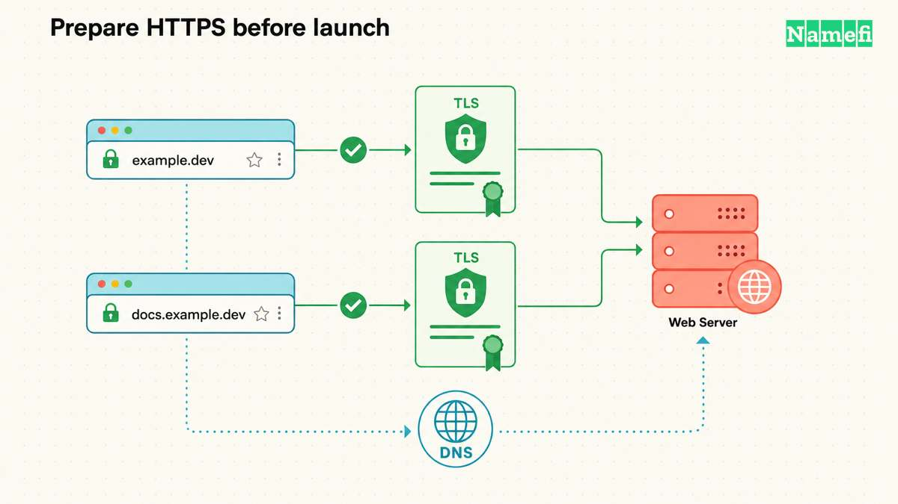

Die **.dev-Domain** ist eine [generische Top-Level-Domain](/de/glossary/gtld/) für Entwickler, Softwareprojekte und technische Teams. Google Registry betreibt .dev über Charleston Road Registry Inc. Die [FAQ des Betreibers](https://www.registry.google/faqs/) erläutert die Unternehmensstruktur.

Die wichtigste technische Voraussetzung betrifft den Browser. Der gesamte Namensraum .dev steht auf der HSTS-Preload-Liste. Browser, die den Eintrag berücksichtigen, benötigen HTTPS, um eine .dev-Website anzuzeigen. Eine Domainregistrierung richtet weder das Hosting ein noch stellt sie ein Zertifikat aus. [Google Registry beschreibt die HTTPS-Pflicht](https://www.registry.google/domains/dev/).

## .dev gibt Entwicklerprojekten eine passende Adresse

| Merkmal | Einzelheit |
| --- | --- |
| Typ | Generische Top-Level-Domain |
| Betreiber | Charleston Road Registry Inc., auch Google Registry genannt |
| Delegierung | 18. Dezember 2014 |
| Allgemeine Verfügbarkeit | 28. Februar 2019 |
| Registrierung | Öffentlich zugänglich, unter Beachtung der Registry- und Registrarregeln |
| Browser-Voraussetzung | Funktionierendes HTTPS für die Website-Hostnamen |
| Typische Nutzung | Portfolios, Dokumentation, Werkzeuge und technische Blogs |

[IANA dokumentiert Betreiber und Delegierungsdatum](https://www.iana.org/domains/root/db/dev.html). Google Registry [öffnete die allgemeine Registrierung am 28. Februar 2019](https://www.registry.google/announcements/launch-details-for-dev/). IANA belegt keine Registrierungsberechtigung. Das [Richtlinienverzeichnis von Google Registry](https://www.registry.google/policies/) führt .dev unter den offenen Endungen auf.

Ein Portfolio wie `yourname.dev` spricht eine Entwicklerzielgruppe an. Eine Dokumentationsseite wie `docs.example.dev` passt ebenfalls zur Endung. Google Registry nennt [web.dev, stripe.dev und flutter.dev](https://www.registry.google/domains/dev/) als Beispiele.

Wählen Sie .dev, wenn Ihre Leser die Endung verstehen. Eine Verbrauchermarke benötigt möglicherweise einen Namen, der weniger Erklärung verlangt. Vergleichen Sie [.app](/de/tld/app/) für Anwendungen und [.io](/de/tld/io/) als weitere technologiebezogene Möglichkeit.

## Jeder kann einen verfügbaren .dev-Namen nach den Registry-Regeln beantragen

Google Registry bezeichnet die Endungen im [Richtlinienverzeichnis](https://www.registry.google/policies/) als offen und unbeschränkt. Die [.dev-Registrierungsrichtlinie](https://www.registry.google/policies/registration/dev/) verlangt weder einen Entwicklernachweis noch eine lokale Niederlassung.

Auch eine offene Registrierung hat Bedingungen. Die Richtlinie verlangt vor dem Kauf einen deutlichen HTTPS-Hinweis. Namen aus zwei ASCII-Buchstaben dürfen keine falsche Verbindung zu einer Regierung oder einem Länderdomainverwalter nahelegen. Registrierungen geschützter Namen des IOC, des Roten Kreuzes und zwischenstaatlicher Organisationen müssen im Namen der betreffenden Organisation erfolgen. Verfügbarkeit und Missbrauchsrichtlinien gelten ebenfalls.

Eine Domainregistrierung verleiht keine Markenrechte. Prüfen Sie den gewünschten Namen vor der Zahlung. Lesen Sie vor dem Kauf die Bedingungen des Registrars zu Laufzeit, Verlängerung, Transfer und Kündigung.

## HSTS verlangt HTTPS in unterstützenden Browsern auch für Subdomains

HSTS steuert die Transportverbindung im Browser. Ein Browser mit dem passenden Preload-Eintrag stellt `http://example.dev` auf HTTPS um, bevor er eine HTTP-Anfrage sendet. Schlägt HTTPS fehl, kann der Browser nicht auf eine gewöhnliche HTTP-Seite zurückfallen. Die [HSTS-Preload-Dokumentation](https://hstspreload.org/) erklärt das Verhalten.

Die Pflicht umfasst Hostnamen unterhalb der registrierten Domain. Richten Sie HTTPS für `www.example.dev`, `docs.example.dev` und interne Web-Hostnamen ein, die Nutzer im Browser öffnen. Jeder Hostname benötigt ein passendes Zertifikat, dem der Client vertraut. Die [Preload-Dokumentation schließt interne Subdomains ausdrücklich ein](https://hstspreload.org/).

HSTS stellt keine Zertifikate aus, konfiguriert kein DNS und sichert keinen Anwendungscode ab. HSTS authentifiziert auch keine E-Mail-Absender. HTTPS ist eine Transportvoraussetzung und kein Vertrauensbeweis für eine Website. Mozilla erklärt die [Browser-Richtlinie und das Verhalten bei Zertifikatsfehlern](https://developer.mozilla.org/en-US/docs/Web/HTTP/Reference/Headers/Strict-Transport-Security).

Andere Programme können eigene Transportregeln anwenden. Prüfen Sie API-Clients und Automatisierungen gesondert. Die Browser-Preload-Liste bestimmt nicht automatisch das Verhalten jedes Protokolls.

## Ein .dev-Start benötigt DNS, Zertifikate und Browserprüfungen

1. Verbinden Sie die Domain mit einem Hostingdienst, der HTTPS für eigene Domains unterstützt.
2. Tragen Sie die vom Hostingdienst verlangten [DNS-Einträge](/de/glossary/dns/) ein.
3. Schließen Sie Domainvalidierung und Zertifikatsausstellung vor der Ankündigung ab.
4. Prüfen Sie HTTPS für die Hauptdomain und jede Web-Subdomain.
5. Testen Sie Weiterleitungen in einem Browser, der die Preload-Liste durchsetzt.
6. Aktivieren Sie die Zertifikatsverlängerung und überwachen Sie Fehler.

Auch eine reine Weiterleitungsdomain benötigt HTTPS am Weiterleitungsserver. Der Browser baut zuerst die HTTPS-Verbindung auf. Erst danach kann der Server eine Weiterleitung zurückgeben. Ein reiner HTTP-Weiterleitungsdienst reicht für .dev daher nicht aus.

Planen Sie für private Entwicklungs-Hostnamen vertrauenswürdige lokale Zertifikate ein, bevor Sie eine .dev-Adresse wählen. Ein Eintrag in der Hosts-Datei ändert die Namensauflösung. Der Eintrag entfernt die geerbte HSTS-Regel des Browsers nicht.

## Der Verlängerungspreis zählt mehr als ein Einführungsangebot

Die [.dev-Preisrichtlinie von Google Registry](https://www.registry.google/policies/pricing/dev/) unterscheidet Standardregistrierung, Premiumregistrierung, Verlängerung, Transfer und Wiederherstellung. Registry-Gebühren und Endkundenpreise eines Registrars sind unterschiedliche Beträge.

Prüfen Sie den konkreten Namen im Bestellvorgang. Vergleichen Sie erste Laufzeit, Verlängerungspreis, enthaltene Leistungen, Steuern und eine mögliche Premiumeinstufung. Ein Aktionspreis gilt nicht automatisch für die Verlängerung. Diese Seite nennt keinen aktuellen Live-Preis.

## Google gibt .dev keinen automatischen Rankingvorteil

Google behandelt [neue generische Endungen grundsätzlich wie andere generische Endungen](https://developers.google.com/search/blog/2015/07/googles-handling-of-new-top-level). Ein Schlüsselwort in der Endung schafft keinen grundsätzlichen Rankingvorteil oder Rankingnachteil.

Wählen Sie .dev für eine erkennbare Entwicklerausrichtung und einen passenden verfügbaren Namen. Planen Sie hilfreiche Inhalte und einen zuverlässigen Betrieb gesondert. Googles Eigentum an der Registry verspricht keine bevorzugte Behandlung in der Suche.

## Namefi ermöglicht die Suche nach einem .dev-Namen

Suchen Sie den gewünschten Namen bei [Namefi](https://namefi.io). Prüfen Sie Verfügbarkeit, Registrierungsbedingungen und Verlängerungspreis vor dem Kauf. Verbinden Sie danach die Domain mit Ihrem Hostingdienst. Schließen Sie die HTTPS-Einrichtung ab, bevor Sie die Adresse teilen.

## Leser stellen häufig diese Fragen zu .dev

### Kann jeder eine .dev-Domain registrieren?

Ja. Google Registry führt .dev unter den offenen Endungen. Registry-Richtlinien, reservierte Namen, Verfügbarkeit und Registrarbedingungen gelten weiterhin.

### Beeinflusst eine .dev-Domain die Suchmaschinenoptimierung?

Google gibt neuen generischen Endungen keinen grundsätzlichen Rankingvorteil oder Rankingnachteil. Wählen Sie .dev nach Zielgruppe und Namen statt nach einem erwarteten Rankingbonus.

### Warum benötigen .dev-Websites HTTPS?

Der Namensraum .dev steht auf der HSTS-Preload-Liste. Browser, die die Liste durchsetzen, stellen HTTP-Anfragen auf HTTPS um. Jeder Website-Hostname benötigt funktionierendes HTTPS und ein vertrauenswürdiges Zertifikat.

### Für wen eignet sich eine .dev-Domain?

Entwicklerportfolios, Dokumentation, Softwarewerkzeuge und Open-Source-Projekte können .dev nutzen. Wählen Sie einen anderen Namen, wenn Ihre Zielgruppe die Endung nicht versteht.

## Diese Quellen erläutern Registry-Regeln und Browserverhalten

Quellen geprüft am 21. Oktober 2026 (America/Los_Angeles):

- [Google Registry: .dev und Beispiele](https://www.registry.google/domains/dev/).
- [Google Registry: offene Endungen](https://www.registry.google/policies/).
- [Google Registry: Registrierungsrichtlinie](https://www.registry.google/policies/registration/dev/).
- [Google Registry: Preisrichtlinie](https://www.registry.google/policies/pricing/dev/).
- [IANA: Betreiber und Delegierung](https://www.iana.org/domains/root/db/dev.html).
- [HSTS-Preload-Dokumentation](https://hstspreload.org/).
- [Mozilla: Strict-Transport-Security](https://developer.mozilla.org/en-US/docs/Web/HTTP/Reference/Headers/Strict-Transport-Security).
- [Google Search Central: neue Endungen](https://developers.google.com/search/blog/2015/07/googles-handling-of-new-top-level).
