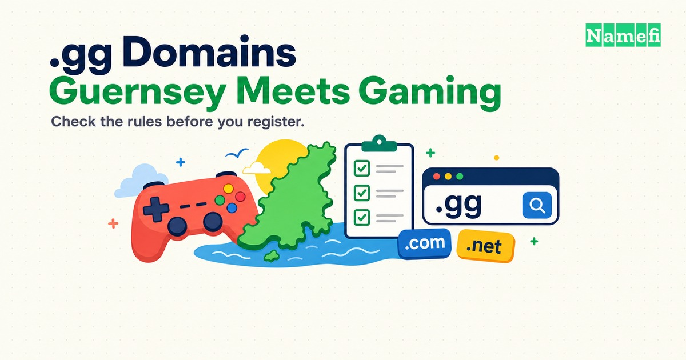

Die **.gg-Domain** ist die [ccTLD (Country-Code Top-Level-Domain)](/de/glossary/cctld/) für Guernsey. Spielgemeinschaften kennen „gg“ außerdem als „good game“, also „gutes Spiel“. Die Bedeutung passt zu E-Sport-Teams, Spielwerkzeugen und Community-Websites.

Der Gaming-Bezug hebt den Registrierungsvertrag nicht auf. Prüfen Sie vor der Registrierung einer .gg-Domain die Voraussetzungen, laufenden Gebühren, Identitätsanforderungen und Streitregeln. Dieser Leitfaden verbindet die Kaufentscheidung mit den Vorteilen für die Marke.

## .gg verbindet eine Länderendung mit Gaming

| Merkmal | Einzelheit |
| --- | --- |
| Domainart | Länderendung für Guernsey |
| Delegierter Verwalter | Island Networks Ltd. laut IANA |
| Vertragliche Registry | CI Domain Registry Ltd. laut Registrierungsvertrag |
| Registrierungsstruktur | Direkte Namen wie yourbrand.gg |
| DNSSEC | IANA führt eine sichere Delegierung und einen DS-Eintrag in der Root-Zone auf |
| Registrierungsvoraussetzungen | Grundsätzlich weltweit offen, mit Regeln zu Identität, reservierten Namen, Sanktionen und Nutzung |
| Mindestlaufzeit | Laut Registry-Vertrag ein Jahr für Registrierung oder Verlängerung |
| Geeignete Projekte | Spielgemeinschaften, E-Sport, Spielwerkzeuge und Organisationen auf Guernsey |

Der [IANA-Eintrag](https://www.iana.org/domains/root/db/gg.html) belegt die Delegierung und den Verwalter. Der [Registry-Vertrag](https://channelisles.net/legal/terms-and-conditions-1) legt die Registrierungsbedingungen fest. Die Quellen beantworten unterschiedliche Fragen.

## .gg behält den Bezug zu Guernsey

Die Registry erklärt, dass GG und JE zunächst reservierte Codes waren. ISO übernahm die Codes 2006 vollständig in den Standard. Die [Organisationsseite des Betreibers](https://www.channelisles.net/about-us/more) beschreibt die Codegeschichte und die Büros auf Alderney.

Die Endung gehört wie [.io](/de/tld/io/) und [.tv](/de/tld/tv/) zu den Ländercodes, die auch internationale Zielgruppen ansprechen. Google behandelt jedoch nicht jede solche Endung gleich.

Googles [Hinweise zu internationalen Websites](https://developers.google.com/search/docs/specialty/international/managing-multi-regional-sites) nennen .io und .tv als generisch behandelte Länderendungen. Die veröffentlichte Liste enthält .gg nicht. Die fehlende Nennung spricht dafür, geografische Signale zu berücksichtigen. Die fehlende Nennung beweist weder eine Beschränkung auf Guernsey noch eine bestimmte Veränderung der Platzierung.

Planen Sie für internationale Websites die Inhaltssprache, Zielgruppe und Adressen der Sprachversionen vor der Domainwahl. Eine vertraute Gaming-Adresse ersetzt keine hilfreichen Inhalte.

## Gaming-Websites zeigen praktische Anwendungen der Endung

Konkrete Beispiele zeigen, welche Aufgaben Besucher auf einer .gg-Website erledigen:

- **[OP.GG](https://op.gg/)** bietet Spielstatistiken, Ranglisten und die Suche nach Spielern.
- **[start.gg](https://www.start.gg/)** bietet Turniererstellung, Veranstaltungssuche und Ranglisten.
- **Discord** dokumentiert die Einladung `discord.gg/wumpus` in seiner [Anleitung zum Serverbeitritt](https://support.discord.com/hc/en-us/articles/360034842871-How-do-I-join-a-Server).

Das Discord-Beispiel belegt die Verwendung für Einladungen. Ein Einladungspfad unter `discord.gg` registriert keine Domain für den Serverbetreiber. Mit `yourbrand.gg` erhält der Registrant eine eigene Adresse, die der Registrant über einen Registrar verwaltet.

Die Beispiele zeigen mehrere mögliche Anwendungen: Turnierveranstalter können Zeitpläne veröffentlichen, Teams können ihre offizielle Website betreiben und Entwickler können Spielerstatistiken anbieten. Unternehmen auf Guernsey können die Länderendung auch ohne Gaming-Thema nutzen.

Erklären Sie die Marke deutlich, wenn die Zielgruppe Gaming-Begriffe nicht kennt. Besucher sollten das Angebot unabhängig von der Endung anhand des Seitentitels und Inhalts verstehen.

## Käufer können .gg mit ähnlichen Alternativen vergleichen

| Frage | .gg | [.io](/de/tld/io/) | [.tv](/de/tld/tv/) | [.com](/de/tld/com/) |
| --- | --- | --- | --- | --- |
| Typischer Markenbezug | Gaming und Guernsey | Technik und Entwicklerwerkzeuge | Video und Streaming | Allgemeine geschäftliche Nutzung |
| IANA-Kategorie | ccTLD | ccTLD | ccTLD | gTLD |
| Google nennt die Endung ausdrücklich als generisch | Nein | Ja | Ja | Generische TLD |
| Hilfreiche Entscheidungsfrage | Erkennt die Zielgruppe gg? | Richtet sich das Produkt an Entwickler? | Steht Video im Mittelpunkt? | Braucht die Marke eine breite Identität? |

Wählen Sie .gg, wenn die Gaming-Bedeutung Besuchern beim Verständnis des Angebots hilft. Vergleichen Sie .tv für einen Videokanal und .io für ein Entwicklerprodukt. Prüfen Sie die tatsächliche Verfügbarkeit, statt mehr kurze Namen bei einer bestimmten Endung vorauszusetzen.

## Weltweite Registrierung umfasst weiterhin Vertragsbedingungen

Die Registry erlaubt grundsätzlich eine weltweite Registrierung ohne lokale Präsenz. Die [Vertragsabschnitte 17.6–17.9](https://channelisles.net/legal/terms-and-conditions-1) enthalten jedoch Identitätsanforderungen und sanktionsbezogene Einschränkungen. Reservierte Namen und verbotene Nutzungen bleiben ebenfalls relevant.

Der Vertrag setzt für Registrierung und Verlängerung eine Mindestlaufzeit von einem Jahr fest. Registranten müssen korrekte Angaben machen und Änderungen innerhalb von sieben Tagen melden. Datenschutzdienste dürfen die Identität des Registranten gegenüber der Registry nicht verbergen.

Eine kommerzielle Website muss nach Abschnitt 4.4 Angaben zur Identität des Unternehmens veröffentlichen. Lesen Sie den vollständigen Vertrag vor dem Start eines Onlineshops oder kostenpflichtigen Dienstes. Die allgemeine Berechtigung garantiert keine Annahme eines bestimmten Antrags.

## Verlängerung und Kündigung brauchen einen klaren Plan

Vergleichen Sie den Registrierungspreis mit dem wiederkehrenden Verlängerungspreis. Prüfen Sie im Bestellvorgang außerdem die gekaufte Laufzeit, automatische Verlängerung, Kündigungsmethode und mögliche Wiederherstellung.

Der Registry-Vertrag beschreibt einen fortlaufenden Vertrag mit jährlichen Gebühren. Die Kündigung erfordert eine Mitteilung vor dem Ende des aktuellen Jahreszeitraums. Die Bedingungen erlauben eine zusätzliche Nachfrist beim Registrar, versprechen jedoch kein einheitliches Wiederherstellungsfenster für alle Kunden.

Halten Sie die Kontaktdaten aktuell und notieren Sie den Verlängerungstermin getrennt vom Termin für das Webhosting. Fragen Sie den Registrar vor einem Anbieterwechsel nach den Fristen einer geschäftskritischen Domain. Übertragen Sie einen allgemeinen .com-Ablaufplan nicht ohne Bestätigung auf .gg.

## Die Registry verwendet ein eigenes Streitverfahren

Ein freier Name muss nicht automatisch ein Name sein, den der Antragsteller nutzen darf. Suchen Sie vor dem Kauf eines Teamnamens, Spieltitels oder Produktnamens nach entgegenstehenden Markenrechten.

Die [Streitverfahrensseite der Channel Isles](https://www.channelisles.net/legal/dispute-resolution) beschreibt unabhängige Schiedsverfahren und Mediation. Die Markengründe verbinden Verwechslungsgefahr mit fehlenden Rechten beziehungsweise berechtigten Interessen oder mit bösgläubiger Registrierung beziehungsweise Nutzung. Ersetzen Sie den Maßstab nicht durch eine Zusammenfassung der ICANN-UDRP.

Bestimmte Behörden der Kanalinseln können außerdem Registrierungen anfechten, die dem Ruf der Inseln als rechtmäßigem Finanzzentrum schaden könnten. Lesen Sie bei einem umstrittenen Namen das tatsächliche Verfahren.

## Eine .gg-Adresse braucht übliche Sicherheits- und E-Mail-Maßnahmen

IANA führt für .gg eine sichere Delegierung auf. Der Status in der Root-Zone signiert nicht automatisch jeden registrierten Namen. Fragen Sie den Registrar nach Unterstützung für die DNSSEC-Konfiguration der einzelnen Domain.

Die Endung allein garantiert keine E-Mail-Zustellung und begründet keine Absenderreputation. Konfigurieren Sie die Authentifizierung und prüfen Sie die Anforderungen des Mailanbieters vor dem geschäftlichen Versand. Versprechen Sie keine Zustellung eines neuen .gg-Postfachs an jeden Empfänger.

Halten Sie Wiederherstellungsdaten aktuell und beschränken Sie den Zugriff auf das Registrar-Konto. Die Berechtigungen eines Discord-Administrators und die Berechtigungen eines Domainregistranten bilden getrennte Verantwortungsbereiche.

## Ein kurzer Name sollte das Projekt klar benennen

- Wählen Sie eine Schreibweise, die Zuschauer nach dem Hören der Adresse eingeben können.
- Stimmen Sie den Websitenamen mit dem Team- oder Community-Namen ab.
- Unterscheiden Sie eine eigene .gg-Website von einem Discord-Einladungspfad.
- Prüfen Sie entgegenstehende Markenrechte vor einer Registrierung oder einem Weiterverkauf.
- Bestätigen Sie die Verlängerungskosten vor dem Druck der Adresse auf Fanartikel.

## Namefi bietet einen Ausgangspunkt für die Namensprüfung

1. Suchen Sie den genauen `.gg`-Namen bei [Namefi](https://namefi.io).
2. Bestätigen Sie Verfügbarkeit, gekaufte Laufzeit, Verlängerungskosten und geltende Registry-Bedingungen.
3. Registrieren Sie den Namen, sofern der Bestellvorgang den Namen anbietet, und konfigurieren Sie anschließend [DNS](/de/glossary/dns/) für den Dienst.

Domainregistrierung und Webhosting erfüllen unterschiedliche Aufgaben. Prüfen Sie die enthaltenen Leistungen vor dem Start der Website oder der Einrichtung von E-Mail.

## Käufer fragen häufig nach Voraussetzungen und Suchmaschinen

### Kann jeder eine .gg-Domain registrieren?

Grundsätzlich ja, auch ohne Wohnsitz auf Guernsey. Identitätsprüfungen, reservierte Namen, sanktionsbezogene Einschränkungen und Nutzungsregeln der Registry gelten trotzdem.

### Warum nutzen Gaming-Websites .gg-Domains?

Spieler verwenden gg als Abkürzung für good game. Die vertraute Bedeutung passt zu Spielgemeinschaften, Statistikplattformen und E-Sport-Veranstaltungen, wie OP.GG und start.gg zeigen.

### Beeinflusst eine .gg-Domain die Suchmaschinenoptimierung?

Google führt .gg nicht auf seiner veröffentlichten Liste generisch behandelter Länderendungen. Berücksichtigen Sie den Bezug zu Guernsey bei der Suchplanung. Der Bezug verbietet keine internationale Reichweite.

### Wer verwaltet die .gg-Domain?

IANA nennt Island Networks Ltd. als delegierten Verwalter. Der Registrierungsvertrag der Channel Isles nennt CI Domain Registry Ltd. als vertragliche Registry.

## Verwandte Beiträge erklären die grundlegenden Begriffe

- [Domain-Hacks erklärt](/de/blog/domain-hacks-explained/)
- [Was ist eine TLD?](/de/blog/what-is-a-tld/)
- [Marktanteile der ccTLDs nach Registrierungsvolumen](/de/blog/cctld-market-share-by-registration-volume/)
- [Leitfaden zur Domainterminologie](/de/blog/domain-terminology-guide/)
- Glossar: [ccTLD (Country-Code Top-Level-Domain)](/de/glossary/cctld/), [Domain-Hack](/de/glossary/domain-hack/), [Registry](/de/glossary/registry/), [Registrar](/de/glossary/registrar/), [DNSSEC (Domain Name System Security Extensions)](/de/glossary/dnssec/)

## Primärquellen belegen die Fakten und Bedingungen

Der Autor hat die Quellen am 21. Oktober 2026 nach pazifischer Zeit abgerufen.

- [IANA-Delegierungseintrag für .gg](https://www.iana.org/domains/root/db/gg.html): Verwalter und sichere Delegierung.
- [Channel Isles-Registrierungsvertrag, v25.01](https://channelisles.net/legal/terms-and-conditions-1): Berechtigung, Identität, Laufzeit, Verlängerung und Kündigung.
- [Channel Isles-Streitverfahren](https://www.channelisles.net/legal/dispute-resolution): Anfechtungsgründe und Mediation.
- [Channel Isles-Organisation](https://www.channelisles.net/about-us/more): Codegeschichte und Standort.
- [Google-Hinweise zu internationalen Websites](https://developers.google.com/search/docs/specialty/international/managing-multi-regional-sites): geografische Signale und Liste generischer Länderendungen.
- [Discord-Anleitung zum Serverbeitritt](https://support.discord.com/hc/en-us/articles/360034842871-How-do-I-join-a-Server), [OP.GG](https://op.gg/) und [start.gg](https://www.start.gg/): tatsächliche Anwendungen.
