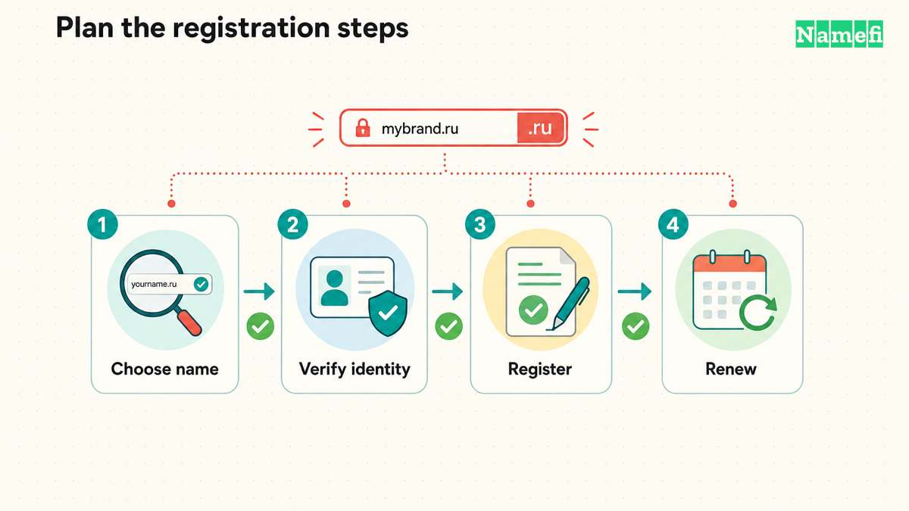

**.ru kennzeichnet Russland im Domain Name System.** Die Endung ist eine [länderspezifische Top-Level-Domain](/de/glossary/cctld/), kurz ccTLD. [IANA führt .ru](https://www.iana.org/domains/root/db/ru.html) als aktive ccTLD mit lateinischer Schrift. IANA nennt das Coordination Center for TLD RU als Verwalter.

Eine Registrierung erfordert mehr als einen verfügbaren Namen. Russland führte im September 2026 staatliche Registrierungsregeln ein. Die Identitätsprüfung verdient deshalb einen eigenen Punkt auf der Prüfliste vor dem Kauf.

## .ru und .рф verwenden unterschiedliche Namensregeln

Nach Abschnitt II der [Regierungsverordnung Nr. 1119](https://cctld.ru/files/pdf/docs/rules_gov.pdf) muss der Name vor .ru folgende Anforderungen erfüllen:

- Der Name enthält 2–63 Zeichen.
- Der Name verwendet lateinische Buchstaben, Ziffern und Bindestriche.
- Der Name beginnt und endet mit einem Buchstaben oder einer Ziffer.
- Der Name enthält keinen Bindestrich gleichzeitig an dritter und vierter Stelle.

Die kyrillische Endung **.рф** ist eigenständig. Die Regierungsregeln legen für .рф eigene Zeichenregeln fest. Die Punycode-Darstellung darf höchstens 63 Zeichen enthalten. Eine .ru-Registrierung umfasst keinen entsprechenden Namen unter .рф.

Für Unternehmen beginnt die Auswahl bei der Zielgruppe und einer leicht eingebbaren Schreibweise. Eine russlandbezogene Adresse kann zu einer lokalen Website passen. Prüfen Sie eine zusätzliche internationale Adresse, wenn das Unternehmen mehrere Märkte bedient.

## Antragsteller müssen das Identitätsverfahren vor der Zahlung klären

Die [Mitteilung des Coordination Center vom 2. September](https://cctld.ru/en/media/news/kc/40983/) beschreibt die neuen Regierungsregeln und den Übergang für Registrare. Die Verordnung Nr. 1119 trat am 1. September 2026 in Kraft.

Die Absätze 9–13 verlangen einen Registrierungsvertrag, richtige Antragstellerdaten und eine Identifizierung über das einheitliche Identifizierungs- und Authentifizierungssystem **ESIA**. Privatpersonen müssen unter anderem Angaben zum Ausweisdokument, Wohnsitz, Kontakt und ESIA-Konto machen. Die Regeln nennen außerdem Angaben für juristische Personen, einschließlich ausländischer juristischer Personen.

Die Erwähnung ausländischer Unternehmen garantiert keinen Zugang für jeden Antragsteller. Fragen Sie den gewählten [Registrar](/de/glossary/registrar/), wie das Identitätsverfahren für den konkreten Antragsteller funktioniert. Klären Sie die erforderlichen Dokumente, Kontovoraussetzungen und die Person, die die Verwaltungsrechte erhalten soll.

Ein Bestellformular beantwortet nicht jede Registrierungsfrage. Lassen Sie die Voraussetzungen bestätigen, bevor Sie einen Geschäftsnamen festlegen, Drucksachen bestellen oder E-Mail umstellen.

## Die jährliche Identitätsprüfung hat eine eigene Frist

Die Absätze 28–34 der [Verordnung Nr. 1119](https://cctld.ru/files/pdf/docs/rules_gov.pdf) knüpfen die Verwaltungsrechte an eine jährliche Identifizierung. Die Regeln sehen vorherige E-Mail-Benachrichtigungen und eine bevorzugte Nachfrist von 30 Tagen nach dem jährlichen Identifizierungstermin vor. Wer die Identifizierung innerhalb der Nachfrist nicht abschließt, muss mit einer Löschung nach dem vorgesehenen Verfahren rechnen.

Verwechseln Sie die jährliche Identitätsprüfung nicht mit der Verlängerungsrechnung des Registrars. Lassen Sie beide Anforderungen und beide Fristen bestätigen. Halten Sie die E-Mail-Adresse des Domaininhabers erreichbar und aktualisieren Sie geänderte Antragstellerdaten.

Ältere Anleitungen beschreiben möglicherweise nur den bisherigen jährlichen Registrierungs- und Verlängerungszyklus. Die englische PDF-Datei der Registry zeigt weiterhin eine Fassung von 2021. Prüfen Sie die geltenden Regeln im [aktuellen russischen Dokumentenverzeichnis](https://cctld.ru/domains/docs/).

## Eine Registrierung garantiert keine ununterbrochene Delegierung

Die Registrierung trägt eine Domain in das Register ein. Die Delegierung ermöglicht die Adressierung über [DNS](/de/glossary/dns/). Die Regierungsregeln behandeln Registrierung und Delegierung als getrennte Vorgänge.

Die Abschnitte VIII und XI der [Verordnung Nr. 1119](https://cctld.ru/files/pdf/docs/rules_gov.pdf) beschreiben Gründe für die Beendigung der Delegierung und die Löschung der Registrierung. Zu den Gründen gehören bestimmte behördliche Anforderungen und Entscheidungen. Ein registrierter Name garantiert deshalb keine dauerhafte Erreichbarkeit einer Website unter allen Umständen.

Der Antragsteller trägt außerdem die Verantwortung für die Namenswahl. Die Absätze 7–8 behandeln Rechte Dritter, unzulässige Namen und die Sperrliste. Prüfen Sie relevante Namen und Marken vor der Registrierung. Eine Verfügbarkeitsanzeige begründet kein Recht zur Verwendung eines Namens.

Ziehen Sie bei einem Streit das [Streitverfahren der Registry](https://cctld.ru/files/pdf/docs/litigations.pdf) heran. Holen Sie Rat ein, der zum konkreten Anspruch passt. Gehen Sie nicht davon aus, dass das Verfahren einer anderen Endung auch für .ru gilt.

## Der Registrar muss Servicebedingungen und Zahlungsbedingungen erklären

Die Registry legt gemeinsame Registrierungsregeln fest. Der Registrar stellt den Kundenvertrag, Serviceverfahren und Endkundenbedingungen bereit. Die Absätze 2.1–2.7 der [Registry-Regeln](https://cctld.ru/files/pdf/docs/rules_ru-rf.pdf) erklären das Verhältnis und verlangen richtige Angaben zu den Leistungen.

Klären Sie vor einer Bestellung fünf Fragen:

1. Welche Organisation registriert und betreut den Namen?
2. Kann der benannte Antragsteller die aktuellen Identitätsanforderungen erfüllen?
3. Was kosten Registrierung, Verlängerung und Zusatzleistungen?
4. Wie bearbeitet der Registrar Prüfhinweise und versäumte Fristen?
5. Welche Verfahren gelten für Transfer, Löschung und Streitfälle?

Prüfen Sie den aktuellen Vertrag und die akzeptierten Zahlungsmethoden direkt beim Anbieter. Diese Seite stellt nicht fest, ob ein bestimmter Anbieter einen bestimmten Kunden bedienen kann. Wählen Sie .ru erst, wenn Name, Antragsteller und laufende Verwaltungsanforderungen zum Projekt passen.

## Diese Antworten klären häufige Fragen zu .ru

### Was bedeutet .ru?

.ru ist Russlands länderspezifische Top-Level-Domain mit lateinischer Schrift. Das Coordination Center for TLD RU verwaltet die Endung.

### Erlaubt .ru kyrillische Namen?

Der Name vor .ru verwendet lateinische Buchstaben, Ziffern und Bindestriche. .рф ist eine eigene Endung mit eigenen Regeln für zulässige Zeichen.

### Können ausländische Antragsteller .ru registrieren?

Gehen Sie weder von allgemeinem Zugang noch von einem allgemeinen Verbot aus. Die Regierungsregeln von 2026 erwähnen ausländische juristische Personen. Antragsteller müssen jedoch die Identitätsprüfung und weitere Voraussetzungen erfüllen. Klären Sie das Verfahren vor der Zahlung mit dem Registrar.

### Erfüllt die Zahlung der Verlängerungsgebühr alle jährlichen Anforderungen?

Gehen Sie nicht davon aus, dass eine Zahlung alle Anforderungen erfüllt. Die Regierungsverordnung Nr. 1119 verlangt eine jährliche Identitätsprüfung für den Erhalt der Verwaltungsrechte. Klären Sie die Fristen für Identitätsprüfung und Zahlung getrennt mit dem Registrar.

## Diese Quellen belegen die Registrierungsanforderungen

Quellen geprüft am **21. Oktober 2026**:

- [IANA-Delegierungseintrag für .ru](https://www.iana.org/domains/root/db/ru.html): Delegierung und Verwalter.
- [Regierungsverordnung Nr. 1119](https://cctld.ru/files/pdf/docs/rules_gov.pdf): Registrierungs- und Identitätsregeln seit September 2026.
- [Mitteilung des Coordination Center](https://cctld.ru/en/media/news/kc/40983/): neue Regeln und Übergang für Registrare.
- [Russisches Dokumentenverzeichnis der Registry](https://cctld.ru/domains/docs/): aktuelle Regelwerke.
- [Registrierungsregeln der Registry](https://cctld.ru/files/pdf/docs/rules_ru-rf.pdf): Verhältnis zwischen Registry und Registrar.
- [Streitverfahren der Registry](https://cctld.ru/files/pdf/docs/litigations.pdf): Verfahren bei Domainstreitigkeiten.
