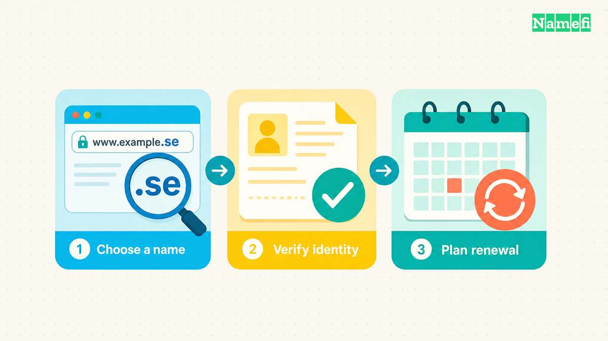

**.se ist die länderspezifische Top-Level-Domain für Schweden.** Internetstiftelsen, die schwedische Internetstiftung, betreibt die Vergabestelle. [IANA führt .se als aktive länderspezifische Top-Level-Domain](https://www.iana.org/domains/root/db/se.html).

Eine .se-Adresse passt zu einem Unternehmen, Dienst oder Medium mit schwedischer Zielgruppe. Ausländische Interessenten können eine Domain beantragen. Die offene Registrierung hebt jedoch weder die Identitätsprüfung noch die Namensregeln auf. Für die Entscheidung zählen Ihre Zielgruppe, Ihre Registrierungsangaben und Ihre Planung für die Verlängerung.

## .se kennzeichnet Schweden und Registrare bearbeiten die Registrierung

Eine [ccTLD (Country-Code Top-Level-Domain)](/de/glossary/cctld/) kennzeichnet ein Land oder Gebiet im Domain Name System. Bei .se ist das Land Schweden. Ein [Registrar](/de/glossary/registrar/) bearbeitet Ihre Bestellung und betreut Sie. Internetstiftelsen führt das zentrale Domainregister.

| Frage | Antwort |
| --- | --- |
| Welches Land nutzt .se? | Schweden |
| Wer betreibt die Vergabestelle? | Internetstiftelsen, die schwedische Internetstiftung |
| Können ausländische Interessenten einen Antrag stellen? | Ja, mit zulässigen Identifikationsangaben und korrekten Kontaktdaten |
| Welche Laufzeiten sind möglich? | 12–120 Monate, abhängig vom Angebot des Registrars |
| Dürfen Namen schwedische Buchstaben enthalten? | Ja, unter anderem å, ä und ö |
| Wie lassen sich strittige Registrierungen klären? | Durch das alternative Streitbeilegungsverfahren für .se oder ein zuständiges Gericht |

Die [Registrierungsanleitung](https://internetstiftelsen.se/en/domains/how-to-register-a-domain-name/) der Vergabestelle verweist Interessenten an zugelassene Registrare. Eine ICANN-Akkreditierung allein belegt kein Angebot für .se. Prüfen Sie die gewünschten Dienste im [Registrarverzeichnis](https://internetstiftelsen.se/en/domains/how-to-register-a-domain-name/registrars/) der Vergabestelle.

## Ausländische Antragsteller müssen gültige Identifikationsangaben vorlegen

Die [Registrierungsbedingungen vom 15. Januar 2026](https://internetstiftelsen.se/app/uploads/2025/12/se-terms-and-conditions-2026-01-15-eng-clean.pdf) erlauben identifizierbaren natürlichen und juristischen Personen einen Antrag. Abschnitt 4.1.1 akzeptiert ausdrücklich gleichwertige ausländische Identifikationsangaben für nichtschwedische Domaininhaber.

Antragsteller müssen ihren Namen, Identifikationsangaben, eine Telefonnummer und eine E-Mail-Adresse angeben. Unternehmen müssen zusätzlich eine Kontaktperson nennen. Aktualisieren Sie die Angaben bei Änderungen. Die schwedische Fassung der Registrierungsbedingungen ist maßgeblich.

Die [Anleitung zur Identitätsprüfung](https://internetstiftelsen.se/en/domains/how-to-register-a-domain-name/verification-of-domain-holders/) beschreibt Dokumentenprüfungen, elektronische Identifizierung sowie die Prüfung von E-Mail-Adressen und Telefonnummern. Registrare können mehrere Methoden kombinieren. Fragen Sie Ihren Registrar vor der Bestellung nach den akzeptierten Nachweisen aus Ihrem Land.

Die Vergabestelle kann die DNS-Aktivierung zurückhalten, während ein Domaininhaber mangelhafte Angaben korrigiert. Eine erfolgreiche Zahlung garantiert keine sofortige Nutzung. Sorgen Sie dafür, dass die verantwortliche Person die Kontaktadresse abrufen und Prüfungsanfragen beantworten kann.

## Namensregeln erlauben schwedische Buchstaben und beschränken bestimmte Namen

Die [aktuellen Namensregeln](https://internetstiftelsen.se/en/domains/how-to-register-a-domain-name/terms-and-conditions-for-se-and-nu-domains/) erlauben Namen mit 1–63 Zeichen. Der zulässige Zeichensatz umfasst å, ä und ö sowie weitere Buchstaben, Ziffern und zulässige Bindestriche.

[IDN (Internationalized Domain Name) / Punycode](/de/glossary/idn/) ermöglicht Namen mit diesen Zeichen. Prüfen Sie die vollständige Zeichentabelle vor der Namenswahl. Testen Sie den Namen mit Ihrer Website, Ihrem E-Mail-Dienst und weiteren vorgesehenen Werkzeugen.

Die Vergabestelle führt Listen gesperrter und reservierter Namen. Ein nicht verfügbarer Name gehört daher nicht zwangsläufig einem anderen Domaininhaber. Ein reservierter Name kann eine besondere Berechtigung voraussetzen. Namen dürfen weder mit einem Bindestrich beginnen noch enden. Weitere technische Beschränkungen gelten ebenfalls.

Wählen Sie einen Namen, den Kunden leicht eingeben und mündlich weitergeben können. Wenn Sonderzeichen zu Ihrer Marke gehören, erwägen Sie zusätzlich eine Schreibweise ohne Sonderzeichen. Prüfen Sie Verfügbarkeit und Rechte für jeden Namen einzeln.

## Die Verlängerung erhält Ihre Registrierung

Die [Beschreibung des Domainlebenszyklus](https://internetstiftelsen.se/en/domains/how-to-register-a-domain-name/se-and-nu-domains-that-may-soon-be-available/) nennt Registrierungszeiträume von 12–120 Monaten. Ihr Registrar bestimmt die angebotenen Laufzeiten. Vergleichen Sie Verlängerungspreise, Steuern, enthaltene Dienste und Zahlungsfristen, bevor Sie ein Angebot für das erste Jahr annehmen.

Die Beschreibung nennt einen Zeitraum von zehn Tagen mit dem Status „Expired“ nach dem Ablauf. Ohne Verlängerung deaktiviert die Vergabestelle die Domain anschließend für 60 Tage. Während der Deaktivierung funktioniert die Domain nicht mehr. Der bisherige Domaininhaber kann die Domain weiterhin verlängern.

Nach der Löschung der Registrierung hält die Vergabestelle den Namen bis zum angegebenen Freigabedatum in Quarantäne. Ein abgelaufener Name steht daher nicht sofort einem neuen Käufer zur Verfügung. Nutzen Sie den Wiederherstellungszeitraum nicht als reguläre Verlängerungsfrist.

## Die Verfügbarkeit begründet kein Recht an einem Namen

Die Vergabestelle vergibt verfügbare Namen nach der Reihenfolge der Anträge, ohne vorab bestehende Rechte zu prüfen. Ein späteres Streitverfahren kann die Registrierung trotzdem anfechten.

Die [Anleitung zur Streitbeilegung für .se](https://internetstiftelsen.se/en/domains/dispute-resolution/dispute-resolution-for-se/) beschreibt das Verfahren unter Verwaltung der WIPO. Der Beschwerdeführer muss ein einschlägiges Recht mit Geltung in Schweden nachweisen. Zusätzlich muss er bösgläubige Registrierung oder Nutzung und fehlende Rechte oder berechtigte Interessen des Domaininhabers nachweisen.

Abschnitt 7.2 der aktuellen Registrierungsbedingungen enthält die genauen Voraussetzungen, einschließlich der Ähnlichkeit mit einem geschützten Namen. Prüfen Sie bei einem Streitfall die konkreten .se-Regeln. Gehen Sie nicht davon aus, dass jede Domainendung dieselben Streitregeln nutzt.

## .se passt zu einer schwedischen Zielgruppe und signalisiert einen Länderbezug

Eine schwedische Domain kann für einen lokalen Dienst oder die schwedische Version einer internationalen Website sinnvoll sein. Bei einem weltweiten Projekt sollten Sie prüfen, ob der Länderbezug zur Zielgruppe passt.

[Googles Anleitung für internationale Websites](https://developers.google.com/search/docs/specialty/international/managing-multi-regional-sites) beschreibt länderspezifische Domains als starke Ländersignale. Google führt einige Länderendungen als generische Ausnahmen auf. .se gehört nicht zu dieser Liste. Das spricht für .se bei einer schwedischen Zielgruppe. Die Endung garantiert jedoch keine besseren Suchplatzierungen.

Inhalte, Sprache und verfügbare Dienste müssen ebenfalls zur Zielgruppe passen. Eine .se-Adresse liefert allein keine schwedische Übersetzung und belegt keinen Unternehmensstandort.

## Domaininhaber sollten Sicherheit und öffentliche Daten getrennt prüfen

Die Vergabestelle unterstützt [DNSSEC (Domain Name System Security Extensions)](/de/glossary/dnssec/). Die [DNSSEC-Anleitung](https://internetstiftelsen.se/en/domains/tech-tools/dnssec/) erklärt den Schutz vor Manipulation durch signierte DNS-Antworten. Fragen Sie Ihren Registrar oder DNS-Anbieter nach Einrichtung und Pflege des Dienstes.

Beschränkungen öffentlicher Abfragen heben die Pflicht zu korrekten Registrierungsangaben nicht auf. Die [Auskunftsregeln](https://internetstiftelsen.se/en/search-domains/disclosure-of-information-from-the-domain-name-register/) erläutern, dass Suchergebnisse bestimmte personenbezogene Daten ausblenden. Die Vergabestelle benötigt für die Weitergabe von Registerdaten eine Rechtsgrundlage nach der DSGVO.

## Antragsteller können einem klaren Registrierungsablauf folgen

1. Suchen Sie den Wunschnamen bei der Vergabestelle oder einem zugelassenen Registrar.
2. Prüfen Sie Namensregeln und mögliche Konflikte mit bestehenden Rechten.
3. Vergleichen Sie Verlängerungskosten, Identitätsanforderungen und enthaltene Dienste.
4. Geben Sie korrekte Inhaberdaten an und durchlaufen Sie die Identitätsprüfung des Registrars.
5. Richten Sie Website und E-Mail ein und planen Sie die Verlängerung vor der Zahlungsfrist.

Bestätigen Sie beim Anbietervergleich die aktuelle Verfügbarkeit von .se direkt beim Anbieter. Behalten Sie die Kontrolle über Inhaberdaten und Wiederherstellungskontakt. Der [Leitfaden zur Domainterminologie](/de/blog/domain-terminology-guide/) erklärt die Aufgaben von Vergabestelle, Registrar und DNS-Anbieter.

## Diese Antworten erklären häufige Registrierungsfragen

### Ausländische Personen und Unternehmen können .se-Domains registrieren

Die Vergabestelle akzeptiert gleichwertige ausländische Identifikationsangaben. Domaininhaber müssen vollständige, korrekte Kontaktdaten angeben und die Anforderungen der Identitätsprüfung erfüllen.

### Registrierungszeiträume reichen von 12 bis 120 Monaten

Fragen Sie Ihren Registrar nach den angebotenen Laufzeiten. Prüfen Sie vor der Bestellung den Verlängerungspreis und die Zahlungsfrist.

### Schwedische Buchstaben können in .se-Domains vorkommen

Die Vergabestelle unterstützt å, ä und ö durch internationalisierte Domainnamen. Prüfen Sie die Zeichentabelle und testen Sie die Schreibweise mit den vorgesehenen Diensten.

## Diese Primärquellen dokumentieren die aktuellen Regeln

Der Autor hat alle Quellen am 21. Oktober 2026 nach pazifischer Zeit abgerufen (22. Oktober nach UTC).

- [IANA dokumentiert die Delegierung von .se](https://www.iana.org/domains/root/db/se.html).
- [Internetstiftelsen erklärt Registrierung und Registrarwechsel](https://internetstiftelsen.se/en/domains/how-to-register-a-domain-name/).
- [Internetstiftelsen führt zugelassene Registrare auf](https://internetstiftelsen.se/en/domains/how-to-register-a-domain-name/registrars/).
- [Die Bedingungen vom Januar 2026 definieren Inhaberpflichten und Streitregeln](https://internetstiftelsen.se/app/uploads/2025/12/se-terms-and-conditions-2026-01-15-eng-clean.pdf).
- [Internetstiftelsen erklärt die Identitätsprüfung](https://internetstiftelsen.se/en/domains/how-to-register-a-domain-name/verification-of-domain-holders/).
- [Internetstiftelsen definiert zulässige Zeichen und reservierte Namen](https://internetstiftelsen.se/en/domains/how-to-register-a-domain-name/terms-and-conditions-for-se-and-nu-domains/).
- [Internetstiftelsen erklärt Ablauf und Freigabe](https://internetstiftelsen.se/en/domains/how-to-register-a-domain-name/se-and-nu-domains-that-may-soon-be-available/).
- [Internetstiftelsen erklärt die Streitbeilegung für .se](https://internetstiftelsen.se/en/domains/dispute-resolution/dispute-resolution-for-se/).
- [Google erklärt die Ausrichtung auf Länder](https://developers.google.com/search/docs/specialty/international/managing-multi-regional-sites).
- [Internetstiftelsen erklärt DNSSEC](https://internetstiftelsen.se/en/domains/tech-tools/dnssec/).
- [Internetstiftelsen erklärt die Weitergabe von Registerdaten](https://internetstiftelsen.se/en/search-domains/disclosure-of-information-from-the-domain-name-register/).
