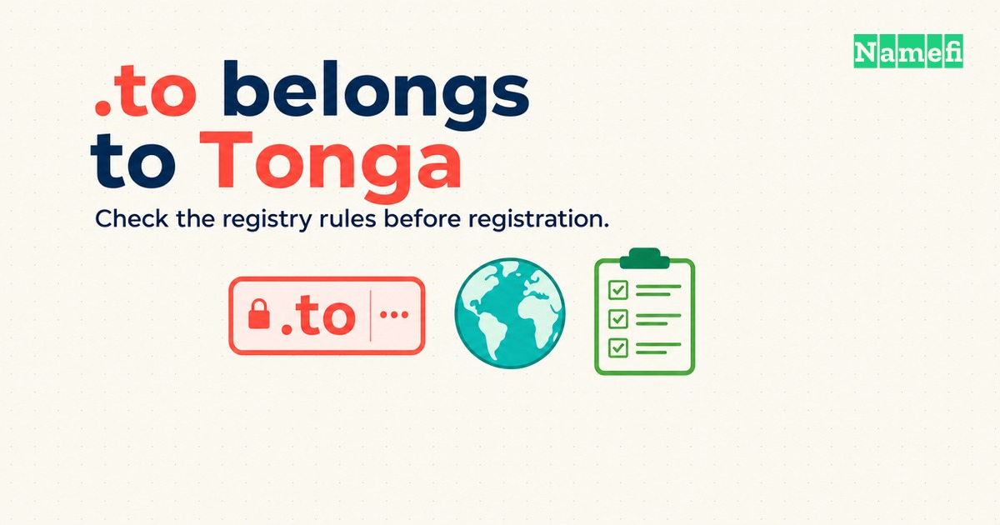

Die **.to-Domain** ist die [ccTLD (Country-Code Top-Level-Domain)](/de/glossary/cctld/) von **Tonga**. Der [IANA-Eintrag](https://www.iana.org/domains/root/db/to.html) nennt Tongas Regierung als Verwalter. [TONIC Domains Inc. betreibt die öffentliche Registrierungswebsite](https://www.tonic.to/). Laut Betreiber arbeitet das automatisierte Register seit 1997.

Die Buchstaben bilden zugleich das englische Wort „to“. Dadurch eignet sich die Endung für einen [Domain-Hack](/de/glossary/domain-hack/) oder einen kurzen Markennamen. Auch ein gut lesbarer Name braucht passende Registrierungsbedingungen. Prüfen Sie Laufzeit, Weiterleitungsregeln, Datenschutzgrenzen und Ländersignale, bevor Sie `.to` wählen.

## Die Endung .to gehört zu Tonga und bedient einen weltweiten Markt

| Frage | Antwort |
| --- | --- |
| Für welches Land steht .to? | Tonga |
| Wer verwaltet die Delegierung? | Laut IANA die Regierung des Königreichs Tonga |
| Wer betreibt die öffentliche Registrierungswebsite? | TONIC Domains Inc. |
| Bietet die Registry weltweite Registrierungen an? | Ja, laut Tonic-FAQ |
| Führt Google .to als generische ccTLD auf? | Nein, Stand 21. Oktober 2026 |
| Zeigt IANA eine sichere Delegierung an? | Nein. IANA kennzeichnet die Delegierung als unsicher |

Der [IANA-Eintrag](https://www.iana.org/domains/root/db/to.html) dokumentiert die Ländercode-Delegierung. Der Eintrag nennt auch die Registry-Website, den WHOIS-Server und den RDAP-Endpunkt. IANA legt die Registrierungsbedingungen für Endkunden nicht fest. Lesen Sie [Tonics eigene Regeln](https://www.tonic.to/faq.htm) zu Registrierung und zulässiger Nutzung.

Tonic beschreibt einen weltweiten automatisierten Registrierungsdienst. Die öffentliche FAQ nennt keinen vorgeschriebenen Wohnsitz in Tonga. Die FAQ weist außerdem auf reservierte Namen hin. Prüfen Sie die Verfügbarkeit, bevor Sie einen bestimmten Namen für den Start einplanen.

## Tonic verlangt bei der Erstregistrierung mindestens zwei Jahre

Die [Tonic-FAQ](https://www.tonic.to/faq.htm) nennt zwei Jahre als Mindestlaufzeit für die Erstregistrierung und ein Jahr für Verlängerungen. Vergleichen Sie die gesamte erste Zahlung mit den Verlängerungskosten. Ein Gesamtpreis für zwei Jahre lässt sich nicht direkt mit einem Einjahresangebot einer anderen Endung vergleichen.

Lassen Sie den Anbieter vor der Zahlung folgende Angaben bestätigen:

1. Bestätigen Sie Laufzeit und Gesamtpreis der Registrierung.
2. Prüfen Sie Verlängerungspreis und Einstellungen für Verlängerungserinnerungen.
3. Prüfen Sie Verfahren und Gebühren für einen Inhaberwechsel.
4. Bestätigen Sie die DNS-Funktionen, die Ihr Projekt benötigt.

Tonics FAQ zur direkten Registrierung behandelt einen Inhaberwechsel als neue Registrierung mit neuen Gebühren. Unterscheiden Sie einen Inhaberwechsel vom Umzug zu einem anderen Anbieter. Fragen Sie vor dem Kauf einer bestehenden Domain nach dem genauen Ablauf.

## Tonic macht Betreiber von Weiterleitungen für Missbrauch verantwortlich

Die [Missbrauchswarnung der Registry](https://www.tonic.to/faq.htm) macht Registranten für Spam ihrer Weiterleitungsnutzer verantwortlich. Tonic warnt vor kostenloser URL-Verkürzung. Laut Tonic kann die erste berechtigte Phishing-Meldung zur dauerhaften Sperrung einer Domain für kostenlose Kurzlinks oder Weiterleitungen führen.

Ein bekannter `.to`-Markenkurzlink bedeutet keine Genehmigung für jedes Geschäftsmodell mit Weiterleitungen. Eine private Weiterleitung eigener Links und ein frei zugänglicher öffentlicher Kurzlinkdienst haben unterschiedliche Missbrauchsrisiken. Lassen Sie Tonic den geplanten Dienst bestätigen. Behalten Sie die Kontrolle über Zieladressen und ermöglichen Sie das Abschalten missbräuchlicher Links.

Testen Sie bei einem Kurzlinkprojekt für ein Unternehmen den gesamten Ablauf vor dem Start. Prüfen Sie Berechtigungen zur Linkerstellung, Änderungen der Zieladressen, Missbrauchsmeldungen und die Notabschaltung. Eine kurze Adresse hebt die Verantwortung des Betreibers nicht auf.

## Tonic bietet Registrierungsabfragen mit begrenzter Datenauskunft an

[Laut Tonic liefern WHOIS und RDAP](https://www.tonic.to/faq.htm) Registrierungs- und DNS-Daten ohne sensible persönliche Angaben. Das bedeutet nicht, dass kein öffentlicher Dienst für [WHOIS (und RDAP)](/de/glossary/whois/) existiert. IANA nennt beide Abfrageendpunkte.

Datenschutz begründet keine Anonymität. Versprechen Sie Kunden nicht, dass eine `.to`-Registrierung sämtliche Identitätsdaten verbirgt oder Maßnahmen gegen Missbrauch verhindert. Prüfen Sie die aktuelle Datenrichtlinie des Anbieters, wenn Sie Kundendaten erheben oder eine Beschwerde bearbeiten.

## Google dokumentiert für .to keine generische Behandlung

[Google Search Central](https://developers.google.com/search/docs/specialty/international/managing-multi-regional-sites) beschreibt ccTLDs als Ländersignale. Google führt außerdem Ländercodes auf, die Google als generisch behandelt. Die Liste enthält `.io`, `.co` und `.tv`, aber zum Prüfzeitpunkt nicht `.to`.

Das Fehlen beweist keine Benachteiligung beim Ranking. Das Fehlen rechtfertigt auch kein Versprechen, dass Google `.to` wie `.com` behandelt. Ein weltweit tätiges Unternehmen sollte das Ländersignal zusammen mit Zielgruppe, Inhaltssprache und Namensanforderungen berücksichtigen.

Wählen Sie [.com](/de/tld/com/), wenn ein geeigneter Name die Projektanforderungen erfüllt. Vergleichen Sie [.io](/de/tld/io/), [.co](/de/tld/co/) und [.tv](/de/tld/tv/), wenn Googles dokumentierte generische Behandlung wichtig ist. Prüfen Sie die Registrierungsregeln jeder Registry separat.

## Die aktuelle Delegierung bietet keine durchgehende DNSSEC-Kette

[IANA kennzeichnet die Delegierung von .to als unsicher](https://www.iana.org/domains/root/db/to.html). Am 21. Oktober 2026 zeigte der Eintrag keine sichere Kette von der Root-Zone zu `.to`. Ein Projekt mit vorgeschriebener durchgängiger [DNSSEC-Kette (Domain Name System Security Extensions)](/de/glossary/dnssec/) sollte diese Anforderung vor der Wahl von `.to` klären.

DNSSEC und HTTPS lösen unterschiedliche Probleme. Der Delegierungsstatus entscheidet nicht darüber, ob eine Website HTTPS nutzen kann. Fragen Sie die Hosting- und DNS-Anbieter, welche Schutzmaßnahmen die geplante Konfiguration unterstützt.

Tonic unterstützt laut eigenen Angaben auch internationalisierte Domainnamen. Die [FAQ verbietet absichtliche Verwechslungsregistrierungen](https://www.tonic.to/faq.htm). Laut FAQ können böswillige Namen ohne Vorankündigung ihren DNS-Dienst verlieren. Testen Sie den gewünschten Namen in Browsern, E-Mail-Programmen und im Gespräch, bevor Sie ungewöhnliche Zeichen verwenden.

## Ein guter .to-Name muss auch jenseits des Schriftbilds funktionieren

Nutzen Sie `.to`, wenn die vollständige Adresse klar lesbar ist und die Registry-Bedingungen zum Projekt passen. Testen Sie den Namen mit einer Person, die die Schreibweise noch nicht gesehen hat. Bitten Sie die Person, die Adresse nach dem Hören einzugeben.

Wählen Sie die Endung nicht allein deshalb, weil ein anderes Unternehmen einen kurzen `.to`-Link nutzt. Eine bestehende Markennutzung belegt weder Verfügbarkeit noch Erlaubnis, Preis oder Eignung für ein anderes Projekt. Unser [Leitfaden zu Domain-Hacks](/de/blog/domain-hacks-explained/) erklärt die Bewertung des vollständigen Namens.

## Prüfen Sie das Angebot des Anbieters vor der Registrierung von .to

1. Suchen Sie den genauen Namen bei [Namefi](https://namefi.io) oder [Tonic](https://www.tonic.to/newname.htm).
2. Bestätigen Sie, dass der Anbieter aktuell `.to` und die benötigte Laufzeit anbietet.
3. Lesen Sie die aktuellen Anbieterbedingungen und Tonics Nutzungsregeln.
4. Registrieren Sie den Namen und konfigurieren Sie [DNS](/de/glossary/dns/).
5. Testen Sie Website, Weiterleitungen und E-Mail vor der Veröffentlichung der Adresse.

Eine Such- oder Informationsseite garantiert weder Verfügbarkeit noch einen bestimmten Kaufpreis. Bestätigen Sie das konkrete Angebot vor der Zahlung. Grundlagen erklären die Artikel [über TLDs](/de/blog/what-is-a-tld/) und [über Domainbegriffe](/de/blog/domain-terminology-guide/).

## Diese Antworten klären häufige Fragen zu .to

### Kann jeder eine .to-Domain registrieren?

Tonic bietet .to-Registrierungen weltweit an. Die öffentliche FAQ nennt keinen vorgeschriebenen Wohnsitz in Tonga. Reservierte Namen und Nutzungsregeln der Registry gelten weiterhin.

### Beeinflusst eine .to-Domain die Suchmaschinenoptimierung?

Google führt .to nicht in der veröffentlichten Liste der generisch behandelten ccTLDs. Nehmen Sie weder dieselbe dokumentierte Behandlung wie bei .io, .co oder .tv noch eine Ranking-Abwertung an.

### Hat .to einen öffentlichen WHOIS-Dienst?

Ja. Tonic bietet WHOIS und RDAP an. Laut Registry liefern beide Dienste Registrierungs- und DNS-Daten ohne sensible persönliche Angaben. Datenschutz bedeutet weder Anonymität noch Schutz vor Maßnahmen gegen Missbrauch.

### Darf ich auf .to einen kostenlosen URL-Verkürzer betreiben?

Tonic warnt vor kostenloser URL-Verkürzung und Weiterleitung. Laut Registry führt die erste berechtigte Phishing-Meldung zur dauerhaften Sperrung einer solchen Domain. Klären Sie den Anwendungsfall mit Tonic, bevor Sie einen Weiterleitungsdienst aufbauen.

## Diese Quellen belegen die aktuelle Prüfung der Richtlinien

Abrufdatum: 22. Oktober 2026 UTC, entsprechend dem 21. Oktober in Los Angeles.

- [IANA-Eintrag zur .to-Delegierung](https://www.iana.org/domains/root/db/to.html): Verwalter, Abfrageendpunkte und Sicherheitsstatus der Delegierung.
- [Tonic-Registry-Website](https://www.tonic.to/): Betreiber und Betriebsgeschichte des automatisierten Registers.
- [Tonic-FAQ](https://www.tonic.to/faq.htm): Registrierungsbedingungen, Datenschutzaussagen, IDN-Regeln und Missbrauchswarnungen.
- [Tonics Einstiegsseite zur Registrierung](https://www.tonic.to/newname.htm): öffentliche Verfügbarkeitsprüfung.
- [Googles Dokumentation zu internationalen Websites](https://developers.google.com/search/docs/specialty/international/managing-multi-regional-sites): Ländersignale und Ausnahmen für generische ccTLDs.
