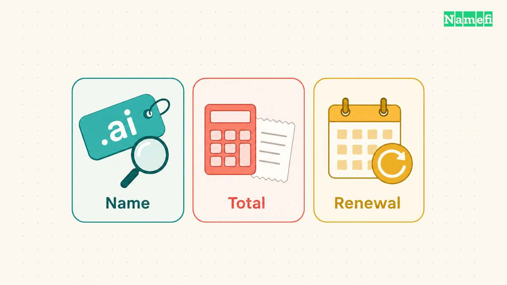
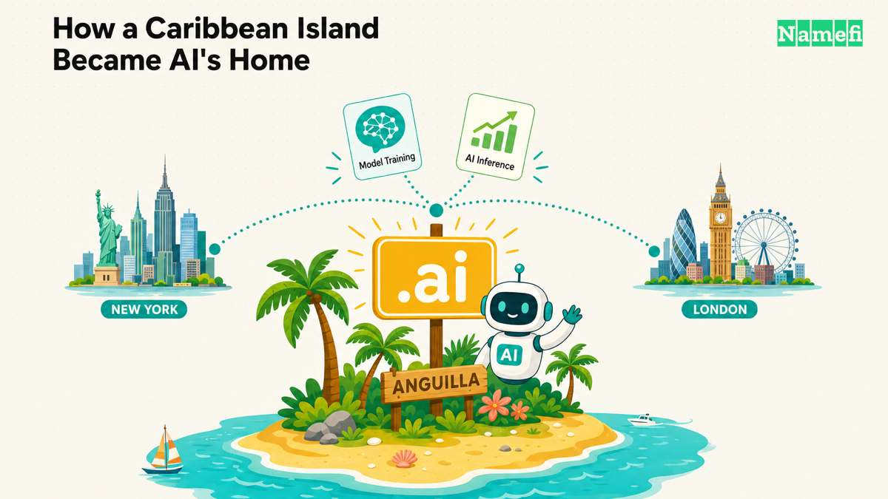
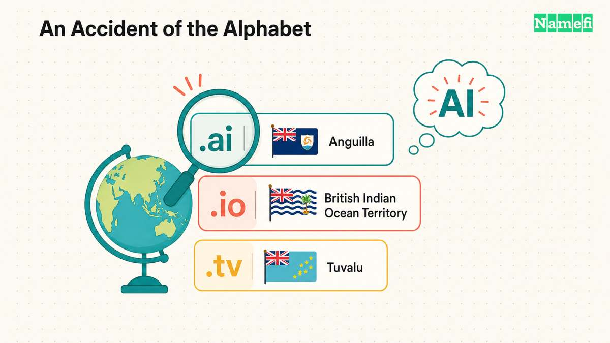
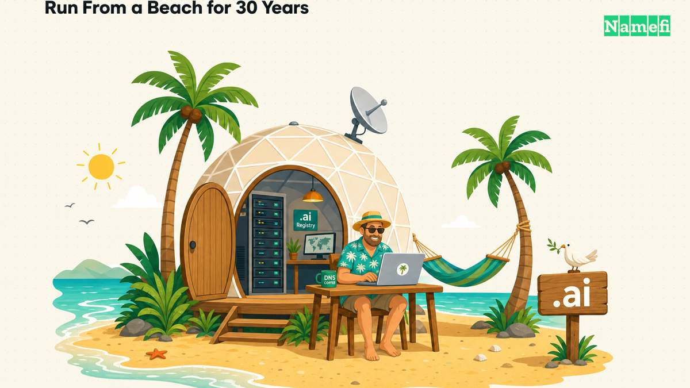
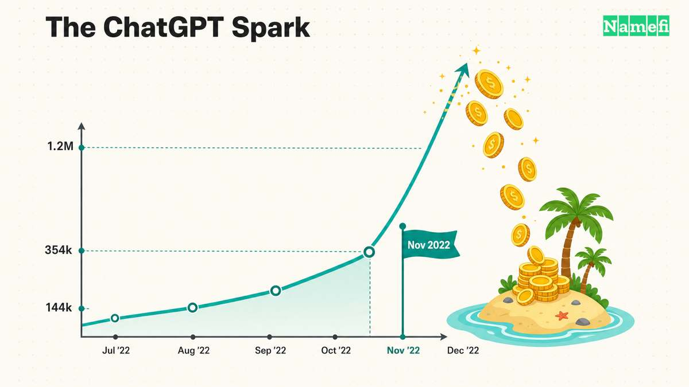
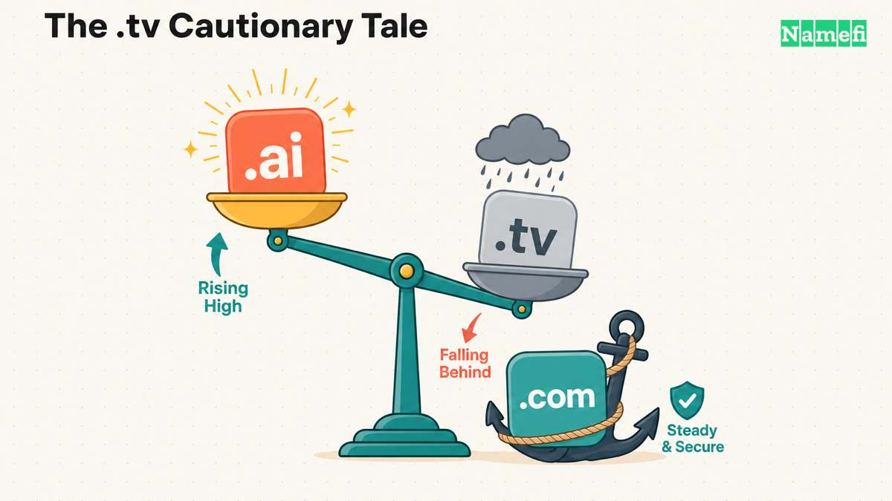

The **.ai domain** is [Anguilla’s country-code top-level domain](https://www.iana.org/domains/root/db/ai.html). “AI” also means artificial intelligence, which gives the extension a clear association for technology brands. The [official registry site](https://www.nic.ai/) presents .ai for AI tools, businesses, and emerging technologies.

## Buyers should check the name, total, and renewal terms

A search for “buy .ai domain” can lead to an available registration or an offer from an existing holder. Establish which transaction the seller offers before comparing prices.

1. **Check the exact name.** Compare the spelling in the search result, cart, and registration confirmation.
2. **Check the complete payment.** Record the term, currency, taxes, and optional services beside the checkout total.
3. **Check the renewal terms.** Ask the registrar for the renewal price, billing date, and recovery procedure before paying.
4. **Check the registrar.** Start with the [registry’s registrar list](https://www.nic.ai/registrars) when comparing providers.
5. **Check the use rules.** The [registry FAQ](https://www.nic.ai/faq) prohibits abuse and allows government intervention for specified reasons, including legal compliance and third-party rights.

The registry [supports RDAP and permits privacy or proxy services](https://www.nic.ai/faq). Ask the registrar which privacy service the order includes. A lookup can help identify the sponsoring registrar, but privacy services can limit visible holder information.

For a detailed provider comparison, read [the .ai registrar guide](/en/blog/ai-tld-registrars/). For the choice between extensions, read [.ai versus .io](/en/blog/ai-vs-io-domain/). The sections below explain Anguilla’s history and the branding tradeoffs.

In 2023, the government of one of the Caribbean's smallest territories earned [about US$32 million from selling domain names — more than 10% of its entire GDP](https://en.wikipedia.org/wiki/.ai#:~:text=In%202023%2C%20Anguilla%27s%20government%20made%20about%20US%2432%20million). By 2025 a minister told the BBC that domain revenue would be [around 47% of the national budget](https://en.wikipedia.org/wiki/.ai#:~:text=by%202025%20it%20will%20be%20around%2047%25). The territory is Anguilla, population roughly sixteen thousand. It did not build a single AI model. It simply happened to own the right two letters: **.ai**.

This is the rare extension whose suffix is also one of the most valuable acronyms in technology. Technically, .ai is the [country-code top-level domain](/en/glossary/cctld/) (ccTLD) for Anguilla, a British Overseas Territory in the Eastern Caribbean. In practice it has become the default address of the entire artificial-intelligence industry. This page tells the full story — the cypherpunk who ran it from a beach for thirty years, the ChatGPT moment that set it on fire, and what all of it means if you're deciding whether to put your brand on a .ai.

## .ai at a glance

| Fact | Detail |
| --- | --- |
| TLD type | ccTLD (country code for Anguilla); treated as generic by Google |
| Registry operator | Government of Anguilla; technical back-end by Identity Digital (since Jan 2025) |
| Year delegated | 1995 |

| DNSSEC | Supported at the registry |

| Best for | AI/ML startups, agent products, developer tools, premium tech brands |

## The unlikeliest tech capital

Anguilla is about 35 square miles of low, scrubby coral in the northeastern Caribbean — sixteen miles long, three and a half at its widest, with a population in the neighborhood of sixteen thousand. Its economy has long rested on two things: luxury tourism on its white-sand beaches, and a modest offshore-finance sector. It is beautiful, remote, and seasonally exposed to hurricanes. It is not, by any obvious measure, a place you'd expect to find a pillar of the global AI economy.

That is exactly what makes the .ai story remarkable. The island didn't write an algorithm or court a single startup; its entire role was to exist in the right alphabetical slot when a technology happened to share its initials. Its windfall is a pure accident of the alphabet — and the more interesting question is how an accident sat dormant for almost thirty years before anyone could cash it in. The answer is a story about one stubborn individual, one product launch, and a lesson in who really controls the building blocks of the internet.

## Two letters, by accident

The letters "AI" are not a marketing choice. They are simply Anguilla's [ISO 3166-1](/en/glossary/cctld/) country code — the same alphabetical coincidence that turned `.io` (the British Indian Ocean Territory) and [.tv](/en/tld/tv/) (Tuvalu) into tech darlings. Country codes were handed out in the 1990s by Jon Postel and the [IANA](/en/glossary/iana/) function under a philosophy he wrote down in [RFC 1591](https://www.ietf.org/rfc/rfc1591.txt): a ccTLD's manager is a *trustee* serving a community, and "concerns about 'rights' and 'ownership' of domains are inappropriate." Nobody imagined these two-letter accidents would become assets worth tens of millions of dollars a year.

.ai was [delegated to Anguilla in 1995](https://www.iana.org/domains/root/db/ai.html), and for almost two decades it did essentially nothing. It was a sleepy island ccTLD — and the story of how it woke up runs through one of the more unusual characters on the early internet.

## The cypherpunk who ran a country's domain from the beach

In November 1994, an American computer scientist named **[Vince Cate](https://en.wikipedia.org/wiki/Vince_Cate)** [moved to Anguilla](https://spectrum.ieee.org/ai-domains#:~:text=I%20came%20to%20Anguilla%20in%201994). A Berkeley graduate and Carnegie Mellon PhD dropout (he'd been working on a networked filesystem before the internet pulled him away), Cate was a committed cypherpunk — part of the 1990s movement that believed strong cryptography was a tool of personal liberty. He'd chosen Anguilla in part because he couldn't afford the better-known tax havens, and he wanted to build what science-fiction author Bruce Sterling had called a "data haven": offshore infrastructure beyond the reach of any one government's censorship.

Cate was not a quiet observer. Arriving on a shoestring, he founded Anguilla's first internet service provider and eventually ran servers out of [a "Buckminster Fuller" style dome near Shoal Bay](https://news.ai/vince-cate-in-search-of-bees/#:~:text=style%20dome%20out%20by%20Shoal%20Bay) that doubled as a literal data haven. He hosted the island's cypherpunk meetings and co-organized the [first **Financial Cryptography conference**, held in Anguilla in 1997](https://ifca.ai/fc97/#:~:text=Financial%20Cryptography%2097%20will%20be%20held%20in%20Anguilla). His most famous stunt was a web page inviting any visitor to ["become an international arms trafficker in one click"](https://en.wikipedia.org/wiki/Vince_Cate#:~:text=become%20an%20international%20arms%20trafficker%20in%20one%20click) — submitting a few lines of encryption code by email, an act that was arguably illegal munitions export under the U.S. cryptography rules of the era. The protest had a sequel: in 1998 Cate went as far as [paying $5,000 to naturalise as a citizen of Mozambique and then giving up his U.S. citizenship](https://en.wikipedia.org/wiki/Vince_Cate#:~:text=paying%20%245%2C000%20to%20naturalise%20as%20a%20citizen%20of%20Mozambique%20and%20then%20giving%20up%20his%20U.S.%20citizenship).

He also wanted a domain name. So he emailed [Jon Postel](https://en.wikipedia.org/wiki/Jon_Postel) — the man who personally managed the world's top-level domains — and asked. Postel's reply, [as Cate has recounted it](https://spectrum.ieee.org/ai-domains#:~:text=do%20you%20want%20to%20run%20.ai): *"There's nobody running .ai, do you want to run .ai?"* Cate said yes. He transferred the official administrative contact to the Government of Anguilla — he felt it shouldn't sit in a private individual's name — but kept operating it, building his own registry software (named **Zenaida**, after Anguilla's national bird) and running the whole thing largely single-handedly for nearly thirty years. He [gave the government 75% of the revenue](https://domainnamewire.com/2025/02/28/former-ai-administrator-discloses-identity-digital-rev-share-other-details/#:~:text=he%20gave%2075%25%20to%20the%20government%20when%20he%20ran%20the%20domain) and ran support by email and phone.

For most of those years, .ai earned very little. In the early days, registrations [lived a level down](https://en.wikipedia.org/wiki/.ai) — `company.com.ai`, `org.ai` — handed out to the handful of Anguillan businesses that wanted them. There was even a near-disaster when [control briefly passed to an overseas company](https://spectrum.ieee.org/ai-domains) that went unresponsive and had to be unwound — exactly the kind of accident that has cost other small nations their ccTLDs.

Two quiet technical decisions turned out to matter enormously. [In December 2017](https://en.wikipedia.org/wiki/.ai#:~:text=On%2016%20December%202017%2C%20the%20.ai%20registry%20started%20supporting%20the%20Extensible%20Provisioning%20Protocol) the .ai registry began supporting the modern [EPP](/en/glossary/registrar/) protocol, which for the first time let registrars around the world sell the domain instead of buyers having to come to Cate directly. And [in 2021, Google added ".ai" to its list of generic country-code top-level domains](https://en.wikipedia.org/wiki/.ai#:~:text=In%202021%2C%20Google%20Search%20analyst%20Gary%20Illyes%20announced%20that) — meaning a .ai site would rank globally rather than being penned into Anguilla. Together those two moves removed the friction and the SEO penalty that had kept .ai niche. The fuse was laid. It just needed a spark.

## The spark: November 30, 2022

The spark was **ChatGPT**, launched on November 30, 2022. Almost overnight, "AI" went from a research term to the defining label of the technology era — and every founder wanted the matching domain. Cate's own description is the cleanest summary of what happened: [*"In the five months after that, our sales went up by almost a factor of four."*](https://spectrum.ieee.org/ai-domains#:~:text=In%20the%20five%20months%20after%20that%2C%20our%20sales%20went%20up%20by%20almost%20a%20factor%20of%20four)

The registration numbers tell the story: roughly **144,000** .ai domains at the end of 2022, **354,000** by the end of 2023 ([both figures from the IMF](https://www.imf.org/en/news/articles/2024/05/15/cf-an-ai-powered-boost-to-anguillas-revenues)), and [past **1.2 million** by 2026](https://en.wikipedia.org/wiki/.ai), with new names arriving at thousands per day. For Anguilla, the financial effect was transformative. The IMF documented it in a 2024 country report, ["An AI-Powered Boost to Anguilla's Revenues"](https://www.imf.org/en/news/articles/2024/05/15/cf-an-ai-powered-boost-to-anguillas-revenues): registration income climbed from about $2.9 million in 2018 to roughly $32 million in 2023 — over 10% of GDP — with around 90% of names renewing, which turns a one-time surge into a recurring stream.

By 2025 the windfall reached an estimated $85 million, and the island has put it to work in ways that show up in daily life: [the expansion of the Clayton J Lloyd International Airport](https://anguillafocus.com/ai-to-generate-nearly-half-of-anguillas-revenue-this-year-tech-minister-tells-bbc/#:~:text=the%20expansion%20of%20the%20Clayton%20J%20Lloyd%20International%20Airport), road repairs, relief on the goods-and-services tax, expanded health services, and a sharp drawdown of public debt. Anguilla has also [begun weighing a sovereign-wealth or national-development fund](https://theanguillian.com/2025/10/government-leaders-address-high-living-costs-renewable-energy-and-where-the-ai-money-flows/#:~:text=conversations%20are%20ongoing%20about%20establishing%20a%20sovereign%20wealth%20or%20national%20development%20fund) to preserve .ai income for future generations. For a place where a single storm can erase a year of tourism, turning two letters into infrastructure and a rainy-day fund is a genuinely consequential piece of statecraft.

The shape of the boom is easiest to see in a single table:

| Year | .ai registrations | Anguilla revenue | Share of govt revenue |
| --- | --- | --- | --- |
| 2018 | ~48,000 | ~$2.9M | ~1% |
| 2022 (pre-ChatGPT) | ~144,000 | ~$16M | ~5% |
| 2023 | ~354,000 | ~$32M | ~20% |
| 2024 | ~530,000+ | ~$39M | ~25% |
| 2025 | ~880,000+ | ~$85M | ~47% |
| 2026 | 1,200,000+ | — | — |

Officials know exactly how lucky they are. Anguilla's technology minister called it a ["gift… given to us by God."](https://anguillafocus.com/ai-to-generate-nearly-half-of-anguillas-revenue-this-year-tech-minister-tells-bbc/#:~:text=this%20is%20as%20a%20gift%2C%20as%20we%20can%20only%20say%2C%20was%20given%20to%20us%20by%20God) But the smartest voices on the island are also wary of it. As former Premier Ellis Webster put it: ["You can't predict how long this is going to last"](https://gizmodo.com/anguilla-ai-2000652757#:~:text=predict%20how%20long%20this%20is%20going%20to%20last) — he didn't want the country's whole economy "just based on this." That tension — a windfall nobody can guarantee will last — is the single most useful thing for a buyer to keep in mind.

## From the beach to the big leagues: Identity Digital

A one-person registry could not run a million-domain namespace. In October 2024, [Anguilla signed a five-year deal with **Identity Digital**](https://domainnamewire.com/2024/10/15/identity-digital-inks-ai-domain-deal-with-anguilla/), one of the world's largest registry operators (it runs hundreds of TLDs and tens of millions of domains), which [completed the technical migration on **January 15, 2025**](https://domainnamewire.com/2025/01/23/identity-digital-is-now-managing-ai-domains-heres-what-this-means-for-registrants/#:~:text=extension%20of%20the%20domain%20by%202%20years%20on%20Jan.%2015%2C%202025%2C%20upon%20completion%20of%20the%20migration). The change was night and day: the registry moved off Cate's home-grown stack onto a modern, far faster and more resilient cloud platform, the roster of accredited registrars expanded sharply, modern [WHOIS](/en/glossary/whois/)/RDAP and creation/expiry dates returned, and expired names began flowing through frequent public auctions rather than a monthly trickle. As part of the handover, every domain was even extended by two years.

Crucially, Anguilla's revenue share *improved*: [Identity Digital is giving 90% of .ai revenues to the government](https://domainnamewire.com/2025/02/28/former-ai-administrator-discloses-identity-digital-rev-share-other-details/#:~:text=Identity%20Digital%20is%20giving%2090%25%20of%20.ai%20revenues%20to%20the%20government%20of%20Anguilla) (keeping about 10%) — better than Cate's old 75/25 split. Cate, for his part, had a warning for the island as he handed over the keys: never sell the golden goose, and don't sign the kind of fixed-price deal that left other small nations with the short end. (More on that below.)

## Who's actually on .ai

Part of why .ai now reads as a credible primary address — not a novelty — is the company it keeps:

- **perplexity.ai** — the AI answer engine
- **character.ai** — consumer AI characters
- **x.ai** — Elon Musk's xAI, maker of Grok
- **stability.ai** — the team behind Stable Diffusion
- **scale.ai** — AI data infrastructure (which also operates scale.com)

It isn't just the marquee names, either: by 2026, [about 28% of newly founded tech startups were launching on a .ai domain](https://www.pymnts.com/artificial-intelligence-2/2026/the-ai-boom-is-funding-a-caribbean-island-two-letters-at-a-time/#:~:text=28%25%20of%20all%20newly%20founded%20tech%20startups%20now%20use%20a%20.ai%20domain), and [the namespace had grown past 1.2 million registrations](https://en.wikipedia.org/wiki/.ai) — proof the suffix had crossed from novelty to default for an entire category of company.

One honest caveat worth knowing: the very biggest labs still anchor on .com — **openai.com** and **anthropic.com** among them. So .ai signals the category brilliantly, but it is not a universal law. It's a statement, and you should mean it.

## What it costs, and what good names sell for

Compare the complete registration payment, renewal quote, and included services before ordering. This page does not quote a current wholesale price or assign registry premium tiers.

- **A hot aftermarket.** The secondary market has produced genuine headline sales: [**you.ai** sold for $700,000 in 2023](https://domaininvesting.com/dharmesh-shah-comments-on-you-ai-acquisition/#:~:text=Sedo%20announced%20the%20%24700%2C000%20sale%20of%20You.ai) (to HubSpot co-founder Dharmesh Shah), [**bot.ai** reportedly for $1.2 million in 2026](https://cognitive.ai/dotaisales.html), and [**fin.ai** reportedly for around $1 million in March 2025](https://en.wikipedia.org/wiki/.ai#:~:text=was%20sold%20for%20%241%2C000%2C000%20in%20March%202025) (widely reported, though not officially confirmed by the parties). For context, [.ai was the second-highest performer by reported aftermarket sales in the first half of 2025](https://www.namepros.com/threads/domain-name-sales-reported-at-namebio-during-first-six-months-of-2025-strength-for-legacy-extensions-ai.1356803/#:~:text=second%20highest%20performer%20in%20the%20first%20half%20of%202025%20was%20.ai) — behind only .com.

This page doesn't quote live retail prices — check current rates when you register. The point for a buyer is that .ai is a deliberate investment in a category signal, not a commodity registration.

## .ai vs the alternatives

| | **.ai** | **.io** | **.com** |
| --- | --- | --- | --- |
| Origin | Anguilla ccTLD | Indian Ocean ccTLD | Original generic gTLD |
| Connotation | Artificial intelligence | Input/output, dev/SaaS | Universal, default |
| Google treatment | Generic (gccTLD) | Generic (gccTLD) | Generic |

Pick **.ai** when artificial intelligence *is* your product and you want the meaning baked into the name. Choose [.io](/en/tld/io/) for broader developer or SaaS plays where it reads as "input/output" and tends to be cheaper — see [why .io domains are expensive](/en/blog/why-are-io-domains-expensive/). Keep [.com](/en/tld/com/) in mind as the universal default; many teams secure it defensively alongside their .ai. For a deeper head-to-head, read [.ai vs .io: which domain is right for your startup?](/en/blog/ai-vs-io-domain/).

## So, should you build on .ai?

Strip away the story and the buyer's question is concrete. Here's the honest case both ways.

**The case for:**

- **Instant category signal.** The moment someone reads your URL, they know your product involves AI. The value proposition is in the name — no other extension does this for an AI company.
- **Short names are still gettable.** Unlike the picked-over [.com](/en/tld/com/) market, concise, brandable .ai names can still be registered or acquired at sane prices.
- **Global, generic SEO.** Because Google treats .ai as generic, you rank worldwide with no geographic penalty.
- **Credibility by association.** With Perplexity, xAI, Character.AI, and Stability on .ai, the suffix now reads as serious, not fringe.

**The case against (eyes open):**

- **Trend risk.** Welding your identity to "AI" ties your brand to a fast-moving cycle (see the next section).
- **It's a category, not a default.** If your product isn't really about AI, a .ai can read as a stretch — and many teams still secure the matching .com defensively anyway.

On **reputation and email**, .ai is perceived as premium and tech-forward — close to .io in prestige and arguably ahead of it for AI brands — and it doesn't carry the spam-prone baggage of some cheap new gTLDs. As always, inbox placement depends on your own SPF, DKIM, and DMARC setup far more than on the suffix. A properly authenticated .ai reaches inboxes as reliably as a .com.

## The catch every buyer should understand

.ai's greatest strength — that its meaning is welded to a specific, booming industry — is also its risk. The cautionary tale is **.tv**, and it's worth knowing in full, because Anguilla's officials cite it themselves.

[Tuvalu is a tiny island nation of 11,000 people](https://en.wikipedia.org/wiki/.tv#:~:text=Tuvalu%20is%20a%20tiny%20island%20nation%20of%2011%2C000%20people) that holds the country code "TV." In 1998 it licensed the domain commercially; after an early deal collapsed, the incubator Idealab restructured it, and the first million-dollar check let Tuvalu finally pay the UN membership fee that had kept it out of the organization. Verisign later ran .tv, and in 2021 [GoDaddy won the contract to operate it](https://domainnamewire.com/2021/12/14/godaddy-wins-contract-to-run-tv-verisign-didnt-bid-for-renewal/#:~:text=has%20won%20the%20contract%20to%20operate), reportedly for around $10 million a year. Real money — but notice the shape of it. .tv peaked and *plateaued* at roughly half a million registrations. The streaming era, which should have been its golden age, instead moved onto platforms — YouTube, Netflix, Twitch itself — and a standalone .tv came to matter less, not more. The brand signal faded even as the thing it named exploded.

That is the open question hanging over .ai: will the two letters still carry weight once the AI hype cycle matures and the category becomes simply "software"? Even Dharmesh Shah, who paid $700,000 for you.ai, has said he believes [".com domains will maintain their value better and for longer."](https://gizmodo.com/anguilla-ai-2000652757#:~:text=.com%20domains%20will%20maintain%20their%20value%20better%20and%20for%20longer) Anguilla structured its Identity Digital deal to capture more of the upside than Tuvalu ever did — but no contract can legislate that "AI" stays fashionable.

There's a grimmer cautionary tale, too. Niue, another tiny Pacific nation, says a Swedish foundation [took over its .nu domain without consent in 2013](https://en.wikipedia.org/wiki/.nu#:~:text=.nu%20domain%20without%20consent%20in%202013) and spent years in court trying to recover it, by some estimates missing out on a hundred million dollars or more. The lesson the domain industry draws from these cases is consistent: a small territory's ccTLD is a real national asset, and how (and to whom) it is managed matters enormously. Anguilla, having watched these precedents, kept control local for decades and then chose a revenue-share rather than a fixed-price sale — which is precisely why its windfall has been so much larger than its peers'.

There's a deeper structural point, too. [ICANN has told a U.S. court that ccTLDs are **not property**](https://domainnamewire.com/2014/07/30/icann-court-cctlds/) — no one "owns" them. In practice Anguilla's control is extremely stable: a ccTLD is only retired if its ISO country code disappears, and even after [the Soviet Union itself was dissolved … the `.su` top-level domain remains in use to the present day](https://en.wikipedia.org/wiki/.su#:~:text=the%20Soviet%20Union%20itself%20was%20dissolved%2015%20months%20later%2C%20the%20.su%20top%2Dlevel%20domain%20remains%20in%20use%20to%20the%20present%20day). As a recognized territory with its own ISO entry, Anguilla isn't going anywhere. But the philosophical point matters: when you buy a .ai, you're buying a long, secure lease on a name within a namespace a small government administers — not a freehold on the two letters themselves.

None of this is a reason to avoid .ai. It's a reason to buy it for the right reason: because your product genuinely *is* AI and you want the world to know it at a glance — not because the suffix is fashionable.

## How .ai works today (the practical bits)

GoDaddy states that anyone can register a .ai domain. Check the chosen registrar’s terms before ordering. GoDaddy lists 2, 4, 6, 8, and 10 years for .ai registration and renewal. Check the chosen registrar’s available terms. [GoDaddy](https://www.godaddy.com/help/about-ai-domains-32220). Source checked 2026-10-21.

On **SEO**, the key fact is that Google [treats certain ccTLDs, including .ai, as generic](https://developers.google.com/search/docs/specialty/international/managing-multi-regional-sites#:~:text=Google%20treats%20some%20ccTLDs) rather than geo-targeting them to the home country. A .ai site can rank globally; the suffix is neither a boost nor a penalty.

On **branding**, the strongest pattern is the [domain hack](/en/glossary/domain-hack/), where the extension completes a phrase — `scale.ai`, `fin.ai`, any natural `noun.ai` that reads as a word-plus-meaning. The whole appeal of .ai is that it lets you own a short, meaningful name while the comparable [.com](/en/tld/com/) is long gone, so don't squander that on something clunky: avoid hyphens and digit substitutions, keep it pronounceable, and when you say it aloud, say "dot A-I" (the letters) so listeners don't hear "dot eye."

## Holding a .ai for the long term

Like any domain, a .ai can be held conventionally through [DNS](/en/glossary/dns/), or as a [tokenized domain](/en/blog/what-are-tokenized-domains/) — an [on-chain](/en/glossary/on-chain/) [NFT](/en/glossary/nft/) that makes [ownership](/en/glossary/domain-ownership/) verifiable and transfers simple, while keeping normal resolution. As an [ICANN-accredited registrar](/en/glossary/accredited-registrar/) that bridges Web2 and [Web3](/en/glossary/web3/), [Namefi](https://namefi.io) lets you register a .ai, manage it, and optionally tokenize it in one place. Search a name at [Namefi](https://namefi.io) to begin.

## Frequently asked questions

### Which country does the .ai domain belong to?

The .ai extension is [Anguilla’s country-code top-level domain](https://www.iana.org/domains/root/db/ai.html). Google lists .ai among the [country-code extensions that Google treats as generic](https://developers.google.com/search/docs/specialty/international/managing-multi-regional-sites) for search targeting.

### Can anyone register a .ai domain?

[GoDaddy](https://www.godaddy.com/help/about-ai-domains-32220) states that anyone can register a .ai domain. Check the chosen registrar’s terms before ordering.

### Does a .ai domain affect SEO?

No. Google treats .ai as a generic top-level domain rather than geo-targeting it to Anguilla, so a .ai site can rank globally. The extension itself is neither a ranking boost nor a penalty; content, links, and user experience still decide rankings.

### Who should register a .ai domain?

It suits AI startups, machine-learning products, AI agents, and developer tools. Compare the name’s meaning with the project’s budget.

### Who owns and operates the .ai registry?

The Government of Anguilla holds the [IANA](/en/glossary/iana/) delegation for .ai. Since January 2025 the technical registry back-end is operated by Identity Digital. Each individual .ai domain you register, however, is owned by you, the [registrant](/en/glossary/registrant/).

### Which .ai registration terms does GoDaddy list?

[GoDaddy](https://www.godaddy.com/help/about-ai-domains-32220) lists 2, 4, 6, 8, and 10 years for .ai registration and renewal. Check the chosen registrar’s available terms.

## Sources

- [IANA root-zone entry for .ai](https://www.iana.org/domains/root/db/ai.html) — Anguilla delegation, 1995
- [RFC 1591 (Postel, 1994)](https://www.ietf.org/rfc/rfc1591.txt) — the ccTLD trustee philosophy
- [IMF — "An AI-Powered Boost to Anguilla's Revenues" (2024)](https://www.imf.org/en/news/articles/2024/05/15/cf-an-ai-powered-boost-to-anguillas-revenues) — revenue, GDP share, renewal rate
- [IEEE Spectrum — the Vince Cate / Anguilla story](https://spectrum.ieee.org/ai-domains) and [Wikipedia: .ai](https://en.wikipedia.org/wiki/.ai)
- [Gizmodo — former Premier Ellis Webster on sustainability](https://gizmodo.com/anguilla-ai-2000652757)
- [Domain Name Wire — Identity Digital takes over .ai (2025)](https://domainnamewire.com/2025/01/23/identity-digital-is-now-managing-ai-domains-heres-what-this-means-for-registrants/)
- [Google Search Central — ccTLDs treated as generic](https://developers.google.com/search/docs/specialty/international/managing-multi-regional-sites)

## Related resources

- [What is a TLD?](/en/blog/what-is-a-tld/)
- [.ai vs .io: which domain is right for your startup?](/en/blog/ai-vs-io-domain/)
- [Why are .io domains expensive?](/en/blog/why-are-io-domains-expensive/)
- [What are tokenized domains?](/en/blog/what-are-tokenized-domains/)
- [.io domain](/en/tld/io/) · [.com domain](/en/tld/com/) · [.dev domain](/en/tld/dev/)
- Glossary: [registrar](/en/glossary/registrar/) · [ICANN](/en/glossary/icann/) · [DNSSEC](/en/glossary/dnssec/) · [domain hack](/en/glossary/domain-hack/)

## Source retrieval note

- IANA — [.ai delegation record](https://www.iana.org/domains/root/db/ai.html) — fetched 2026-10-21; supports the opening country answer and the new country FAQ.
- IANA — [.ai delegation record](https://www.iana.org/domains/root/db/ai.html) — fetched 2026-09-15; supports the extension type and delegated organization.

- The .ai registry — [official site](https://www.nic.ai/), [registrars](https://www.nic.ai/registrars), and [FAQ](https://www.nic.ai/faq) — fetched 2026-10-21; supports the new buyer checklist’s registry links, use rules, RDAP, and privacy-service statements.
- Identity Digital — [migration announcement](https://www.identity.digital/newsroom/ai-completes-a-historic-migration-to-the-identity-digital-platform) — fetched 2026-10-21; confirms the platform migration on January 15, 2025.
- Google Search Central — [multi-regional sites](https://developers.google.com/search/docs/specialty/international/managing-multi-regional-sites) — fetched 2026-10-21; still lists .ai among ccTLDs that Google treats as generic.

- [GoDaddy](https://www.godaddy.com/help/about-ai-domains-32220) — Source checked 2026-10-21.
