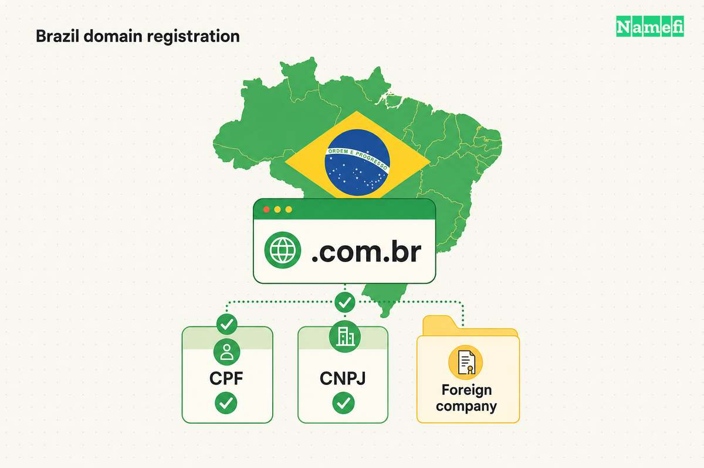

The **.br domain** is Brazil's [country-code top-level domain](/en/glossary/cctld/) (ccTLD). Most buyers choose a category such as `.com.br`, rather than a name directly under `.br`. Registration requires more than an available name. Applicants must satisfy local eligibility, identification, and category rules.

This guide explains the ordinary CPF/CNPJ route, the separate foreign-company process, and the costs and responsibilities of keeping a Brazilian domain.

## .br identifies Brazil in the domain name system

| Fact | Detail |
| --- | --- |
| TLD type | Country-code TLD for Brazil |
| IANA manager | CGI.br, the Brazilian Internet Steering Committee |
| Registration service | NIC.br, through Registro.br |
| Delegation | 1989 |
| Main commercial category | `.com.br` |
| Identification | CPF for individuals or CNPJ for legal entities, with a separate foreign-company procedure |
| IDN support | Specified Portuguese accented characters and cedilla |
| DNSSEC | Supported, with extra requirements in some categories |

[IANA's delegation record](https://www.iana.org/domains/root/db/br.html) identifies CGI.br as the manager and records the 1989 delegation. The [Registro.br contract](https://registro.br/dominio/contrato/) identifies NIC.br as the registration service provider. The delegation record establishes management, rather than registration eligibility.

## .com.br is the ordinary commercial choice

Registro.br offers registrations under [defined categories](https://registro.br/dominio/categorias/). `.com.br` and `.net.br` serve commercial activity. Other categories describe professions, technology, locations, education, or public bodies. A label such as `brand.com.br` therefore contains a registrant-selected name, a category, and the country code.

The catalogue distinguishes categories that accept CPF, CNPJ, or both. Some categories require supporting documents, institutional authorization, or DNSSEC. For example, `.edu.br` requires proof of higher-education activity, while `.org.br` requires proof of a nonprofit organization. Consult the [category documentation requirements](https://registro.br/ajuda/registro-de-novos-dominios/categorias-envio-documentacao/) before choosing a restricted category.

The [registry statistics](https://registro.br/dominio/estatisticas/) displayed 6,028,037 total domains and 5,571,552 `.com.br` domains on October 21, 2026. That makes `.com.br` about 92.4% of the total. The displayed 98.61% figure concerns the **generic category group**, not the entire namespace.

Direct `name.br` registration is not a general commercial alternative. NIC.br's [academic-domain clarification](https://www.nic.br/registro-nota-edu/) records the closure of automatic root registration, individual assessment, and preservation of qualifying historical academic names. The current category catalogue does not offer unrestricted direct `.br` registrations. An existing university address under `.br` therefore does not establish that a business can buy an equivalent direct name.

## Applicants must satisfy Brazilian eligibility requirements

Registro.br's [eligibility guidance](https://registro.br/ajuda/registro-de-novos-dominios/quem-pode-registrar/) describes companies and adult individuals legally established in Brazil, with a contact in Brazil. The [general rules](https://registro.br/dominio/regras/) require regular identification records with the Ministry of Finance.

- **Individuals provide a CPF**, the Brazilian individual taxpayer identifier.
- **Legal entities provide a CNPJ**, the Brazilian legal-entity identifier.
- **Applicants satisfy category requirements**, in addition to the general eligibility rules.

The CPF is an identification requirement, rather than proof that every foreign individual can register. An individual who lives abroad should obtain an eligibility determination from Registro.br before purchasing services. The published foreign-company process applies to companies, rather than all overseas individuals.

The [registration contract](https://registro.br/dominio/contrato/) requires truthful, complete, current registrant data. False or invalid identification and failure to provide requested documents can lead to cancellation. Register the domain under the correct holder, rather than borrowing another person's CPF or CNPJ.

## Foreign companies must complete a separate registration process

A foreign company must appoint a representative legally established in Brazil. Registro.br then creates an identifier that the company uses instead of a CNPJ. The [official foreign-company instructions](https://registro.br/dominio/regras/empresas-estrangeiras/) list these documents:

1. A power of attorney with the signature notarized in the company's country of origin.
2. A notarized declaration of commercial activity, including company and legal-representative details.
3. A notarized commitment to establish activities permanently in Brazil within 12 months.
4. Brazilian consular legalization of those three documents.
5. Sworn translations of those three documents.
6. A copy of the representative's CPF or CNPJ.
7. A representative's letter identifying the foreign holder's contact ID.

The power of attorney must cover registration, cancellation, ownership transfer, and changes to the holder contact. The representative must also register their own entity if necessary. Domain billing contacts must reside in Brazil. Registro.br handles changes to the foreign holder's corporate name administratively.

These requirements come from the instructions available on October 21, 2026. Confirm document acceptance with Registro.br before arranging legalization or translation. The process involves a commitment to Brazilian activities, rather than a presence-free way to buy a country-code domain.

## Name rules also cover accents and hyphens

Under the [current syntax rules](https://registro.br/dominio/regras/), the chosen label must:

- Contain 2–26 characters, excluding the category.
- Use letters, digits, hyphens, or the specified Portuguese accented characters.
- Include at least one character other than a digit.
- Start and end with a character other than a hyphen.

Registro.br compares equivalent names by removing accents, replacing `ç` with `c`, and removing hyphens. A different holder's equivalent name blocks registration within the same category. CGI.br's [registration resolution, article 3](https://www.cgi.br/resolucoes/documento/2008/008), states that category boundary.

Check the accented and unaccented versions together. Registro.br [recommends registering both versions](https://registro.br/ajuda/registro-de-novos-dominios/) for web use when possible. An accented spelling does not provide a way around another holder's equivalent registration.

## Owners must configure DNS and maintain DNSSEC correctly

The [registration rules](https://registro.br/dominio/regras/) require at least two authoritative [DNS](/en/glossary/dns/) servers. Applicants can use Registro.br's servers in eligible categories. Applicants who supply external servers must configure those servers for the new domain. The [new-domain guidance](https://registro.br/ajuda/registro-de-novos-dominios/preciso-provedor-para-registrar/) explains the available options and exceptions.

Registro.br supports [DNSSEC](/en/glossary/dnssec/), as its [DNSSEC guidance](https://registro.br/tecnologia/dnssec/) and live deployment statistics show. Some restricted categories require DNSSEC. Confirm the selected category's requirements and coordinate signing changes with the DNS provider, especially during a provider migration.

## Registro.br publishes registration and renewal prices

Registro.br's [payment page](https://registro.br/ajuda/pagamento-de-dominio/) lists R$40 for one year, R$76 for two years, and R$364 for ten years. Those prices applied to almost all categories when checked on October 21, 2026. `.nom.br` has a different minimum-period schedule, and the service provider sets `.emp.br` pricing.

A provider can bundle administration or other services with registration. Compare the provider's total with the direct registry schedule. Do not assume that string length determines the registry's standard maintenance charge.

The [contract, clauses seven and nine](https://registro.br/dominio/contrato/), links renewal to payment for another 12 months or a longer offered period. The payment guidance warns that nonpayment leads to freezing and eventual release for another registration. Keep billing contacts current and confirm payment before expiry. A reminder email alone does not renew the domain.

## Brazil targeting does not guarantee search rankings

Google uses country-code domains as a signal of a site's intended country audience. `.br` does not appear in [Google's list of country-code domains treated as generic](https://developers.google.com/search/docs/specialty/international/managing-multi-regional-sites).

Choose `.com.br` when Brazilian customers form the intended audience and the registrant qualifies. Consider [.com](/en/tld/com/) when a geographic signal does not match the business. Neither choice guarantees rankings. The earlier claim that `.br` necessarily improves Brazilian rankings or harms international rankings was too strong.

## Domain holders remain responsible for naming disputes

An available domain can still conflict with another party's rights. The [contract](https://registro.br/dominio/contrato/) places responsibility for the chosen name and its use on the applicant. Eligibility checks do not constitute trademark clearance or guarantee email reputation.

Registro.br's [SACI-Adm page](https://registro.br/dominio/saci-adm/) describes an administrative dispute system for `.br` names registered after October 2010. The contract also addresses SACI-Adm procedures and Brazilian law. Review relevant rights before registration, particularly when a name resembles an established business or trademark.

## Applicants can follow a practical registration sequence

1. Check the holder's eligibility and identification.
2. Choose `.com.br` or another suitable category.
3. Search the registry for the name and equivalent spellings.
4. Complete any category or foreign-company documentation.
5. Configure authoritative DNS and any required DNSSEC.
6. Pay the maintenance charge and confirm the registration.
7. Keep contact details current and monitor renewal dates.

## These answers address common .br questions

### Can anyone register a .br domain?

No. The ordinary route requires an adult individual or legal entity legally established in Brazil, CPF or CNPJ identification, and a contact in Brazil. Foreign companies have a separate documented representative process. A CPF alone does not establish that any foreign individual qualifies.

### Does a .br domain affect SEO?

Google treats .br as a country-code domain associated with Brazil. The country signal can help Google identify the intended audience, but it does not guarantee higher rankings. A global site should consider whether Brazil-specific targeting matches its audience.

### What is the difference between .com.br and direct .br?

.com.br is a commercial category available through ordinary registration to eligible individuals and legal entities. Direct names such as name.br are not a general commercial alternative. NIC.br documents the closure of automatic root registration and preservation of qualifying historical academic names.

### Who runs the .br domain?

IANA lists Comite Gestor da Internet no Brasil, or CGI.br, as the .br manager. NIC.br provides registration services through Registro.br. Registry rules and the registration contract govern eligibility and maintenance.

## These resources explain related domain choices

- [What is a TLD?](/en/blog/what-is-a-tld)
- [ccTLD market share by registration volume](/en/blog/cctld-market-share-by-registration-volume)
- [Domain hacks explained](/en/blog/domain-hacks-explained)
- [Top TLDs to secure for your business](/en/blog/top-tlds-to-secure-for-your-business)
- Glossary: [ccTLD](/en/glossary/cctld), [registrar](/en/glossary/registrar), [ICANN](/en/glossary/icann), [registry](/en/glossary/registry), [IDN](/en/glossary/idn)
- Compare TLDs: [.com](/en/tld/com), [.mx](/en/tld/mx), [.ca](/en/tld/ca), [.au](/en/tld/au)

## These primary sources document .br rules

All sources were opened on October 21, 2026, America/Los_Angeles. Registro.br pages required a rendered browser to display their text.

- [IANA .br delegation record](https://www.iana.org/domains/root/db/br.html).
- [Registro.br general registration rules](https://registro.br/dominio/regras/) and [new-domain guidance](https://registro.br/ajuda/registro-de-novos-dominios/).
- [Registro.br foreign-company requirements](https://registro.br/dominio/regras/empresas-estrangeiras/).
- [Registro.br category catalogue](https://registro.br/dominio/categorias/) and [live statistics](https://registro.br/dominio/estatisticas/).
- [Registro.br contract, dated November 26, 2024](https://registro.br/dominio/contrato/).
- [Registro.br payment and renewal guidance](https://registro.br/ajuda/pagamento-de-dominio/).
- [Registro.br DNSSEC guidance](https://registro.br/tecnologia/dnssec/) and [SACI-Adm overview](https://registro.br/dominio/saci-adm/).
- [CGI.br registration resolution 2008/008](https://www.cgi.br/resolucoes/documento/2008/008).
- [NIC.br clarification on historical academic .br names](https://www.nic.br/registro-nota-edu/).
- [Google Search Central's international targeting guidance](https://developers.google.com/search/docs/specialty/international/managing-multi-regional-sites).
