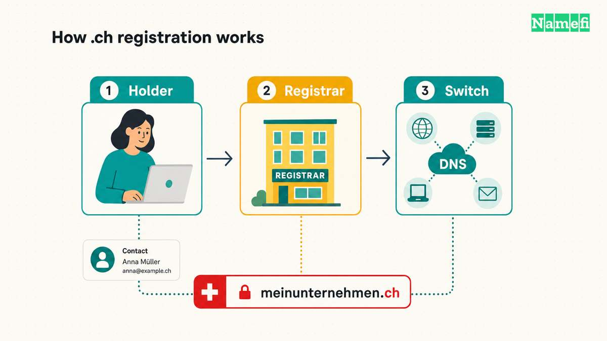

The **.ch domain** is Switzerland’s [country-code top-level domain](/en/glossary/cctld/). **Switch** operates the registry on behalf of [OFCOM, the Swiss communications regulator](https://www.bakom.admin.ch/en/ch-internet-domain-names).

People and businesses outside Switzerland can register .ch names. However, open eligibility does not remove contact-data duties, reserved-name rules, or third-party rights. This guide explains the country association, registration process, costs, privacy, and search implications.

## The .ch domain identifies Switzerland

| Fact | Detail |
| --- | --- |
| Country | Switzerland |
| Registry | Switch, under OFCOM oversight |
| Delegation date | May 20, 1987 |
| General eligibility | No Swiss citizenship, residence, or business-location requirement |
| Standard name length | 3–63 characters, subject to statutory or approved exceptions |
| Accented names | Supported characters appear in the registry’s permitted-character lists |
| DNSSEC | Supported |
| Buying a name | Use a registrar rather than buying directly from Switch |

[IANA’s .ch record](https://www.iana.org/domains/root/db/ch.html) confirms the delegation and current operator. Switch’s [registration FAQ](https://www.nic.ch/support/general/) and [General Terms and Conditions](https://www.nic.ch/terms/agb/) govern registration questions.

CH abbreviates **Confoederatio Helvetica**, the Latin name for the Swiss Confederation. The [Swiss Federal Archives](https://www.bar.admin.ch/en/the-confederation-before-1798) documents the Latin designation and the CH abbreviation.

## The .ch registry has changed since 1987

- **1987:** IANA records .ch’s delegation on May 20.
- **1990:** Switch dates its registry role to 1990 in its [domain statistics explanation](https://www.nic.ch/statistics/domains/). The delegation date and Switch’s registry history describe different events.
- **2004:** Switch introduced accented domain names in March, as its [contemporary IDN announcement](https://www.presseportal.ch/fr/pm/100004516/100471895) explains.
- **2015–2016:** Switch ended direct sales on January 1, 2015. Switch [completed the transfer of customer administration to registrars in May 2016](https://www.nic.ch/transfer/).
- **2021:** Switch stopped displaying personal holder data in public lookups on January 1. Its [information service](https://www.nic.ch/whois/domaininfo/) explains access exceptions.

## International applicants must follow .ch registration rules

Switch’s [FAQ confirms that foreign applicants can register](https://www.nic.ch/support/general/#:~:text=Do%20I%20have%20to%20be%20Swiss). A .ch address therefore does not prove Swiss ownership, a Swiss office, or Swiss hosting.

The [registry terms, sections 2.5–2.6](https://www.nic.ch/terms/agb/), add two important duties. Holders must maintain accurate contact data. On a competent Swiss authority’s request, Switch can require a holder without a valid Swiss correspondence address to provide one and identity details within 30 days. Failure to comply leads to revocation.

Sections 3.1.1–3.1.2 set the application and naming rules. Standard names contain 3–63 characters. Statutory or approved exceptions exist, so “all two-letter names are reserved for cantons” overstates the rule. Reserved names and prohibited hyphen positions also limit registration. Swiss municipality names have specific protections, as Switch’s [legal information](https://www.nic.ch/terms/) explains.

Availability does not establish permission to use a trademark. The holder must check third-party rights before registration. Switch’s [dispute service](https://www.nic.ch/terms/disputes/) provides a separate route for rights disputes. Its [procedure combines conciliation with a possible expert decision](https://www.nic.ch/terms/disputes/proceedings/). Civil proceedings remain possible.

## Registrars handle .ch purchases, prices, and transfers

Switch lists its [contractual registrars](https://www.nic.ch/registrars/). Switch does not sell names directly to end customers. ICANN accreditation alone does not establish a registrar’s relationship with this country-code registry.

Switch’s [FAQ states that prices depend on the registrar](https://www.nic.ch/support/general/#:~:text=What%20does%20a%20domain%20name%20cost). Compare the following items before checkout:

| Cost or term | What to check |
| --- | --- |
| Registration | First-year price, currency, and taxes |
| Renewal | Regular renewal price and billing date |
| Additional services | Separate hosting, email, or DNS charges |
| Transfer | Registrar process, possible charges, and service continuity |
| Aftermarket purchase | Seller’s price, separate from ongoing registrar charges |

The same FAQ explains registrar transfers: obtain an **Auth-Code** from the current registrar and supply the code to the new registrar. Keep the code private.

For a new registration:

1. Search for the exact name with a registrar that supports .ch.
2. Check naming rules and potential rights conflicts.
3. Compare renewal fees and included services.
4. Provide accurate holder details and complete the registrar’s checks.
5. Configure nameservers, hosting, and email as required.

A domain purchase does not automatically include a working website. At Namefi, check current .ch availability and supported services before planning a purchase. The general [domain guide](/en/blog/what-is-domain/) explains the separate parts of a website address.

## A .ch domain gives Google a geographic signal

Google explains that [country-code domains indicate a target country](https://developers.google.com/search/docs/specialty/international/managing-multi-regional-sites). Google’s published generic-ccTLD list does not include .ch.

Choose .ch when Switzerland forms an important part of the intended audience or brand. Consider a generic extension such as [.com](/en/tld/com/) when the site needs an address without a country-code association. The geographic signal does not guarantee Swiss rankings or prevent international visibility.

A [domain hack](/en/blog/domain-hacks-explained/) can use “ch” to finish a word across the dot. The naming technique does not change the registry rules or Google’s geographic interpretation. Test pronunciation and spelling before choosing the name.

## The .ch suffix does not certify a business or an email sender

A Swiss country association can fit a Swiss business, institution, or community. The association does not verify business quality or security. Public examples include the [Swiss government portal](https://www.admin.ch/) and [Swiss Radio and Television](https://www.srf.ch/).

For email, evaluate the provider’s authentication setup and sending practices. Do not treat the suffix as an inbox-delivery guarantee. For accented names, Switch’s [IDN guidance](https://www.nic.ch/support/idn/) advises against relying solely on an IDN for important applications.

## Public .ch lookups limit personal information

Switch’s [information service rules](https://www.nic.ch/whois/domaininfo/) distinguish public technical data from personal holder data. An identified requester must demonstrate an overriding legitimate interest to request personal data. A wish to buy the domain is insufficient.

Public lookup privacy does not remove the holder’s obligation to supply accurate information to the registrar and registry.

## These answers explain common .ch questions

### Can anyone register a .ch domain?

Swiss citizenship, residence, and a Swiss business are not general requirements. Holders must provide accurate contact data and follow registry rules. A competent Swiss authority can require a Swiss correspondence address and identity details within 30 days.

### Does a .ch domain affect SEO?

Google uses country-code domains as geographic signals. A .ch domain indicates a Swiss audience, but the extension does not guarantee rankings or prevent visibility elsewhere.

### Who runs the .ch domain?

Switch operates the .ch registry on behalf of OFCOM. Registrars handle customer registration and administration. Switch stopped direct sales on 1 January 2015.

### Why does Switzerland use the letters CH?

CH abbreviates Confoederatio Helvetica, the Latin name for the Swiss Confederation.

## These sources document the .ch rules

Sources fetched on October 21, 2026:

- [IANA .ch delegation record](https://www.iana.org/domains/root/db/ch.html).
- [Switch registration FAQ](https://www.nic.ch/support/general/).
- [Switch General Terms and Conditions](https://www.nic.ch/terms/agb/), sections 2.5–2.6 and 3.1.
- [Switch legal information](https://www.nic.ch/terms/) and [dispute proceedings](https://www.nic.ch/terms/disputes/proceedings/).
- [Switch registrar list](https://www.nic.ch/registrars/) and [completed customer transfer](https://www.nic.ch/transfer/).
- [Switch registry history note](https://www.nic.ch/statistics/domains/) and [2004 IDN announcement](https://www.presseportal.ch/fr/pm/100004516/100471895).
- [Switch IDN guidance](https://www.nic.ch/support/idn/) and [holder information service](https://www.nic.ch/whois/domaininfo/).
- [OFCOM’s .ch overview](https://www.bakom.admin.ch/en/ch-internet-domain-names).
- [Google’s guidance for regional sites](https://developers.google.com/search/docs/specialty/international/managing-multi-regional-sites).
- [Swiss Federal Archives: The Confederation before 1798](https://www.bar.admin.ch/en/the-confederation-before-1798), “From the Switzers to the Swiss.”
