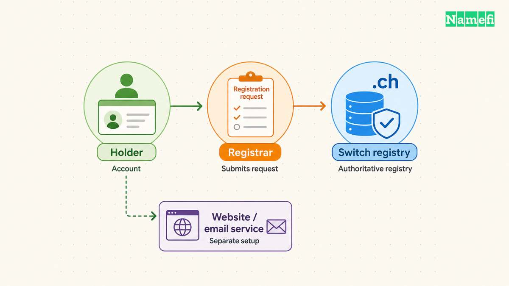
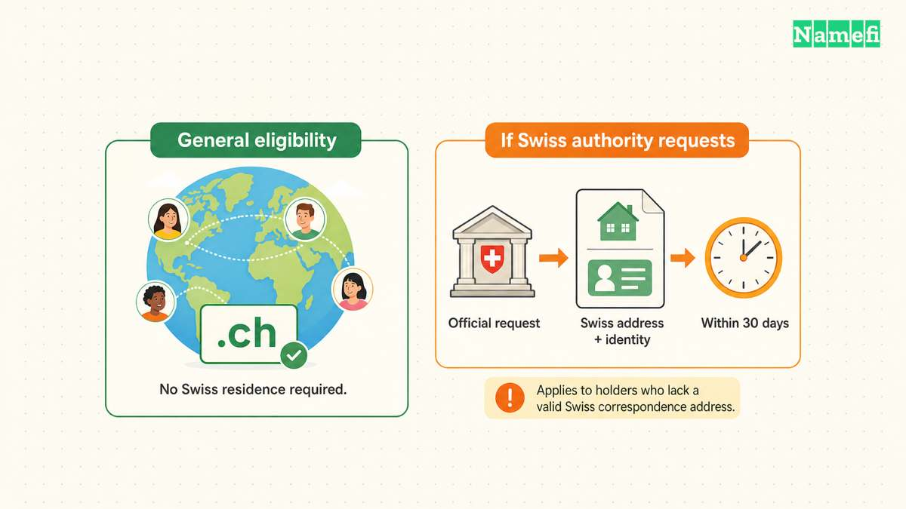

You can register a `.ch` domain without being Swiss, living in Switzerland, or basing your business in Switzerland. Switch’s [registration FAQ states the eligibility rule](#switch-explains-ch-eligibility-and-pricing). Use a registrar from [Switch’s official registrar list](https://www.nic.ch/registrars/) to search the name and complete the purchase.

Open eligibility does not remove the registry’s naming rules or holder duties. Compare the registrar’s renewal terms, supply accurate contact details, and plan the website and email services separately.

## The Swiss registry and the registrar perform different jobs

`.ch` is Switzerland’s country-code top-level domain. [IANA’s delegation record identifies Switch as the manager](#iana-identifies-the-swiss-delegation). The registry maintains the registration system, while the registrar handles the customer-facing purchase and administration workflow.

Use [Switch’s registrar directory](#switch-lists-its-registrars) as the official starting point. Check that the chosen provider supports the required services and offers terms the intended holder can maintain.

A registrar that supports another extension does not automatically have the same relationship with `.ch`. Verify support for the exact extension before planning a transfer or purchase.

Our [TLD guide](/en/blog/what-is-a-tld/) explains the country-code category. A country association describes the extension. The association does not certify the nationality, business quality, or security of every site beneath the extension.

## Applicants outside Switzerland still have contact duties

Switch says applicants do not need Swiss citizenship, residence, or a Swiss business location. The same FAQ warns that a `.ch` address does not necessarily mean that the operator is Swiss. [Read the registry’s wording](#switch-explains-ch-eligibility-and-pricing) rather than treating the extension as a verified business credential.

The General Terms and Conditions require the holder’s information to remain complete, correct, and current. The holder must report changes through the registrar. [The data-maintenance provisions describe the obligation](#switch-defines-holder-and-naming-duties).

A specific conditional rule also matters for foreign holders. Upon a competent Swiss authority’s request, the registry can require a Swiss correspondence address and identity details within 30 days. The requirement applies to a holder without a valid Swiss correspondence address. The terms describe revocation for noncompliance.

That conditional duty differs from a universal local-address requirement at initial registration. Keep the distinction clear when comparing registrar explanations.

Choose a monitored contact email and maintain access to the registrar account. If the registration supports a business, document which legal entity holds the name. Do not leave that decision to an unrelated checkout default.

## The exact name must satisfy registry conditions

Switch’s terms specify permitted characters, hyphen restrictions, reserved-name conditions, and length limits. Standard names contain between 3 and 63 characters, subject to statutory or approved exceptions. [The grounds-for-refusal section gives the conditions](#switch-defines-holder-and-naming-duties).

Do not assume every short or apparently unused name can be registered. A name can fail because the name is reserved, violates a naming rule, or already has an earlier pending request.

Review accented names against the registry’s permitted-character annexes. Check the spelling in the registrar’s final cart and test the complete address in the applications the project needs.

Availability also does not settle another party’s rights. Switch’s terms say the registry does not judge whether registration or use infringes third-party rights. [The terms separate registration from that rights assessment](#switch-defines-holder-and-naming-duties).

For an organization, review potential name conflicts before committing to signage, email, and application configuration. This is a practical planning step rather than a legal clearance guarantee.

## Registrar prices determine the actual purchase budget

Switch says `.ch` registration costs depend on the registrar. Website and nameserver services can create separate charges. [The FAQ explicitly separates those costs](#switch-explains-ch-eligibility-and-pricing).

Compare the same name and term across the providers you consider:

| Item | Check before purchase |
| --- | --- |
| Registration | Exact term, currency, taxes, and total charge |
| Renewal | Renewal amount, term, and billing date |
| DNS | Included record management and support |
| Website | Whether hosting exists or requires another product |
| Email | Mailboxes, sending service, and separate subscription |
| Transfer | Authorization process and disclosed charges |

This article does not quote a universal `.ch` price. The selected registrar’s current checkout and agreement determine the actual amount.

A low initial quote can still accompany a renewal obligation that does not fit the project. Record the ordinary renewal terms before buying. Keep optional services only when the project needs those services.

## A registration can precede a working website

Switch’s FAQ says a domain can be registered without active use. The General Terms and Conditions separately describe the nameserver requirements for using the domain. [Review the registry’s use provisions](#switch-defines-holder-and-naming-duties).

After registration, identify the authoritative DNS provider and add the records your host requests. Keep mail and verification records intact when connecting a website.

Our [website launch guide](/en/blog/build-website-with-domain/) explains the sequence. A domain appearing in the registrar account does not prove that the website, HTTPS certificate, or mailbox works.

For a hypothetical `www.example.com` website, obtain the actual destination from your host. The hostname illustrates structure only. The example does not represent a purchasable domain or a recommended DNS target.

## You should plan maintenance and transfers before the name becomes critical

Save the registrar account details, holder identity, renewal date, and responsible contact. Use the available account authentication and recovery controls.

Switch’s FAQ says registrar transfers use a transfer code, also called an Auth-Code, obtained from the current registrar and supplied to the new registrar. [The FAQ describes the process](#switch-explains-ch-eligibility-and-pricing). Keep the code private and coordinate the DNS configuration during a move.

Choose `.ch` when the address fits the project’s Swiss association and the holder can meet the registration duties. Complete the purchase with a registrar whose renewal and support terms fit the project, then verify the services that use the name.

## Sources and further reading

### Switch explains ch eligibility and pricing

[Switch explains ch eligibility and pricing](https://www.nic.ch/support/general/#:~:text=You%20can%20register%20a%20.ch%20domain%20name%20without%20being%20Swiss%20and%20without%20living%20in%20Switzerland%20or%20having%20your), checked 2026-10-30.

### IANA identifies the Swiss delegation

[IANA identifies the Swiss delegation](https://www.iana.org/domains/root/db/ch.html#:~:text=Category%20Classification%20based%20on%20purpose%20and%20governing%20global%20allocation%20policy%20Country-code%20top-level%20domain), checked 2026-10-30.

### Switch lists its registrars

[Switch lists its registrars](https://www.nic.ch/registrars/#:~:text=Here%20is%20a%20complete%20list%20of%20Switch%27s%20contractual%20partners%20%28registrars%29.%20These%20companies%20are%20responsible%20for%20registering%20and%20administering), checked 2026-10-30.

### Switch defines holder and naming duties

[Switch defines holder and naming duties](https://www.nic.ch/terms/agb/#:~:text=The%20holder%20will%20report%20any%20changes%20to%20the%20registrar%20without%20undue%20delay.), checked 2026-10-30.
