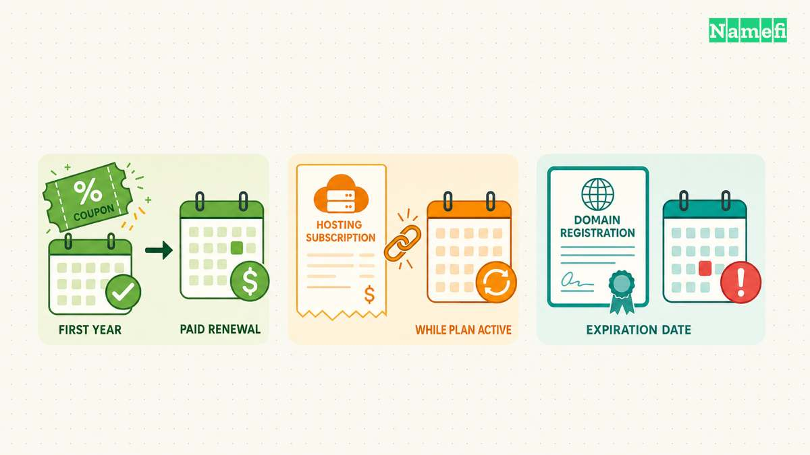
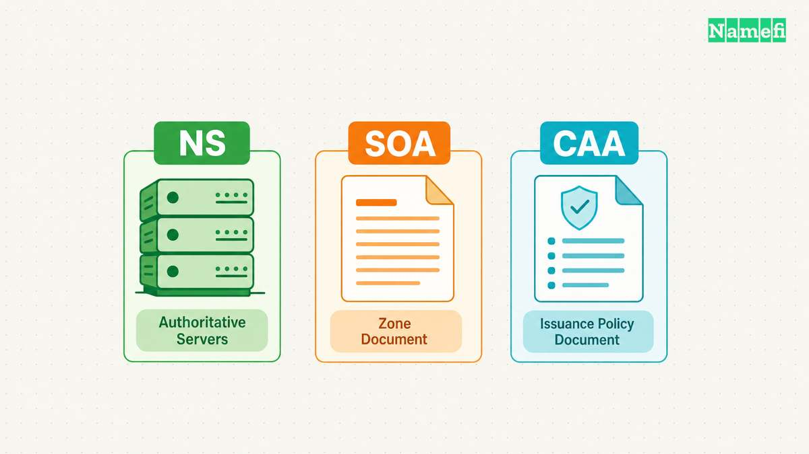

Buy an available .com domain through a registrar or a registrar's reseller. Compare the first registration charge with the renewal quote before checkout. [ICANN defines the registrar's registration role](#icann-defines-accredited-registrars). [IANA identifies Verisign as the .com registry manager](#iana-identifies-the-com-registry). The registry and the retail seller have different jobs.

For an official buying route, start with [Cloudflare's registration instructions](https://developers.cloudflare.com/registrar/get-started/register-domain/#how-to-register-a-new-domain), then compare the exact name with another seller's checkout. Read the DNS restriction before choosing Cloudflare. This guide provides a comparison method, rather than an unverified lowest-price ranking.

## Availability determines which buying process you need

Search for the complete name, including `.com`. Check the spelling before evaluating a price. A name that looks similar to the intended brand can create a separate problem that a discounted registration cannot solve.

Read the search result carefully. An available registration, a listed resale, and a broker invitation represent different purchase tasks. Do not treat a seller's invitation to make an offer as a confirmed registration price.

If the name already has a registrant, the [domain value guide](/en/blog/what-makes-a-domain-valuable/) can help frame an acquisition decision. A new registration checkout does not establish that an existing owner will sell.

Keep alternatives concrete. Compare the same complete name where possible. When comparing different names, record the change explicitly. A lower quote for a different extension does not answer the cost of the desired .com registration.

For the new-registration branch, enter the complete `.com` candidate in [Namefi's domain search](https://namefi.io/#register). Review the current result before checkout. An unavailable result does not provide an aftermarket purchase process, and a displayed offer is not a completed registration.

## The initial quote needs a matching renewal quote

A useful comparison separates registration, renewal, transfer, taxes, and optional services. The [domain holding cost guide](/en/blog/how-much-is-a-domain-understanding-holding-cost/) explains why the later obligation matters.

Record the seller, exact name, currency, registration term, and quote date. Then obtain the renewal quote for the same name. If the renewal amount is unavailable, mark the amount unknown and ask the seller before purchasing.

Cloudflare describes a model based on registry and ICANN charges without its own markup. [The provider explains that pricing model publicly](#cloudflare-describes-its-retail-pricing-model). That statement does not provide a current checkout quote for every reader, tax situation, or registration term.

This article intentionally omits a price table. A table without verified, comparable current quotes can create false precision. The order summary remains the relevant source for the actual purchase.

| Cost field | What the comparison must establish |
| --- | --- |
| Registration | Total charge for the selected initial term |
| Renewal | Charge and term after the initial registration |
| Transfer | Charge and conditions for a future registrar move |
| Taxes and currency | What checkout includes and the currency billed |
| Extras | Separate charges for services you intentionally select |

Save the order summary before payment. Remove optional services that the project does not require. Keep required services in the comparison instead of excluding them to make one quote appear lower.

## DNS control can matter as much as the registration charge

A registrar choice can constrain how the project manages DNS. Cloudflare says domains registered through Cloudflare Registrar must use Cloudflare nameservers. [Its documentation says customers cannot select another provider's nameservers while using Cloudflare Registrar](#cloudflare-explains-registration-and-dns-restrictions).

That condition can suit a project that already wants Cloudflare DNS. The condition can conflict with a project that requires another authoritative DNS provider. Decide before purchase, rather than discovering the restriction during a website migration.

Ask every seller which controls the account provides. Check DNS record editing, nameserver changes, DNSSEC management, renewal management, and access for collaborators. Do not assume a website builder's domain connection feature supplies all registrar controls.

The [nameserver change guide](/en/blog/change-domain-nameservers/) explains the difference between changing the DNS operator and editing an individual website record. A .com registration alone does not publish the website's content or configure its email.

## Account recovery protects the registration you buy

Use the intended owner's account and accurate registration information. Confirm access to the recovery email before making the purchase. Enable the seller's supported account protections and store recovery material through the owner's established secure process.

Cloudflare's registration documentation requires a verified account email and describes registrant email verification. [The provider also documents post-purchase contact and renewal controls](#cloudflare-explains-registration-and-dns-restrictions). Follow the seller's actual verification instructions rather than assuming payment completes every requirement.

Keep the registration account separate from temporary contractor access. A contractor can help build a website without becoming the only person able to manage the domain. Assign appropriate access when the seller supports collaborator roles.

Record the renewal date, billing account, and person responsible for ongoing management. A project handoff should include those administrative facts alongside website credentials and source files.

## Transfer conditions should enter the decision before checkout

Changing registrars differs from moving a website to another host. A DNS change may support a hosting move while the registration stays with the same seller.

[ICANN documents conditions that can prevent a registrar transfer](#icann-explains-domain-transfer-constraints), including certain recent registrations and transfers. ICANN also explains that registrars can set transfer fees. Read the current seller's transfer instructions and confirm the account can request the required authorization.

Do not plan a launch around an immediate transfer of a newly registered name. Ask both registrars about the relevant eligibility conditions if a move forms part of the project plan.

## A clear purchase record makes the decision reviewable

Before submitting payment, confirm the exact .com spelling, registration term, renewal quote, DNS requirements, and account owner. Review each optional service separately. Keep a dated copy of the selected terms.

After registration, confirm that the name appears in the intended account. Complete the seller's verification requests. Then follow the website and email providers' DNS instructions.

The next action is to obtain comparable quotes for one exact name. Choose the seller whose complete cost and account controls fit the project. The advertised first-year amount should support that decision, rather than substitute for the decision.

## Sources and further reading

### IANA identifies the COM registry

[IANA identifies the COM registry](https://www.iana.org/domains/root/db/com.html#:~:text=VeriSign%20Global%20Registry%20Services) — checked 2026-10-30.

### ICANN defines accredited registrars

[ICANN defines accredited registrars](https://www.icann.org/resources/pages/registrars/registrars-en#:~:text=An%20accredited%20registrar) — checked 2026-10-30.

### Cloudflare explains registration and DNS restrictions

[Cloudflare explains registration and DNS restrictions](https://developers.cloudflare.com/registrar/get-started/register-domain/#prerequisites-and-restrictions) — checked 2026-10-30.

### Cloudflare describes its retail pricing model

[Cloudflare describes its retail pricing model](https://www.cloudflare.com/products/registrar/#:~:text=registries%20and%20ICANN) — checked 2026-10-30.

### ICANN explains domain transfer constraints

[ICANN explains domain transfer constraints](https://www.icann.org/resources/pages/name-holder-faqs-2017-10-10-en#:~:text=60%20days) — checked 2026-10-30.
