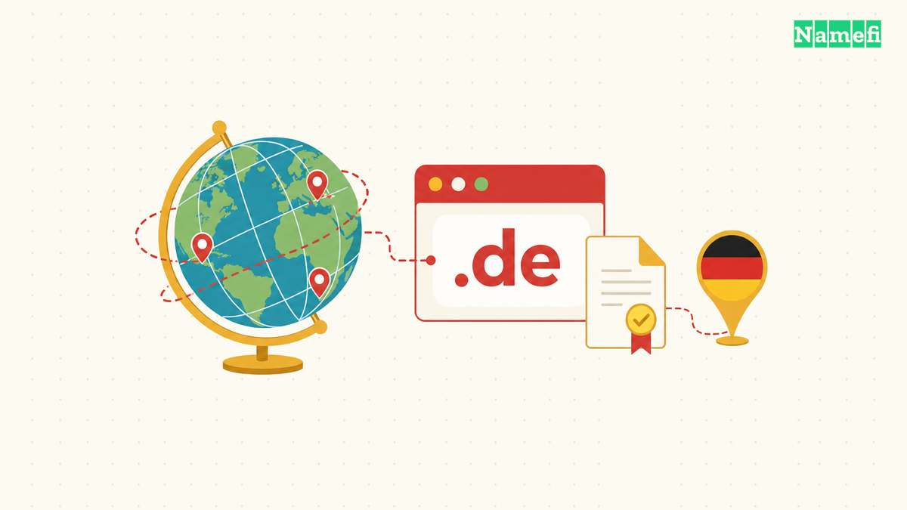

The **.de domain** is the official [country-code top-level domain](/en/glossary/cctld/) (ccTLD) for **Germany**, and one of the largest ccTLDs on the internet by registration count. Run by the Frankfurt-based cooperative [DENIC eG](https://www.denic.de/en/about-us/who-we-are), .de is open to registrants anywhere in the world, not just Germany — but it carries an unmistakable "made for Germany" signal that shapes how both users and search engines read it. This guide covers who runs .de, its history, who it suits, and the honest trade-offs, sourced directly from DENIC's own registration terms.

## .de at a glance

| Fact | Detail |
| --- | --- |
| TLD type | Country-code top-level domain (ccTLD) for Germany |
| Registry operator | [DENIC eG](https://www.denic.de/en/about-us/who-we-are) — a member cooperative based in Frankfurt am Main |
| Year launched | Delegated by IANA on 5 November 1986 |
| IDN support | Yes — umlauts (ä, ö, ü) and ß are supported |
| DNSSEC | Supported |
| Registration restrictions | Open to all worldwide; DENIC can require a Germany-domiciled representative for legal service on request (see below) |
| Best for | Businesses targeting the German market, German-language sites, brands wanting explicit local trust |

## What is .de?

.de is Germany's [ccTLD](/en/glossary/cctld/), delegated under the ISO 3166-1 country code for Germany. Its delegation record is public in the [IANA root-zone database](https://www.iana.org/domains/root/db/de.html), which lists **DENIC eG** as the sponsoring organization. Unlike a generic [TLD](/en/glossary/tld/) such as [.com](/en/tld/com/), .de is administered under DENIC's own German-law contract rather than a standard ICANN registry agreement. DENIC's [Domain Terms and Conditions](https://www.denic.de/en/domain-terms-and-conditions/) govern the registration contract.

For search visibility, Google's own guidance on [managing multi-regional sites](https://developers.google.com/search/docs/specialty/international/managing-multi-regional-sites?hl=en#:~:text=tied%20to%20a%20specific%20country%20%28for%20example%20.de%20for%20Germany) names .de explicitly as an example of a ccTLD "tied to a specific country" — Google does not treat .de as one of its generic vanity ccTLDs (a short list that includes .co, .io, and .tv). A .de site sends a real, explicit signal that the content targets German users.

## IANA records the delegation and DENIC operates .de

IANA records the .de delegation date as **5 November 1986**. DENIC eG formed later, in **1996**, with 37 founding members. DENIC now describes a cooperative of around 300 members and more than 17 million registered domains. The delegation date and the cooperative's founding date describe different events. See [IANA's record](https://www.iana.org/domains/root/db/de.html) and [DENIC's account](https://www.denic.de/en/about-us/who-we-are).

## How people use .de

- **German-market businesses** — retailers, service firms, and local branches of international companies that want an unambiguous "we operate in Germany" signal.
- **German-language publishers and media** — news, blogs, and content sites written primarily for German-speaking readers.
- **Brands with a legal or physical presence in Germany** — since a .de address reinforces that local footprint.
- **International companies opening a German storefront**, often running .de alongside their global .com as the localized entry point.
- **Personal and hobby sites** aimed at a German audience, taking advantage of a namespace many Germans recognize by default.

**Who it's not ideal for:** projects chasing a global, English-first audience, where the strong Germany association works against broader reach, or buyers hoping for cheap, short, generic names — three-plus decades of registrations have left the .de namespace mature and comparatively scarce.

## Notable sites using .de

Major, everyday examples of active .de sites include **bild.de** (Bild), **spiegel.de** (Der Spiegel), **zeit.de** (Die Zeit), and **otto.de** (OTTO). These sit alongside countless German small and mid-sized businesses (the "Mittelstand") for whom a .de address is the default way to be found online in Germany.

## .de vs other domains

| Factor | .de | [.com](/en/tld/com/) | [.eu](/en/tld/eu/) | [.co](/en/tld/co/) |
| --- | --- | --- | --- | --- |
| Type | ccTLD (Germany) | Legacy gTLD | ccTLD (European Union) | ccTLD (used globally) |
| Registration restrictions | Open worldwide (conditional local-rep clause) | Open | [EU/EEA citizenship, residency, or establishment required](https://help.eurid.eu/hc/en-gb/articles/9731617172381-Who-can-register-a-eu-or-its-variants-in-other-scripts-domain-name) | Open |
| Google geo-signal | Germany-targeted | Generic | Treated as generic by Google | Generic |
| Namespace maturity | Very mature — short names scarce | Extremely mature | Younger, more availability | Younger, more availability |

Choose **.com** for a globally neutral default, **.de** when the German market is genuinely your focus, **[.eu](/en/tld/eu/)** for a pan-European identity if you or your organization meets EU/EEA eligibility, and **[.co](/en/tld/co/)** for an alternative that Google treats as geographically generic.

## Why choose .de?

- **Instant German-market credibility.** Few signals say "this business operates in Germany" as directly.
- **Large, stable, well-governed registry.** DENIC is a not-for-profit cooperative explicitly committed to neutrality and non-discrimination, not a commercial registry chasing volume.
- **Modern technical baseline.** IDN support for umlauts and ß, plus DNSSEC, are standard.
- **Genuinely open registration.** No sunrise gatekeeping or nationality test blocks a first-time buyer.

## Things to consider

- **Namespace scarcity.** With 17-plus million names registered since 1986, short and generic .de strings are largely taken.
- **German contractual language.** DENIC's domain contract is legally binding only in German; the English version is a courtesy translation.
- **The conditional local-representative clause.** It won't affect most registrants, but it is a real obligation that can surprise a non-German holder if a dispute triggers it (see below).
- **Strong geo-association.** The country signal suits a German audience. International sites should plan their language and regional URLs deliberately.

## Who can register a .de domain?

**Registration restrictions: open to all.** DENIC's own [registration page](https://www.denic.de/en/products/de-domains/registration#:~:text=Open%20to%20everyone) states .de is "open to everyone — whether you are a private individual, association, or company, in Germany or abroad." Applicants need legal capacity and accurate holder data. Applicants must respect trademark and name rights. German nationality or residence is not a registration requirement.

**Foreign holders:** DENIC can request a representative in Germany for service of official or court documents. The holder then has two weeks to name the representative. A post-office box is insufficient. The request requires a prospective serving party's application and the conditions for a DISPUTE entry. See [§3(4) of DENIC's terms](https://www.denic.de/en/domain-terms-and-conditions/).

**Holder data:** Supply accurate identity and contact details, keep the details current, and cooperate with DENIC's verification requests. Incorrect or unverified data can lead to suspension of connectivity or termination under the contract. See [DENIC's terms, §§2–3 and 7](https://www.denic.de/en/domain-terms-and-conditions/).

**Domain syntax:** DENIC allows 1–63 characters and supported IDN letters, including ä, ö, ü and ß. Names cannot start or end with a hyphen or contain hyphens in both positions three and four. The 63-character limit applies to the ACE-encoded form for IDNs. See [DENIC's Domain Guidelines, section V](https://www.denic.de/en/domain-guidelines/). DENIC also supports [DNSSEC](https://www.denic.de/en/products/dnssec/).

## DENIC distinguishes the contract term from annual billing

DENIC's contract has an **indefinite term** under [§7(1) of its terms](https://www.denic.de/en/domain-terms-and-conditions/). An annual registrar invoice describes a billing period. Check the provider's renewal and cancellation terms separately.

For a provider transfer, DENIC's password normally lasts **30 days** and permits one use. A DISPUTE entry prevents a transfer to another holder. See [DENIC's terms, §§1(4), 2(3) and 6](https://www.denic.de/en/domain-terms-and-conditions/). A token or marketplace transfer must still satisfy the registry's requirements.

## .de pricing and value

.de retail pricing depends on the provider and service bundle. DENICdirect publishes a [standard annual domain-management fee](https://www.denic.de/preisliste/#:~:text=Domainverwaltung%20f%C3%BCr%20ein%20Jahr%20inkl.%20Domainregistrierung) rather than a label-based registry premium schedule. A registrar may still offer introductory discounts, and an already registered short or dictionary name can command a higher **aftermarket** price from its owner; neither should be described as registry premium registration or renewal pricing. Compare the registrar's first-year and renewal fees before buying.

## Email operators must configure authentication

A .de domain alone does not establish a sender's trustworthiness. Configure SPF, DKIM and DMARC, maintain permission-based mailing lists, and monitor delivery results. Google's [email sender guidelines](https://support.google.com/a/answer/81126?hl=en) explain the authentication and reputation requirements for messages to personal Gmail accounts.

## Branding and naming tips

- **Mind the hyphen rule.** A name cannot start or end with a hyphen, or contain hyphens in both positions three and four.
- **Use umlauts deliberately.** ä, ö, and ü can make a name feel authentically German, but confirm your audience can type them easily; many buyers also register the ASCII version (ae, oe, ue) defensively.
- **Lean into the German association.** .de works best when "this is a German business" is part of the pitch, not incidental to it.
- **Expect to get creative.** With the zone this mature, exact-match short names are rare; compound or brandable names fare better.

## How to register a .de domain at Namefi

1. **Search** your desired `.de` name to check availability.
2. **Review** the registrar's first-year and renewal fees, and distinguish a new registration from an aftermarket purchase.
3. **Register** and configure [DNS](/en/glossary/dns) for your site or email.

[Namefi](https://namefi.io) is an [ICANN-accredited registrar](/en/glossary/accredited-registrar/) that bridges Web2 and [Web3](/en/glossary/web3/), with transparent pricing, fast DNS management, and the option to [tokenize your domain](/en/blog/what-are-tokenized-domains) into a blockchain-backed asset for easier transfers and provable ownership.

## Frequently asked questions

### Can anyone register a .de domain?

Yes. DENIC states .de registration is open to everyone worldwide, private individuals or companies. The one conditional rule: if the domain holder is not domiciled in Germany, DENIC can require them to name a Germany-domiciled authorized representative for legal service within two weeks of a request, which typically only comes up if a dispute arises.

### Does a .de domain affect SEO?

Yes. Google explicitly lists .de as a country-code top-level domain tied to Germany, and treats it as a strong geo-targeting signal for a German audience. The extension signals the intended country. The extension does not guarantee a ranking improvement or prevent international visibility.

### Who runs the .de domain?

DENIC eG, a cooperative based in Frankfurt am Main, Germany. It was founded in 1996 by 37 members and now has around 300 members, operating .de under principles of neutrality, non-discrimination, and no intention of making a profit.

### Does .de support umlauts like ä, ö, ü and ß?

Yes. DENIC supports internationalized domain names (IDNs) for .de, so registrants can use German-specific characters such as ä, ö, ü, and ß directly in a domain name, alongside standard letters, numbers, and hyphens.

## Related resources

- [What is a TLD?](/en/blog/what-is-a-tld)
- [ccTLD market share by registration volume](/en/blog/cctld-market-share-by-registration-volume)
- [How TLD affects domain value](/en/blog/how-tld-affects-domain-value)
- Glossary: [ccTLD](/en/glossary/cctld), [registrar](/en/glossary/registrar), [DNSSEC](/en/glossary/dnssec)
- Compare TLDs: [.com](/en/tld/com), [.eu](/en/tld/eu), [.co](/en/tld/co), [.uk](/en/tld/uk)

## These primary sources explain .de rules

Sources accessed on 21 October 2026 (America/Los_Angeles).

- denic.de — [DENIC eG](https://www.denic.de/en/about-us/who-we-are)
- IANA — [IANA root-zone database](https://www.iana.org/domains/root/db/de.html)
- Google Search Central — [managing multi-regional sites](https://developers.google.com/search/docs/specialty/international/managing-multi-regional-sites?hl=en#:~:text=tied%20to%20a%20specific%20country%20%28for%20example%20.de%20for%20Germany)
- denic.de — [registration page](https://www.denic.de/en/products/de-domains/registration#:~:text=Open%20to%20everyone)
- denic.de — [Domain Terms and Conditions](https://www.denic.de/en/domain-terms-and-conditions/)
- denic.de — [standard annual domain-management fee](https://www.denic.de/preisliste/#:~:text=Domainverwaltung%20f%C3%BCr%20ein%20Jahr%20inkl.%20Domainregistrierung)
- DENIC — [Domain Guidelines](https://www.denic.de/en/domain-guidelines/)
- DENIC — [DNSSEC](https://www.denic.de/en/products/dnssec/)
- Google — [Email sender guidelines](https://support.google.com/a/answer/81126?hl=en)
