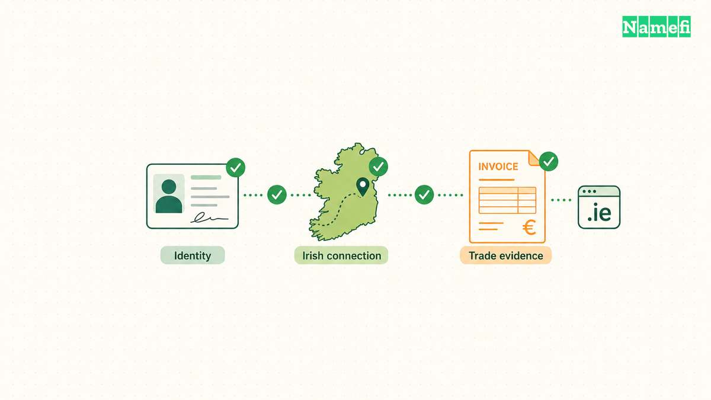

A **.ie domain** is Ireland's [country-code top-level domain](/en/glossary/cctld/). The extension suits businesses, organisations, and individuals with a genuine connection to the island of Ireland. That connection includes Northern Ireland under the registry's eligibility policy.

The important buying question is eligibility. An available name alone does not qualify an applicant. The registry checks the applicant's Irish connection and identity before registration. Overseas businesses have a documented route, but unrelated overseas individuals cannot simply register a name. Start with the [registry's document requirements](https://www.weare.ie/document-requirements/) before planning a launch.

## The .ie domain requires an Irish connection

| Fact | Detail |
| --- | --- |
| TLD type | Country-code top-level domain for Ireland |
| Registry manager | IE Domain Registry CLG |
| Registration level | Directly under .ie, as in `example.ie` |
| IDN support | Irish vowels with the fada, subject to naming rules |
| DNSSEC | Supported by the registry |
| Registration restrictions | Evidence of a real connection to the island of Ireland, plus personal or commercial identity |
| Best fit | Irish businesses, community projects, and overseas businesses serving Irish customers |

The [IANA .ie record](https://www.iana.org/domains/root/db/ie.html) establishes the delegated manager and country-code status. The operator's [Registration and Naming Policy](https://www.weare.ie/wp-content/uploads/2023/12/Registration-and-Naming-2023.pdf) establishes applicant eligibility. These sources answer different questions.

## The .ie domain identifies an Irish audience

The extension attaches an explicit Irish identity to an address. A local shop, a professional practice, or a community group can use that identity consistently across its website and email.

Google describes country-code domains as a [strong signal to users and search engines about the intended country](https://developers.google.com/search/docs/specialty/international/managing-multi-regional-sites). Choose .ie when Ireland is central to the website's audience. A global business can also maintain a separate international address. The suffix does not guarantee a search position, and it does not choose the website's language.

A German-language page about an Irish service can use .ie. An English-language site can also use .ie. Country targeting and language targeting solve different problems.

## The 2018 policy change removed the name-claim requirement

The registry changed its registration rules on **21 March 2018**. Applicants no longer had to explain their claim to a particular name. The [registry's liberalisation explanation](https://www.weare.ie/liberalisation/) explicitly preserves the identity and Irish-connection checks.

That distinction matters when older advice says every domain must match a company name or trademark. The change widened naming choices. The change did not turn .ie into an unrestricted global extension.

The current published naming policy records a December 2023 revision. The registry also publishes separate registrant terms. Read the operator's current documents when applying, because a historical account cannot replace the rules governing a new registration.

## Real organisations use .ie for public services

The registry itself operates [weare.ie](https://www.weare.ie/), with registration guidance and domain policies. Ireland's [Revenue Commissioners](https://www.revenue.ie/en/Home.aspx) use `revenue.ie` for tax information and services.

These examples show institutional use of the extension. A private business does not gain official status by registering another .ie address. Evaluate the organisation, contact details, and website content separately.

## Applicants can prove eligibility through several routes

The [document requirements](https://www.weare.ie/document-requirements/) distinguish applicant types. Select the route that matches the intended domain holder. Register the name to the actual individual or organisation, rather than a web designer acting in place of the holder.

| Applicant | Examples of evidence the registry lists |
| --- | --- |
| Irish company or business | CRO/RBN number, qualifying VAT number, or specified Revenue correspondence |
| Individual with an Irish connection | Irish passport, or qualifying identity and address documents |
| Overseas business | Commercial identity plus evidence of trade with Ireland or an accepted professional letter |
| Charity | Irish CHY number or Northern Ireland NIC number |
| School or college | Recognised school or college roll number |

An Irish passport can establish identity and connection together. A utility bill showing an Irish address requires separate proof of personal identity. Do not assume every document works alone.

For overseas businesses, the registry lists sales invoices showing sales to consumers or businesses on the island. The registry also accepts a signed letter from a solicitor, accountant, bank manager, or auditor. The letter must confirm trade or serious intention to trade in the immediate future. The applicant must also establish commercial identity, such as incorporation evidence.

The registry states that individuals who neither reside on the island nor hold citizenship there cannot meet the registration requirements. A wish to own a short domain is insufficient. Northern Irish evidence appears throughout the policy, so eligibility does not stop at the Republic's border.

## Naming and contact rules continue after approval

The naming policy permits letters, digits, and hyphens, plus fada accents on Irish vowels. A label can contain up to 63 characters. A hyphen cannot start or end the label. The policy also restricts hyphens in the third and fourth positions.

The registry prohibits names that infringe third-party rights or involve bad faith. Reserved or blocked names and certain special words have additional rules. In particular, the policy restricts use of “university” to recognised applicants. Availability searches do not replace these checks.

The policy requires at least two correctly configured authoritative nameservers. Ask the [registrar](/en/glossary/registrar/) to confirm the DNS setup before submitting an application. The registry validates applications rather than treating checkout as immediate acceptance.

Under the [Registrant Terms and Conditions](https://www.weare.ie/wp-content/uploads/2020/11/Registrant-Terms-and-Conditions-16-November-2020.pdf), holders must maintain accurate registration data and follow dispute processes. Registration grants a contractual right to use the name. Registration does not grant a trademark or permission to misuse another party's name.

## The .ie domain serves a different purpose from .com

| Choice | Appropriate planning question |
| --- | --- |
| .ie | Does the organisation qualify, and does the website principally serve Ireland? |
| [.com](/en/tld/com/) | Does the brand need a geographically neutral international address? |
| [.uk](/en/tld/uk/) | Does the website principally address the United Kingdom? |

An organisation serving both Ireland and international customers may consider more than one address. Decide which address carries the main website. Plan redirects and email use before printing either address on packaging or business cards.

A Northern Irish applicant may qualify for .ie under the island-wide connection rules. The branding decision still depends on the intended audience. Eligibility and marketing strategy are separate decisions.

## Costs depend on the registrar and the transaction

Compare the complete registration and renewal terms. Ask about restoration charges, optional hosting, email services, and the cost of changing providers. A domain purchase does not automatically include a website or a mailbox.

A purchase from an existing holder also involves a separate negotiated price. The incoming holder must satisfy the registry's requirements. A valuable name does not create an exception to eligibility rules.

The [registry FAQ](https://www.weare.ie/frequently-asked-questions/) describes registrar transfers through an Authcode. A change of registrar differs from a change of registrant. Ask which procedure applies before paying for a transfer.

## Holders must manage renewals, privacy, and security

The registry FAQ says individual owners do not appear in public WHOIS following GDPR. Do not interpret that statement as anonymity from the registrar or registry. Eligibility checks still require real identity evidence.

The registry supports [DNSSEC](/en/glossary/dnssec/). Confirm that the chosen registrar and DNS provider can support the intended configuration. DNSSEC authenticates DNS data. DNSSEC does not establish a merchant's honesty or guarantee email delivery.

Keep renewal notices and contact addresses current. The registry documents suspension and deletion processes for unpaid domains. Treat the renewal date as the operational deadline. Do not build a business continuity plan around recovering a domain after suspension.

For email, configure the sending service and authentication records carefully. A country-code extension cannot replace a well-managed mailbox or sender reputation. For customer trust, publish clear business details and delivery terms rather than relying only on the suffix.

## Buyers should verify support before starting a Namefi application

1. Search the intended name through [Namefi](https://namefi.io).
2. Confirm current .ie support and the document submission process.
3. Prepare the holder's identity and Irish-connection evidence.
4. Check naming rules, renewal terms, and DNS requirements.
5. Submit through an accredited .ie registrar and wait for registry acceptance.

Do not assume that a search result guarantees registration or that every registrar supports .ie. If Namefi cannot process the application, consult the registry's [accredited registrar directory](https://www.weare.ie/full-list-of-ie-registrars/). The registry's eligibility rules apply regardless of the purchasing interface.

## These answers clarify common .ie buying questions

### Can anyone register a .ie domain?

No. Applicants must prove a real connection to the island of Ireland and their personal or commercial identity. The registry accepts several forms of evidence, including Irish identity documents, company records, and qualifying overseas trade evidence.

### Can an overseas business register a .ie domain?

Yes, if the business proves its commercial identity and a qualifying connection to Ireland. The registry accepts evidence of trade with Irish customers, or a professional letter confirming trade or serious plans to trade in the immediate future.

### Must a .ie domain match a registered business name?

No. The registry removed the claim-to-the-name requirement on 21 March 2018. Applicants still need to meet eligibility rules, and the chosen name must comply with naming rules and third-party rights.

### Does a .ie domain affect SEO?

Google describes country-code domains as a strong country signal. A .ie domain supports an Ireland-focused website strategy, but the extension does not guarantee rankings or replace useful content and technical SEO.

## Related resources explain domain structure and security

- [The TLD guide explains domain extensions](/en/blog/what-is-a-tld/).
- [The terminology guide separates domains, URLs, and hostnames](/en/blog/domain-terminology-guide/).
- [The DNSSEC glossary explains signed DNS data](/en/glossary/dnssec/).

## Primary sources establish the registration rules

Sources checked on 21 October 2026:

- [IANA .ie delegation record](https://www.iana.org/domains/root/db/ie.html).
- [Registry document requirements](https://www.weare.ie/document-requirements/).
- [Registration and Naming Policy, December 2023](https://www.weare.ie/wp-content/uploads/2023/12/Registration-and-Naming-2023.pdf).
- [Registrant Terms and Conditions, November 2020](https://www.weare.ie/wp-content/uploads/2020/11/Registrant-Terms-and-Conditions-16-November-2020.pdf).
- [Registry explanation of the 2018 rule change](https://www.weare.ie/liberalisation/) and [operational FAQ](https://www.weare.ie/frequently-asked-questions/).
- [Google guidance for regional websites](https://developers.google.com/search/docs/specialty/international/managing-multi-regional-sites).
