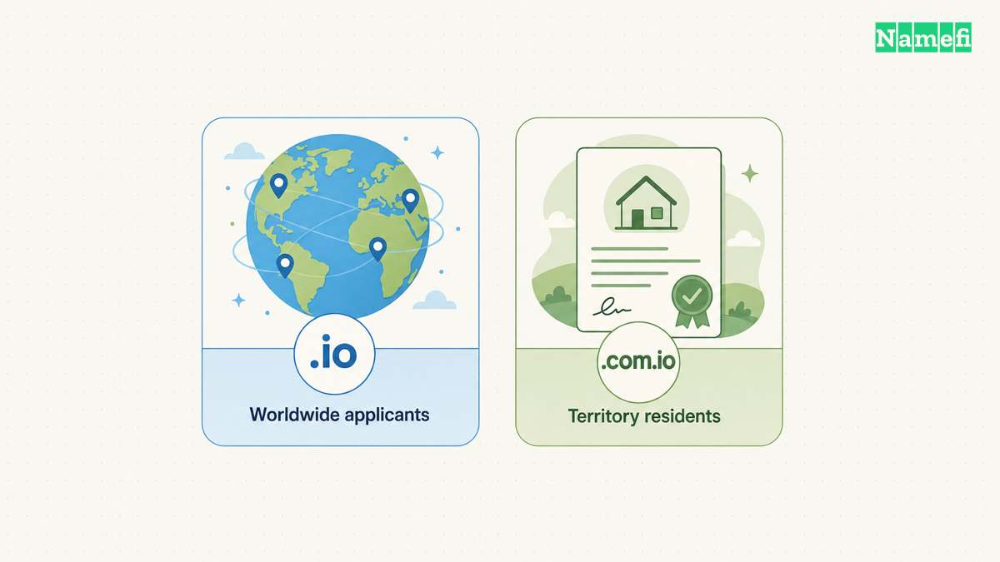
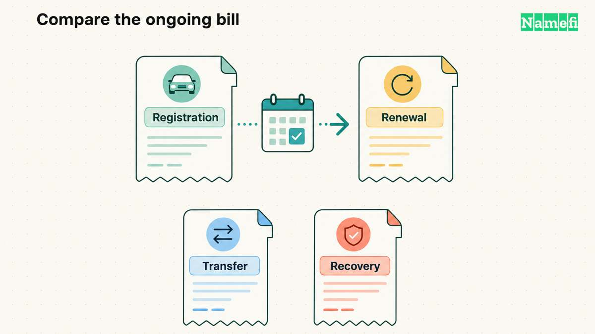
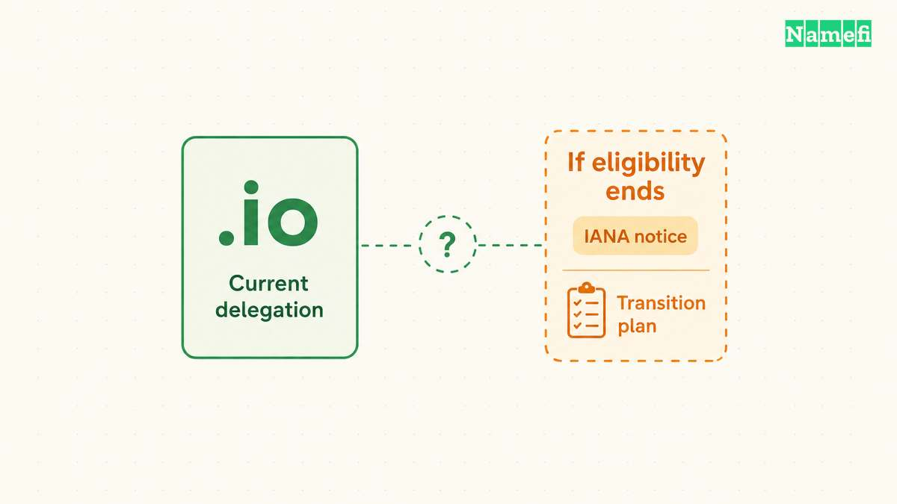

To buy a `.io` domain, search the exact name with a registrar that supports `.io`, then review the registration and renewal terms. For a second-level name directly beneath `.io`, the registry permits applicants from any legal jurisdiction. [The registry’s allocation rules distinguish second-level and third-level names](#the-io-registry-defines-registration-eligibility).

A `.io` purchase needs more than an attractive first-term quote. Compare the renewal obligation, applicant rules, intended audience, and long-term dependence on the address. Use the official records below to evaluate the extension before paying.

## The .io extension remains a country-code domain

[IANA’s delegation record](#iana-identifies-the-io-delegation) classifies `.io` as a country-code top-level domain and lists Internet Computer Bureau Limited as the manager. The record associates the delegation with the British Indian Ocean Territory.

The familiar technology use of the letters does not change that registry classification. Choose `.io` because the complete name fits the project, rather than assuming the ending represents a different legal category.

At the time checked, IANA’s record lists `.io` as active. That is a statement about the checked record, not a guarantee about every future policy decision. Keep the current delegation record separate from speculation about the extension’s future.

Our [TLD explainer](/en/blog/what-is-a-tld/) explains the difference between a generic TLD and a country-code TLD. The distinction matters because registry policies and search-engine treatment can follow different categories.

## Second-level and third-level registration rules differ

The registry’s second-level rule says an applicant may reside in any legal jurisdiction. The third-level rule requires an applicant to reside in the British Indian Ocean Territory. [Read the relevant registry sections](#the-io-registry-defines-registration-eligibility) before assuming every `.io` structure follows the same conditions.

| Proposed structure | Relevant registry question |
| --- | --- |
| A name registered directly beneath `.io` | Does the second-level name meet the applicable rules? |
| A name beneath `com.io` | Do the third-level residency and naming conditions apply? |
| A subdomain beneath a registered `.io` name | Which DNS and hosting settings create the subdomain? |

The table describes registration levels. The table does not claim that a particular name is available.

The registry also requires accurate, verifiable contact information. Open residency eligibility does not waive those duties. Use the correct legal individual or entity as the holder, and keep the contact email monitored.

If someone else registers the name for the business, document who controls the registrar account and holder details. Treat an employee’s personal payment account as an operational issue to resolve before launch.

## The checkout quote should expose recurring obligations

This article does not publish a universal `.io` price. A price depends on the exact name, registrar, term, currency, and applicable charges. Read the live search result and final cart for the candidate you intend to buy.

Compare candidates using the same information:

| Item | What to record |
| --- | --- |
| Initial registration | Exact name, term length, currency, and amount due |
| Renewal | Renewal amount, term, and auto-renew behavior |
| Premium treatment | Whether special pricing applies initially or repeatedly |
| Transfer | Eligibility, authorization process, and disclosed fees |
| Extra services | Separate email, hosting, DNS, or security subscriptions |
| Recovery | Registrar support and restoration terms |

This is editorial buying advice. The actual registrar agreement controls the transaction. Do not infer a renewal quote from a promotional headline or another customer’s historical receipt.

Keep the purchase and ongoing registration costs separate when buying an existing domain from a seller. A seller’s acquisition price does not replace the registrar’s future renewal charges.

For a project budget, compare the full period the project expects to use the name. A shorter spelling may be attractive, but the team still needs to accept the recurring obligation. Our [discussion of .io pricing](/en/blog/why-are-io-domains-expensive/) provides context without replacing a live quote.

Enter the exact `.io` candidate in [Namefi's domain search](https://namefi.io/#register) for a current registrar-side result. Check the offered transaction and its terms rather than treating an unused website as evidence of availability. The result does not change the registry's registration or continuity rules.

## Google treats .io as generic for geographic targeting

Google includes `.io` in the country-code extensions that Google treats as generic. [Google’s regional-site documentation publishes that list](#google-explains-ios-search-treatment).

The distinction helps a globally directed project evaluate the address. Google’s search treatment does not alter IANA’s country-code classification, and the classification does not promise a ranking benefit.

Compare the complete address with your alternatives. Consider pronunciation, spelling, how the address appears in email, and whether the intended audience expects another ending. Ask a person unfamiliar with the project to type the address after hearing the address once.

A descriptive or short address can still create confusion. If the business also needs another extension, include that registration in the budget. Do not describe a defensive registration as automatic protection against every impersonation attempt.

## Continuity planning should use official retirement information

IANA explains that country-code eligibility depends on the associated ISO 3166-1 assignment. When eligibility ends, IANA’s documented retirement process provides an orderly transition framework. [The official retirement guide describes the trigger and notices](#iana-explains-the-country-code-retirement-process).

That general policy is different from a specific retirement notice for `.io`. This article does not infer a deadline from a political announcement or assign a shutdown date that the checked record does not provide.

For a business-critical name, continuity planning is sensible regardless of the extension. Keep an inventory of website links, email addresses, application callbacks, customer documentation, and integrations that use the domain. The inventory helps estimate the work of any future migration.

Monitor official registry and IANA notices. Avoid relying on a social post that presents a possible future policy event as a completed DNS removal.

## You can complete the purchase with a short final review

Search the exact name, open the quoted terms, and confirm that the holder meets the registry rules. Review the renewal price before adding optional services.

Secure the registrar account with the available authentication controls. Record the expiration date, billing contact, and account recovery process. Then configure DNS, hosting, and email according to the services the project needs.

Buy `.io` when the complete address, recurring terms, and continuity requirements fit the project. Keep a different extension on the shortlist when any of those checks creates a practical problem.

## Sources and further reading

### The io registry defines registration eligibility

[The io registry defines registration eligibility](https://nic.io/rules.htm#:~:text=3.1%20An%20applicant%20may%20reside%20in%20any%20legal%20jurisdiction.), checked 2026-10-30.

### IANA identifies the io delegation

[IANA identifies the io delegation](https://www.iana.org/domains/root/db/io.html#:~:text=Category%20Classification%20based%20on%20purpose%20and%20governing%20global%20allocation%20policy%20Country-code%20top-level%20domain), checked 2026-10-30.

### Google explains ios search treatment

[Google explains ios search treatment](https://developers.google.com/search/docs/specialty/international/managing-multi-regional-sites#:~:text=Country-code%20top-level%20domain%20names%20%28ccTLDs%29.%20These%20are%20tied%20to%20a%20specific%20country), checked 2026-10-30.

### IANA explains the country code retirement process

[IANA explains the country code retirement process](https://www.iana.org/help/cctld-retirement#:~:text=ccTLD%20eligibility%20is%20determined%20by%20the%20associated%20country%20or%20territory%20being%20assigned%20in%20the%20ISO%203166-1%20standard.), checked 2026-10-30.
