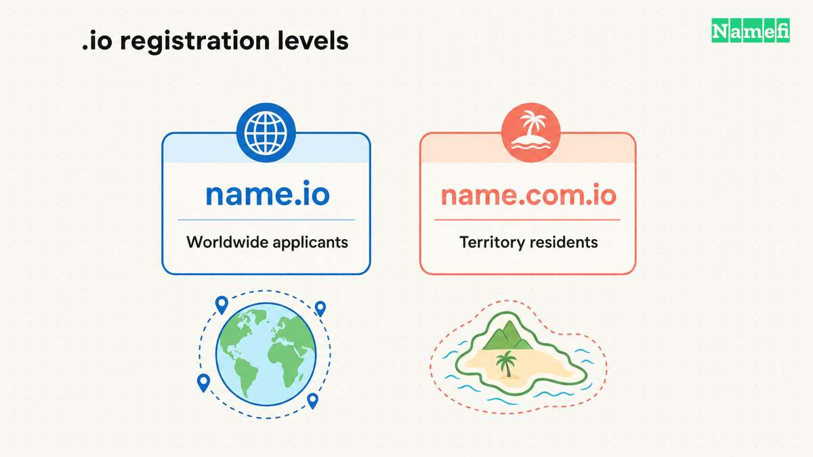

The **.io domain** is the country-code top-level domain for the **British Indian Ocean Territory**, as the [IANA delegation record](https://www.iana.org/domains/root/db/io.html) confirms. Technology brands also use the letters to suggest **input/output (I/O)**, as [Yuka explains about its own domain](https://help.yuka.io/l/fr/article/0crz5kblss-pourquoi-io-comme-nom-de-domaine). That association does not change the extension’s country-code status.

Buyers usually mean a second-level name such as `example.io`. The [registry allocation rules](https://nic.io/rules.htm) permit applicants from any legal jurisdiction at that level. The same rules impose residence requirements on third-level registrations such as `example.com.io`.

If you are launching a SaaS product, an API, an open-source project, or a [blockchain](/en/glossary/blockchain/) venture, .io is one of the most recognized signals you can put after your brand name. This page covers where it came from, who can register one, how pricing works, and how it stacks up against the alternatives.

## .io at a glance

| Fact | Detail |
| --- | --- |
| TLD type | Country-code TLD (ccTLD), treated as generic by Google |
| Registry operator | Internet Computer Bureau Ltd (a subsidiary of Identity Digital) |
| Year delegated | 1997 |
| Assigned to | British Indian Ocean Territory (BIOT) |
| DNSSEC | Yes |
| Registration eligibility | Second-level names accept applicants from any legal jurisdiction; third-level rules differ |
| Best for | Tech startups, SaaS, developer tools, APIs, browser games, Web3 |

## What is .io?

The **.io top-level domain** is a [country-code TLD (ccTLD)](/en/blog/cctld-market-share-by-registration-volume/) assigned to the **British Indian Ocean Territory** in the Chagos Archipelago. It was delegated in 1997 under the ISO 3166-1 standard, as documented in the [IANA root-zone entry for .io](https://www.iana.org/domains/root/db/io.html). The ccTLD manager of record is **Internet Computer Bureau Ltd**, now a subsidiary of registry-services provider [Identity Digital](https://www.identity.digital/).

Google lists .io among the [ccTLDs it treats as generic for geographic targeting](https://developers.google.com/search/docs/specialty/international/managing-multi-regional-sites#generic-domains). A .io address therefore does not automatically target the territory in Google Search. That treatment does not promise a ranking advantage or remove registry rules.

## History of .io

.io was delegated in 1997, making it one of the older ccTLDs in active commercial use. For its first decade it was an obscure island code. Two things changed that. First, developers noticed that "io" reads as **I/O (Input/Output)** — a coincidence that gave the suffix instant meaning to a technical audience. Second, in the 2010s a wave of well-funded startups and developer platforms adopted it, turning .io into a status marker for software companies.

The suffix also lent its name to an entire genre: **"io games"** — browser-based multiplayer titles like Agar.io and Slither.io that required no downloads and drew tens of millions of players. On the registry side, the original operator was eventually folded into the Identity Digital portfolio, which now provides registry services for the namespace.

## How people use .io

The suffix clusters tightly around technology niches:

- **SaaS and tech startups** establishing instant credibility with a tech-native audience
- **Developer tools, APIs, and infrastructure** where "I/O" is a literal fit
- **Open-source projects, documentation sites, and developer portfolios**
- **Web3, blockchain, and decentralized application** teams signaling technical depth
- **Browser-based "io games"** and indie game marketplaces

**Who it's not ideal for:** local brick-and-mortar businesses that want to rank for a specific country, non-technical consumer brands, or budget buyers who need the cheapest registration — .io carries a premium price and a techy connotation that can feel off-brand outside software.

## Notable sites using .io

- **GitHub Pages** (`github.io`) — millions of developer sites hosted from repositories
- **Etherscan** (`etherscan.io`) — the leading [Ethereum](/en/glossary/ethereum/) blockchain explorer
- **itch.io** — a popular open [marketplace](/en/glossary/marketplace/) for indie game creators
- **Agar.io** and **Slither.io** — the browser games that defined the "io games" genre

These span developer infrastructure, Web3, indie publishing, and gaming, illustrating why .io reads as credible to a technical audience.

## .io vs other domains

The extension’s meaning answers a branding question. The registration rules, recurring price, and policy context answer separate purchasing questions.

| Buyer question | What to compare |
| --- | --- |
| Does the name explain the product? | Test the complete name with the intended audience. |
| Can the applicant register it? | Check the registry rules for the exact registration level. |
| Can the buyer maintain it? | Compare renewal and recovery charges, not only the first-term price. |
| What happens if policy changes? | Monitor IANA notices and keep a practical migration plan. |

Pick [.com](/en/tld/com/) for the universal default when you can find or afford the name. Choose [.ai](/en/tld/ai/) when your product is explicitly about artificial intelligence, or [.dev](/en/tld/dev/) for developer tools and documentation. Choose **.io** for general tech, SaaS, infrastructure, gaming, and Web3 where the Input/Output association fits and short names are still attainable.

## Why choose .io?

- **Industry recognition.** Among founders, engineers, and investors, .io instantly reads as "technology company."
- **Better short-name availability.** The namespace is younger and smaller than [.com](/en/tld/com/), so concise, brandable names are far easier to find.
- **Domain-hack potential.** The two-letter suffix folds neatly into words (`rad.io`, `stud.io`), enabling clever, memorable names.
- **Global SEO.** Search engines treat it as generic, so your site can rank worldwide without being boxed into one region.

## Things to consider

- **Premium pricing.** The registry sets a relatively high wholesale price, so .io typically costs several times a basic .com — at both registration and renewal.
- **Niche connotation.** The techy meaning is an asset in software and a liability for mainstream consumer brands.
- **Sovereignty uncertainty.** The Chagos Archipelago is the subject of an ongoing UK–Mauritius sovereignty arrangement, which has fueled speculation about the suffix's long-term future (covered below).
- **Single-TLD risk.** As with any extension, betting an entire brand on one suffix without a backup is a risk worth weighing.

## Who can register a .io domain?

For `example.io`, [NIC.IO rule 3.1](https://nic.io/rules.htm) allows an applicant in any legal jurisdiction. Rules for `example.com.io` require territory residence. Some short labels have controlled allocation, so a three-character minimum is not a universal registry rule.

The rules require accurate contact details and prohibit spam and specified unlawful or sexual uses. Applicants must also follow the [registration terms](https://nic.io/terms.htm). Transfers follow the procedure and fee applicable at the time. Renewals use the then-current terms. Confirm expiry, recovery deadlines, and fees with the registrar before buying. Do not assume every ICANN gTLD grace period applies to .io.

### The Chagos sovereignty question

As checked **October 21, 2026**, [IANA lists .io as active](https://www.iana.org/domains/root/db/io.html) and displays no retirement date. The UK and Mauritius [signed a Chagos agreement on May 22, 2025](https://commonslibrary.parliament.uk/research-briefings/cbp-10273/). That political event alone does not announce a domain shutdown.

[ICANN’s explanation](https://www.icann.org/en/blogs/details/the-chagos-archipelago-and-the-io-domain-14-11-2024-en) distinguishes a sovereignty change from removal of the IO code in ISO 3166-1. Under the [IANA retirement process](https://www.iana.org/help/cctld-retirement), loss of eligibility leads to a public Notice of Removal. The default removal period is five years. An approved extension can add up to five more years. A manager can retire a domain earlier.

These rules do not guarantee that .io will close or continue indefinitely. A long-lived business should monitor official notices and consider migration costs alongside the name’s branding value.

## .io pricing and value

This page never quotes live prices, but the pricing **dynamics** are worth understanding:

- **A premium wholesale floor.** The .io registry sets a relatively high base price, which registrars pass on. Even a plain, unregistered .io typically costs several times a basic .com.
- **First-year vs. renewal pricing differ.** An introductory first-year rate can sit below the recurring renewal rate, so budget for the renewal — not just the signup price.
- **Premium-tier names exist.** Short, dictionary, or highly brandable .io names may be registry-reserved as premium, and the secondary market for them is active. We cover the drivers in [why are .io domains expensive](/en/blog/why-are-io-domains-expensive/).

## Reputation and email deliverability

.io carries a **premium, technical reputation**. To founders, developers, and investors it reads as serious and modern — closer to a status signal than a discount extension, the opposite of the cheap, spam-prone new gTLDs that some aggressive mail filters treat with suspicion.

Because .io is widely used by reputable startups and major developer platforms, it does not suffer the blanket spam-filtering problems that affect some bargain extensions. As always, deliverability depends far more on your own sending practices — properly configured SPF, DKIM, and DMARC records, a warmed-up sending domain, and clean list hygiene — than on the suffix itself.

## Branding and naming tips

The two-letter suffix is built for **domain hacks** — names where the TLD becomes part of the word, folding ".io" onto a stem (`stud.io`, `rad.io`, `scenar.io`). Keep names short and pronounceable; the strength of .io is concision.

Watch two pitfalls. First, spoken aloud, "io" can be misheard, so test how your full name sounds on a phone call. Second, because .io is so strongly tied to software, a name in a non-technical category may feel mismatched.

## How to register a .io domain at Namefi

1. **Search** for your desired name at [Namefi](https://namefi.io) to check availability.
2. **Choose** the .io result (and any alternates worth securing).
3. **Register** and configure DNS.

As an [ICANN-accredited](/en/glossary/icann/) [registrar](/en/glossary/registrar/), Namefi bridges Web2 and Web3: transparent pricing, fast [DNS](/en/glossary/dns/) management, and the option to hold your name as a [tokenized domain](/en/blog/what-are-tokenized-domains/) for verifiable [domain ownership](/en/glossary/domain-ownership/) and easy transferability. Get started at [Namefi](https://namefi.io).

## Frequently asked questions

### Can anyone register a .io domain?

For a second-level name such as example.io, NIC.IO permits applicants from any legal jurisdiction. Third-level registrations such as example.com.io have territory-residence requirements. Registry terms and use rules still apply.

### Does a .io domain affect SEO?

Google treats .io as generic for geographic targeting. A .io address does not automatically target the territory, but the extension does not guarantee rankings.

### Who should register a .io domain?

Software startups, SaaS products, developer tools, open-source projects, API services, browser game studios, and Web3 or blockchain teams. The "Input/Output" reading fits wherever a technology focus is part of the brand.

### Is the .io domain going away because of the Chagos sovereignty deal?

IANA listed .io as active without a retirement date on October 21, 2026. Loss of country-code eligibility would invoke the IANA retirement process. No statement here guarantees the future of .io.

### Does .io support WHOIS privacy and DNSSEC?

DNSSEC is supported by the .io registry. WHOIS privacy availability depends on your registrar; most modern registrars, including Namefi, offer privacy protection on eligible registrations.

## Related resources

- [What is a domain?](/en/blog/what-is-domain/)
- [Domain terminology guide](/en/blog/domain-terminology-guide/)
- [Why are .io domains expensive?](/en/blog/why-are-io-domains-expensive/)
- [.ai vs .io domain](/en/blog/ai-vs-io-domain/)
- [Tokenized domain use cases (2026)](/en/blog/tokenized-domain-use-cases-2026/)
- TLD guides: [.com](/en/tld/com/), [.ai](/en/tld/ai/), [.dev](/en/tld/dev/), [.app](/en/tld/app/), [.tech](/en/tld/tech/)
- Glossary: [ICANN](/en/glossary/icann/), [registrar](/en/glossary/registrar/), [DNS](/en/glossary/dns/), [DNSSEC](/en/glossary/dnssec/)

## These sources explain the current rules

The following sources were opened on **October 21, 2026**. The update covers meaning, registration eligibility, geographic search treatment, and retirement policy.

- [Yuka domain explanation](https://help.yuka.io/l/fr/article/0crz5kblss-pourquoi-io-comme-nom-de-domaine): a primary brand example of the input/output association.
- [IANA .io record](https://www.iana.org/domains/root/db/io.html): active delegation and manager.
- [NIC.IO allocation rules](https://nic.io/rules.htm): registration levels, contact requirements, and use restrictions.
- [NIC.IO terms](https://nic.io/terms.htm): transfer and renewal conditions.
- [Google Search documentation](https://developers.google.com/search/docs/specialty/international/managing-multi-regional-sites): generic geographic treatment.
- [UK Parliament treaty briefing](https://commonslibrary.parliament.uk/research-briefings/cbp-10273/): agreement signing date.
- [ICANN Chagos explanation](https://www.icann.org/en/blogs/details/the-chagos-archipelago-and-the-io-domain-14-11-2024-en) and [IANA retirement process](https://www.iana.org/help/cctld-retirement): eligibility and transition rules.
